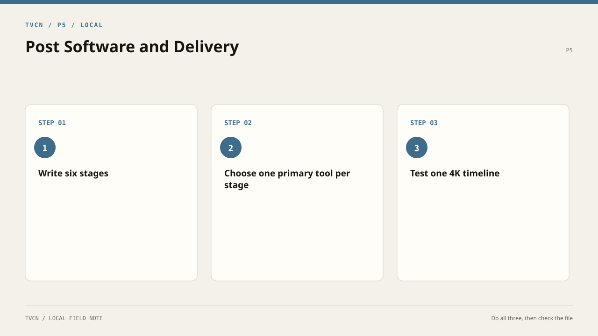

Editing, grading, audio, encoding and review are five stages. Set the workflow before choosing subscriptions. Do not buy all at once.

<!-- DIAGRAM_START -->
<h2>Diagram</h2>
<figure>
  
  <figcaption>A process diagram, not a software ad.</figcaption>
</figure>
<!-- DIAGRAM_END -->
<h2>Workflow first: six stages, not six apps</h2>

Post is not a pile of software. A film moves through six fixed stages: backup/transcode, proxy edit, fine cut, grade, sound, encode/deliver. Each stage needs one primary tool; the rest fill gaps. Write the workflow before buying subscriptions.
<ol><li>Media: camera card → two backups → checksum.</li><li>Proxy: same frame rate and timecode; originals untouched.</li><li>Edit: timeline uses proxies; all story decisions in week one.</li><li>Grade: return to originals, transform first, style second.</li><li>Sound: dialogue, music and ambience on separate tracks; dialogue first.</li><li>Delivery: H.264 for platforms; ProRes/originals for archive.</li></ol>
<h2>Decision tree: project first, tool second</h2>

Interview, short drama, advertising and documentary need different tools. Interview needs stability and long runs; series needs collaboration and versioning; advertising needs grading and compositing; documentary needs media management and proxies. Do not change the workflow because one app is cheaper.

<table class="data-table"><thead><tr><th>Project</th><th>Look at</th><th>Can ignore</th><th>Budget</th></tr></thead><tbody><tr><td>Interview/talking head</td><td>Stability, audio sync, fast export</td><td>Complex compositing</td><td>Low</td></tr><tr><td>Short drama/series</td><td>Collaboration, versions, proxies</td><td>Single-seat extreme grade</td><td>Medium</td></tr><tr><td>Advertising/product</td><td>Grade, compositing, delivery specs</td><td>Long-form edit</td><td>Medium-high</td></tr><tr><td>Documentary</td><td>Media management, proxies, search</td><td>Realtime effects</td><td>Medium</td></tr></tbody></table>

<h2>Eight comparisons: total cost before subscription</h2>

<table class="data-table"><thead><tr><th>Stage</th><th>Look at</th><th>Fits</th><th>Does not fit</th></tr></thead><tbody><tr><td>NLE</td><td>Timeline stability, proxies, collaboration</td><td>Long-form/series</td><td>One short video only</td></tr><tr><td>Grade</td><td>Nodes, colour management, tracking</td><td>Advertising/narrative</td><td>Straight-out meeting</td></tr><tr><td>Audio</td><td>Multitrack, automation, denoise</td><td>Interview/short drama</td><td>Music-only cut</td></tr><tr><td>Encoding</td><td>H.264/ProRes, queue, hardware</td><td>Batch delivery</td><td>One export</td></tr><tr><td>Review</td><td>Frame notes, version compare</td><td>Client work</td><td>Personal practice</td></tr><tr><td>Media management</td><td>Proxies, tags, search</td><td>Documentary/series</td><td>One shoot</td></tr><tr><td>Collaboration</td><td>Locking, comments, permissions</td><td>Team</td><td>Solo</td></tr><tr><td>Total cost</td><td>Subscription + plugins + storage + learning</td><td>Every project</td><td>Monthly fee only</td></tr></tbody></table>

<h2>Buying order: do not buy everything at once</h2>

Buy the editor first and finish a five-minute film; add grading when clients ask for a look; add audio when dialogue needs repair; add encoding/review when delivery volume grows. Buy only plugins you will use weekly, not the ones that look powerful.
<ol><li>Month one: one NLE and one encoder.</li><li>Month two: add grading or audio for a real project.</li><li>Month three: add review/collaboration when a client needs it.</li><li>Every quarter, cancel one unused subscription.</li></ol>
<h2>Test scope: use the same 4K timeline</h2>

Use one 4K 10-bit timeline and test four things: 50% playback, proxy switching, a grade node, export time. Log machine, GPU, software version and cache settings. Not measured: lab benchmarks or large cross-platform comparisons.

<h2>Continue: post and delivery hub</h2>
<ul><li><a href="/en/article/nle-compare/">Choosing an NLE: project first</a></li><li><a href="/en/article/davinci-node/">DaVinci nodes: nodes are not filters</a></li><li><a href="/en/article/color-management/">Colour management: put the LUT in the right place</a></li><li><a href="/en/article/export-h264/">H.264 export: bitrate and compatibility</a></li><li><a href="/en/article/export-prores/">ProRes export: archive and delivery</a></li><li><a href="/en/article/audio-noise-fix/">Noise diagnosis: start with the room</a></li><li><a href="/en/article/delivery-specs/">Delivery: do not export the wrong file</a></li><li><a href="/en/article/proxy-create/">Proxy creation: edit without stutter</a></li><li><a href="/en/article/buy-storage/">Buying project storage: speed, capacity, backup</a></li><li><a href="/en/article/model-comparison/">Model comparison: test by shot type</a></li></ul>
<h2>Verification and price date</h2>

Verified 2026-11-23. Software prices and subscription rules follow vendor pages; this page covers workflow and short tests, not benchmark scores.

<!-- P5_EXTRA_START -->
<h2>Add: failure cases</h2>

Tool stacking is not a workflow. These five cases only add breakpoints.

<table class="data-table"><thead><tr><th>Move</th><th>Result</th><th>Replace with</th></tr></thead><tbody><tr><td>Buy grading before learning the edit</td><td>Story is unclear; grading cannot save it</td><td>Finish one five-minute film first</td></tr><tr><td>Ten subscriptions, broken workflow</td><td>Every stage is shallow and delivery stalls</td><td>One primary tool per stage</td></tr><tr><td>Edit proxies, lose the conform</td><td>Originals no longer match</td><td>Same name and timecode for proxy/original</td></tr><tr><td>Check delivery spec at export</td><td>Platform rejects or recompresses</td><td>Write the spec before shooting</td></tr><tr><td>Review via compressed chat video</td><td>Client cannot see detail; notes miss</td><td>Frame notes or original-file review</td></tr></tbody></table>

<h2>Delivery check: six items</h2>
<ol><li>The timeline references proxies; originals stay untouched.</li><li>Transform colour before grading; do not hide it with a LUT.</li><li>Dialogue is intelligible solo; music does not cover words.</li><li>Export one H.264 and one ProRes with correct specs.</li><li>Archive project, originals, outputs and subtitles.</li><li>Client review has a version number and deadline.</li></ol>
Miss one and the last hour becomes rework.

<!-- P5_EXTRA2_START -->
<h2>Add: tool selection table</h2>

Do not choose by “most features”; choose by the action you do every week.

<table class="data-table"><thead><tr><th>Action</th><th>Look at</th><th>Buy later</th></tr></thead><tbody><tr><td>Rough/fine cut</td><td>Timeline stability, proxies, shortcuts</td><td>Collaboration/review</td></tr><tr><td>Grade</td><td>Colour management, nodes, cache</td><td>Film-grain plugins</td></tr><tr><td>Audio</td><td>Multitrack, automation, denoise</td><td>Surround</td></tr><tr><td>Encoding</td><td>H.264/ProRes, queue, hardware</td><td>Cloud render</td></tr><tr><td>Review</td><td>Frame notes, version compare</td><td>Brand portal</td></tr></tbody></table>

<h2>Add: delivery failure cases</h2>

The usual post failure is not a missing feature; it is a delivery that ignores the spec.

<table class="data-table"><thead><tr><th>Move</th><th>Result</th><th>Replace with</th></tr></thead><tbody><tr><td>Send only ProRes to a platform</td><td>Too large or recompressed</td><td>Make a separate H.264</td></tr><tr><td>Wrong audio sample rate</td><td>Silence or pitch shift</td><td>Use 48kHz</td></tr><tr><td>Archive outputs only</td><td>No re-edit in six months</td><td>Keep project + originals + subtitles</td></tr></tbody></table>

<!-- P5_EXTRA3_START -->
<h2>Last line: workflow beats software</h2>

Software only executes decisions faster. If the workflow is unclear, a more expensive app only makes the error more polished. Finish one five-minute film through all six stages before discussing subscriptions, plugins and collaboration. Every quarter, remove one unused tool and give the time back to editing, sound and delivery.

<!-- P5_EXTRA4_START -->
<h2>Boundary: a subscription is not a skill</h2>

A subscription buys a tool, not judgment. Cut points, colour management, sound layers and delivery specs are learned film by film; the more tools you own, the more you need one fixed workflow.

<!-- SOURCES_START -->
## References and further reading

- [S34] [Adobe: Premiere Pro Guide](https://helpx.adobe.com/premiere-pro/user-guide.html) — Accessed 2026-11-26. Used to check the terminology/method/rule in the “Test scope: use the same 4K timeline” section against official Premiere Pro guide, not a verdict on workflow quality; it does not verify numbers, model choices or on-set conclusions derived from this page, and is not a substitute for a test.
- [S60] [Apple: Final Cut Pro Guide](https://support.apple.com/guide/final-cut-pro/welcome/mac) — Accessed 2026-11-26. Used to check the terminology/method/rule in the “Workflow first: six stages, not six apps” section against official Final Cut Pro guide, not a verdict on workflow quality; it does not verify numbers, model choices or on-set conclusions derived from this page, and is not a substitute for a test.
- [S35] [Avid: Resource Center](https://www.avid.com/resource-center) — Accessed 2026-11-26. Used to check the terminology/method/rule in the “Decision tree: project first, tool second” section against Avid resource center, not an independent review; it does not verify numbers, model choices or on-set conclusions derived from this page, and is not a substitute for a test.
<!-- SOURCES_END -->

