<!-- DIAGRAM_START -->
<h2>Diagram</h2>
<figure>
  
  <figcaption>Diagram: VPG, sustained write, capacity, heat, and recovery decide whether a card belongs on a project.</figcaption>
</figure>
<!-- DIAGRAM_END -->
<h2>First decision: which link is missing</h2>
Check the camera manual for minimum card class and bitrate; “shoots 8K” is not a standard. CFexpress Type B suits high bitrate. SD UHS-II handles 4K 10-bit but sustained write varies; V90 is steadier than V60, but confirm the camera uses it.

<strong>Fits:</strong>
<ul><li>High-bitrate 4K/6K/8K</li><li>Multicam/long takes</li><li>Fast offload</li></ul>
<strong>Does not fit:</strong>
<ul><li>Light 1080p only</li><li>Camera only supports UHS-I</li><li>One card as the only backup</li></ul><h2>Test protocol: reproducible, no invented scores</h2>
Record a full card at the project’s highest bitrate and check for dropped frames/errors. Record 30 minutes and feel the card temperature. Time a 100GB offload. Short clips hide heat issues that appear after 20 minutes.

<table class="data-table"><thead><tr><th>Check</th><th>Pass line</th><th>Reference/log</th></tr></thead><tbody><tr><td>VPG</td><td>达到相机要求的最低等级</td><td>说明书/卡标</td></tr><tr><td>持续写入</td><td>满卡录制不丢帧</td><td>最高码率</td></tr><tr><td>容量</td><td>单机位 1–2 小时</td><td>码率/卡量</td></tr><tr><td>发热</td><td>30 分钟不报警/不烫手</td><td>连续录制</td></tr><tr><td>恢复</td><td>有恢复服务/保修</td><td>序列/发票</td></tr></tbody></table>
<h2>Price bands: total cost of ownership first</h2>
Look beyond the sticker: cards, batteries, adapters, gimbal, stands, software subscriptions, and repair. Bands describe the minimum kit for a real project type, not toy pricing.

<table class="data-table"><thead><tr><th>Tier</th><th>Reference</th><th>Includes</th><th>Watch</th></tr></thead><tbody><tr><td>Entry</td><td>¥300–800</td><td>128GB V60/V90 SD</td><td>May not handle high bitrate</td></tr><tr><td>Main</td><td>¥800–2,500</td><td>256–512GB CFexpress B / V90</td><td>Reader extra</td></tr><tr><td>Advanced</td><td>¥2,500–6,000</td><td>1TB CFexpress/pro card</td><td>Camera compatibility</td></tr></tbody></table>

Prices are China mainland channel references as of November 2026; tax and quotes vary. Not buying advice.
<h2>Alternatives and upgrades: do not add money on the wrong axis</h2><ul><li>Two 128GB cards rotated</li><li>Rent fast cards for high bitrate</li><li>External SSD instead of some cards</li></ul><h2>Buying steps: bring footage, not spec sheets</h2>
Run these in order before paying. If one fails, do not tell yourself post will fix it.
<ol><li>Check camera minimum class</li><li>Full card at max bitrate</li><li>30-min heat check</li><li>Time 100GB offload</li><li>Confirm reader and warranty</li></ol><h2>Check</h2><ul><li>Card meets camera minimum.</li><li>Full card records without drops.</li><li>Capacity covers 1–2 hours per camera.</li><li>No heat warning in 30 min.</li><li>At least two cards rotated.</li><li>Recovery/warranty exists.</li></ul>

<!-- SOURCES_START -->
## References and further reading

- [S23] [SMPTE Standards](https://www.smpte.org/standards) — Accessed 2026-11-26. Used to check the terminology and public context in the opening paragraph (“A card’s peak read speed is irrelevant; sustained write deci”) against Entry point for timecode, color, cinema and signal-chain standards; not a substitute for an on-set test.
- [S25] [ITU-R BT.709](https://www.itu.int/rec/R-REC-BT.709/en) — Accessed 2026-11-26. Used to check the terminology and public context in the opening paragraph (“A card’s peak read speed is irrelevant; sustained write deci”) against HD SDR gamut, transfer function and viewing conditions; not a substitute for an on-set test.
- [S26] [ITU-R BT.2020](https://www.itu.int/rec/R-REC-BT.2020/en) — Accessed 2026-11-26. Used to check the terminology and public context in the opening paragraph (“A card’s peak read speed is irrelevant; sustained write deci”) against Wide-gamut and parameter definitions for UHD/HDR; not a substitute for an on-set test.
- [S29] [YouTube Upload Specs](https://support.google.com/youtube/answer/1722171) — Accessed 2026-11-26. Used to check the terminology and public context in the opening paragraph (“A card’s peak read speed is irrelevant; sustained write deci”) against Recommended resolution, bitrate, frame rate and audio codec; not a substitute for an on-set test.
- [S38] [State Taxation Administration: Official site](https://www.chinatax.gov.cn/) — Accessed 2026-11-26. Used to check the terminology and public context in the opening paragraph (“A card’s peak read speed is irrelevant; sustained write deci”) against Official entry for VAT, cross-border services and withholding; not a substitute for an on-set test.
<!-- SOURCES_END -->

