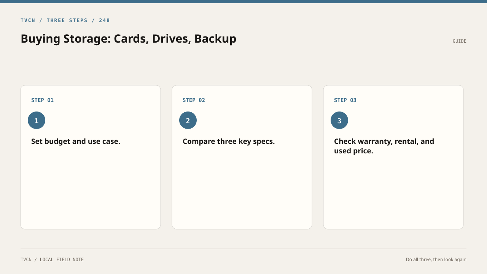

Cards shoot, SSDs edit, drives backup; do not make one drive do all three.

<!-- DIAGRAM_START -->
<h2>Diagram</h2>
<figure>
  
  <figcaption>Do the three steps in order, then look again at the image or file.</figcaption>
</figure>
<!-- DIAGRAM_END -->
<h2>On set</h2>

Buy V90 SD or CFexpress cards, a TLC SSD with DRAM, and two backup drives from different brands.

<h2>Do this</h2>

Storage has three layers: cards shoot, SSD edits, drives back up. Do not make one drive do all three.
<ol><li>Buy V90 SD or CFexpress cards and calculate runtime at the highest bitrate.</li><li>Buy a TLC SSD with DRAM, at least twice the footage size.</li><li>Back up to two different-brand drives, one off-site.</li></ol>
<h2>Avoid</h2>

Do not shoot on one card and edit from it; cards fail and footage disappears.

<h2>Check</h2>
<ul><li>V90 or CFexpress runtime is calculated at the highest bitrate.</li><li>The SSD is TLC with DRAM and at least twice the footage size.</li><li>Two different-brand drives are used, one off-site.</li></ul>
