<!-- DIAGRAM_START -->
<h2>Diagram</h2>
<figure>
  
  <figcaption>Diagram: drag, counterbalance, tilt range, interfaces, and weight decide whether a pan is smooth.</figcaption>
</figure>
<!-- DIAGRAM_END -->
<h2>First decision: which link is missing</h2>
Choose by rig weight: under 3kg, 75mm is enough; over 5kg, look at 100mm. Dynamic counterbalance matters more than payload. Low angles, top-down, and long lenses need different balance settings.

<strong>Fits:</strong>
<ul><li>Video pan/tilt</li><li>Long lens/sports/stage</li><li>Low-angle/top-down</li></ul>
<strong>Does not fit:</strong>
<ul><li>Stills only, ball head is enough</li><li>Ultralight travel kit</li><li>Electronic remote control</li></ul><h2>Test protocol: reproducible, no invented scores</h2>
Mount the rig, balance it, and release to check for a nod. Pan from slowest to fastest and feel whether drag is continuous. Tilt to the lowest and highest and check limits.

<table class="data-table"><thead><tr><th>Check</th><th>Pass line</th><th>Reference/log</th></tr></thead><tbody><tr><td>阻尼</td><td>全程连续，无突然变松/紧</td><td>慢快摇移</td></tr><tr><td>平衡</td><td>松手 3 秒内不点头</td><td>重心调平</td></tr><tr><td>俯仰</td><td>-70°~+90° 可用</td><td>低/高机位</td></tr><tr><td>接口</td><td>75/100mm 与脚架匹配</td><td>安装</td></tr><tr><td>重量</td><td>整机可单人携带</td><td>称重</td></tr></tbody></table>
<h2>Price bands: total cost of ownership first</h2>
Look beyond the sticker: cards, batteries, adapters, gimbal, stands, software subscriptions, and repair. Bands describe the minimum kit for a real project type, not toy pricing.

<table class="data-table"><thead><tr><th>Tier</th><th>Reference</th><th>Includes</th><th>Watch</th></tr></thead><tbody><tr><td>Entry</td><td>¥500–1,500</td><td>75mm fluid head</td><td>Limited balance steps</td></tr><tr><td>Main</td><td>¥1,500–4,000</td><td>75/100mm, continuous drag</td><td>Tripod extra</td></tr><tr><td>Advanced</td><td>¥4,000–12,000</td><td>100mm pro fluid, long-lens balance</td><td>Weight/transport</td></tr></tbody></table>

Prices are China mainland channel references as of November 2026; tax and quotes vary. Not buying advice.
<h2>Alternatives and upgrades: do not add money on the wrong axis</h2><ul><li>Ball head + small fluid head</li><li>Rent a 100mm head</li><li>Used Manfrotto 504/502</li></ul><h2>Buying steps: bring footage, not spec sheets</h2>
Run these in order before paying. If one fails, do not tell yourself post will fix it.
<ol><li>Mount rig and balance</li><li>Release and check nod</li><li>Slow/fast pan drag</li><li>Tilt to limits</li><li>Confirm tripod interface</li></ol><h2>Check</h2><ul><li>No nod within 3 seconds.</li><li>Drag is continuous.</li><li>Tilt covers low/high shots.</li><li>Interface matches tripod.</li><li>One-person transportable.</li><li>Long-lens pan is stable.</li></ul>

> Intent split: this page covers the practical details of “Buying a Fluid Head: Drag, Counterbalance, and Return”; start with <a href="https://tools.tvcn.org/article/gimbal-balance/">Gimbal Balance: Five Minutes Before Power</a> for the cluster-level judgement, then return here.

<!-- INTENT_SCOPE -->

<!-- SOURCES_START -->
## References and further reading

- [S23] [SMPTE Standards](https://www.smpte.org/standards) — Accessed 2026-11-26. Used to check the terminology and public context in the opening paragraph (“A fluid head is not “it pans.” The difference is continuous ”) against Entry point for timecode, color, cinema and signal-chain standards; not a substitute for an on-set test.
- [S25] [ITU-R BT.709](https://www.itu.int/rec/R-REC-BT.709/en) — Accessed 2026-11-26. Used to check the terminology and public context in the opening paragraph (“A fluid head is not “it pans.” The difference is continuous ”) against HD SDR gamut, transfer function and viewing conditions; not a substitute for an on-set test.
- [S26] [ITU-R BT.2020](https://www.itu.int/rec/R-REC-BT.2020/en) — Accessed 2026-11-26. Used to check the terminology and public context in the opening paragraph (“A fluid head is not “it pans.” The difference is continuous ”) against Wide-gamut and parameter definitions for UHD/HDR; not a substitute for an on-set test.
- [S29] [YouTube Upload Specs](https://support.google.com/youtube/answer/1722171) — Accessed 2026-11-26. Used to check the terminology and public context in the opening paragraph (“A fluid head is not “it pans.” The difference is continuous ”) against Recommended resolution, bitrate, frame rate and audio codec; not a substitute for an on-set test.
- [S38] [State Taxation Administration: Official site](https://www.chinatax.gov.cn/) — Accessed 2026-11-26. Used to check the terminology and public context in the opening paragraph (“A fluid head is not “it pans.” The difference is continuous ”) against Official entry for VAT, cross-border services and withholding; not a substitute for an on-set test.
<!-- SOURCES_END -->

