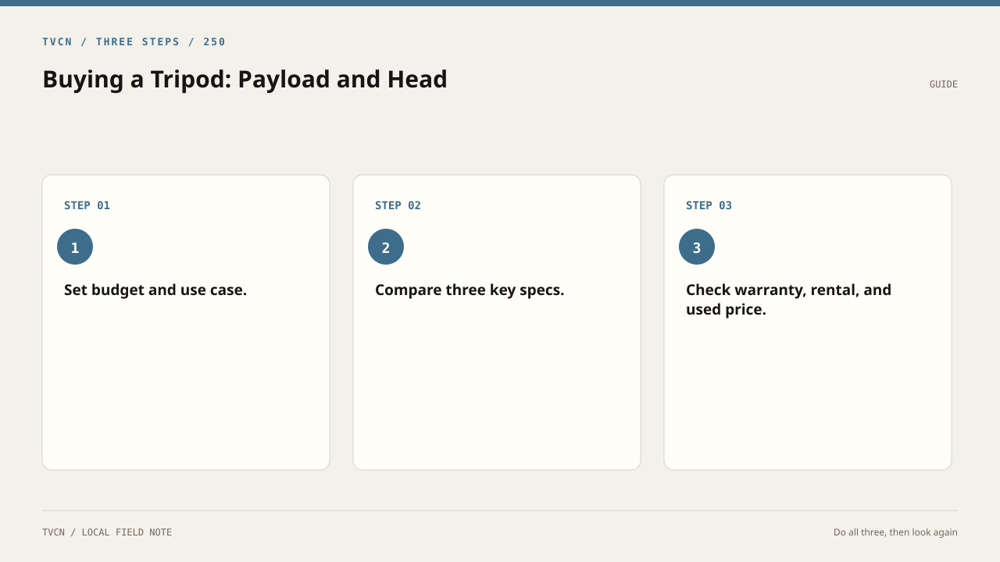

Payload and head before weight; a cheap head nods at the worst moment.

<!-- DIAGRAM_START -->
<h2>Diagram</h2>
<figure>
  
  <figcaption>Do the three steps in order, then look again at the image or file.</figcaption>
</figure>
<!-- DIAGRAM_END -->
<h2>On set</h2>

Payload at least twice the rig weight. The head should start and stop in three seconds and the leg locks should not pinch.

<h2>Do this</h2>

Tripod: payload and head first, weight second. A cheap head nods at the worst moment.
<ol><li>Payload at least twice the combined weight of body, lens, and accessories.</li><li>Test the head for a three-second start and stop, with no tilt rebound.</li><li>Leg locks that do not pinch, plus a center column or low-shot mode.</li></ol>
<h2>Avoid</h2>

Do not trade stability for lightness; one gust ends the shot.

<h2>Check</h2>
<ul><li>Payload is at least twice the total rig weight.</li><li>The head starts and stops in three seconds with no tilt rebound.</li><li>Leg locks do not pinch and a center column or low-shot mode exists.</li></ul>
