<!-- DIAGRAM_START -->
<h2>Diagram</h2>
<figure>
  
  <figcaption>Diagram: range, dropout, latency, battery, and interference decide whether sound stays alive.</figcaption>
</figure>
<!-- DIAGRAM_END -->
<h2>First decision: which link is missing</h2>
Check the scene: 2.4GHz is fine for indoor interviews; malls, concerts, and multiple kits favor UHF or digital systems with frequency hopping. Do not buy the cheapest dual kit; a dropout re-shoots the film. Test clothing rub and wind on the lav itself.

<strong>Fits:</strong>
<ul><li>Interview/voiceover/events</li><li>Solo/duo moving</li><li>Untethered audio</li></ul>
<strong>Does not fit:</strong>
<ul><li>Many kits in one venue</li><li>Heavy RF/long range</li><li>Broadcast-level redundancy</li></ul><h2>Test protocol: reproducible, no invented scores</h2>
Walk the real venue: turn away, cover with a hand, go behind a crowd, approach metal. Record 30 seconds each and listen for dropouts/noise. Clap for latency. Run two kits together for cross-interference.

<table class="data-table"><thead><tr><th>Check</th><th>Pass line</th><th>Reference/log</th></tr></thead><tbody><tr><td>距离</td><td>真实场地全程不断</td><td>走动测试</td></tr><tr><td>断点</td><td>遮挡/转身不断</td><td>商场/人群</td></tr><tr><td>延迟</td><td>拍手口型偏差可接受</td><td>拍手回放</td></tr><tr><td>电池</td><td>覆盖 8 小时拍摄日</td><td>续航记录</td></tr><tr><td>干扰</td><td>双套同场不串频</td><td>双套测试</td></tr></tbody></table>
<h2>Price bands: total cost of ownership first</h2>
Look beyond the sticker: cards, batteries, adapters, gimbal, stands, software subscriptions, and repair. Bands describe the minimum kit for a real project type, not toy pricing.

<table class="data-table"><thead><tr><th>Tier</th><th>Reference</th><th>Includes</th><th>Watch</th></tr></thead><tbody><tr><td>Entry</td><td>¥800–2,000</td><td>2.4GHz dual kit</td><td>Mall/multi-kit dropouts</td></tr><tr><td>Main</td><td>¥2,000–6,000</td><td>Digital/UHF dual + backup mic</td><td>Battery/accessories</td></tr><tr><td>Advanced</td><td>¥6,000–20,000</td><td>Pro wireless, multi-kit, timecode</td><td>Frequency coordination</td></tr></tbody></table>

Prices are China mainland channel references as of November 2026; tax and quotes vary. Not buying advice.
<h2>Alternatives and upgrades: do not add money on the wrong axis</h2><ul><li>Wired lav + recorder</li><li>Rent pro wireless</li><li>Shotgun + recorder</li></ul><h2>Buying steps: bring footage, not spec sheets</h2>
Run these in order before paying. If one fails, do not tell yourself post will fix it.
<ol><li>Walk the real venue</li><li>Cover/turn dropout</li><li>Clap latency</li><li>Two-kit interference</li><li>Price batteries/backup mic</li></ol><h2>Check</h2><ul><li>No dropout in the real venue.</li><li>No loss behind body/turns.</li><li>Lip-sync latency is acceptable.</li><li>Battery covers 8 hours.</li><li>Two kits do not cross.</li><li>Lav has no clothing rub/wind noise.</li></ul>

> Intent split: this page covers the practical details of “Buying Wireless Lavs: Range, Dropouts, and Latency”; start with <a href="https://tools.tvcn.org/article/lav-hidden/">Lav Hiding: Collar, Hair, Tape</a> for the cluster-level judgement, then return here.

<!-- INTENT_SCOPE -->

<!-- SOURCES_START -->
## References and further reading

- [S27] [ITU-R BS.1770: Loudness and True Peak](https://www.itu.int/rec/R-REC-BS.1770/en) — Accessed 2026-11-26. Used to check the terminology/method/rule in the “First decision: which link is missing” section against BS.1770 loudness measurement, not microphone buying advice; it does not verify numbers, model choices or on-set conclusions derived from this page, and is not a substitute for a test.
- [S23] [SMPTE: Standards](https://www.smpte.org/standards) — Accessed 2026-11-26. Used to check the terminology/method/rule in the “Test protocol: reproducible, no invented scores” section against SMPTE standards portal, not specific camera specs; it does not verify numbers, model choices or on-set conclusions derived from this page, and is not a substitute for a test.
<!-- SOURCES_END -->

