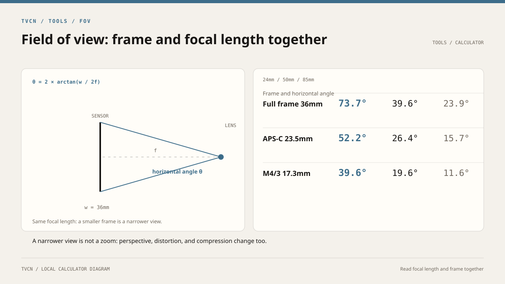

<!-- DIAGRAM_START -->
## Diagram

<figure>
  
  <figcaption>Same focal length: a smaller frame is a narrower view. Narrower is not a zoom.</figcaption>
</figure>
<!-- DIAGRAM_END -->

## What this calculator solves

“Is a 24mm wide enough indoors?” “Will an 85mm feel too tight for a person?” Do not guess. Estimate the horizontal angle first.

## Formula

\[
\theta = 2 \times \arctan\left(\frac{w}{2f}\right)
\]

Where \(w\) is sensor width, \(f\) is focal length, and \(\theta\) is the horizontal field of view.

## Common sensor widths

- Full frame: 36mm
- APS-C: 23.5mm
- M4/3: 17.3mm

## How to use it

1. Choose the sensor width.
2. Enter the focal length.
3. Read the horizontal angle.
4. If the angle is too narrow for the space, go wider; if faces distort, go longer.

## Three checks

- You can explain what wide and long lenses change, beyond “zoom.”
- You know the same focal length gives a different angle on different sensor sizes.
- You can use the angle to estimate camera distance.

## Boundary

This is horizontal field of view. It does not include distortion, focus breathing, or real-world lens marking error. Cinema lenses should be measured on set.
