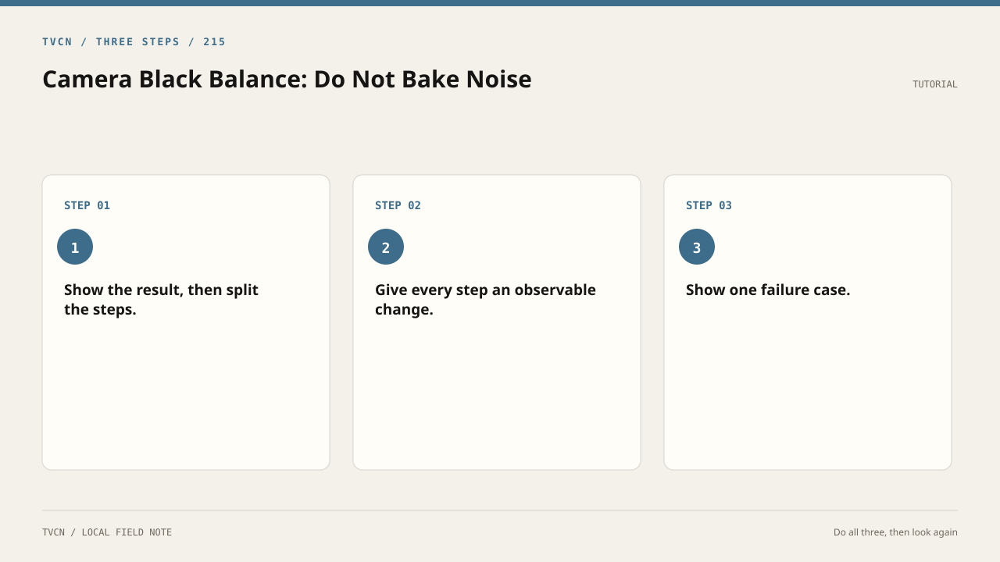

Cap the lens, turn off all light, and black-balance at the shooting frame rate, shutter and gain. A balance made at other settings does not carry over. Shoot a black frame and zoom in for fixed bright dots or color patches.

<!-- DIAGRAM_START -->
<h2>Diagram</h2>
<figure>
  
  <figcaption>Watch “Cap the lens and run black balance from” and “Shoot a dark area afterward.”; judge whether the spec maps to one concrete shooting problem.</figcaption>
</figure>
<!-- DIAGRAM_END -->
<section><h2 id="section-1">Black balance in full dark, same settings</h2>
Redo after sensor temperature changes; on long shoots, warm up ten minutes first.
<h2 id="section-2">Limits</h2>
Black balance cannot fix dead pixels. Fixed dots are a sensor issue; black balance only suppresses dark current. Dead pixels need mapping or post.
</section><section><h2 id="section-3">On set</h2>
Cap the lens and run the camera's black balance. Shoot a dark area and check whether noise drops.
</section><section><h2 id="section-4">Do this</h2>
Camera black balance follows the manufacturer's procedure; do not call noise a style. Clean shadows give post room.
<ol><li>Cap the lens and run black balance from the menu.</li><li>Shoot a dark area afterward.</li><li>Compare noise before and after to confirm cleanup.</li></ol></section><section><h2 id="section-5">Avoid</h2>
Do not skip black balance after conditions change; shadow noise drifts with temperature.
</section><section><h2>Judge</h2>
Three signals are observable on set:
<ul><li>every spec maps to one concrete shooting problem</li><li>weight, power and connections hold on a real rig</li><li>a 60-second test leaves one comparable number</li></ul></section><section><h2>Failures</h2>
These three moves erase the detail you just built:
<ul><li>specs without connections, power or weight</li><li>batteries, storage or body do not match after purchase</li><li>no 60-second test, so the problem arrives on the shoot</li></ul></section><section><h2>Extend</h2>
<strong>10-minute exercise:</strong> Run a 60-second test with the gear you already own, measuring only “Cap the lens and run black balance from”. Record two numbers: what you need and what the gear actually gives.
</section>
<h2>Check</h2><ul><li>Black balance completes per the menu with the lens capped.</li><li>Dark-area footage exists before and after for comparison.</li><li>Shadow noise drops visibly instead of being kept as style.</li></ul>
