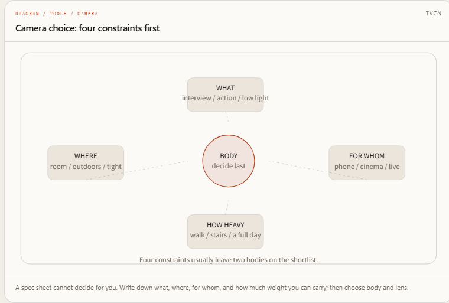

<!-- DIAGRAM_START -->
## Diagram

<figure>
  
  <figcaption>A spec sheet cannot decide for you. Write down what, where, for whom, and how much weight you can carry; then choose body and lens.</figcaption>
</figure>
<!-- DIAGRAM_END -->

Write what you shoot, where, for whom, and how much you can carry before choosing a body. A spec sheet cannot decide for you.

## Write the constraints

Five constraints: budget including lenses, maximum recording time, whether you need 4K60, whether you accept a crop, and how long you carry it each day. Write them down before browsing bodies.

Budget is not the body price. Cards, batteries, lenses, support, monitoring, and storage usually add more than fifty percent.

## Three specs

Look at sensor size and mount, then 10-bit/log and thermals, then autofocus. The sensor defines angle and depth; the mount decides which lenses you can borrow.

Not everyone needs 4K60. Ask whether your delivery platform really needs slow motion. If not, put the budget into light and sound.

## Rent and used

Rent when unsure. One full shooting day tells you more than ten reviews. For used gear, check shutter count, mount wear, sensor dead pixels, and service history.

Before buying, confirm batteries are available, cards can be read, and service exists. A camera is a tool, not a collectible.

## Three checks

- Five constraints are written, budget includes accessories.
- You can name two practical limits from sensor and mount.
- You rented or tested before buying.

<!-- DEEP_DIVE_START -->
## Deep dive

<strong>About 7 minutes.</strong> Choosing a camera is not choosing the highest specs. It is choosing one that works reliably on your set.

### Ask three questions

How long, who holds it, where it sits. Three hours handheld and a twelve-hour interview are not the same camera. One operator and a three-person crew are not either.

Then ask delivery: vertical platforms, cinema, or web only. Delivery decides resolution, bitrate, and color science, not the brand.

### Look at system cost

The body is the first cost: lenses, cards, batteries, monitoring, audio, rig, backup. The system is the cost. Expensive cards, weak batteries, and a narrow lens mount become time on set.

Rent when one rental is cheaper than owning. A three-day project does not need brand loyalty.

### On-set reliability

Check three: charge while shooting, dual-card backup, continuous recording without overheating. If one is unstable, the set stops.

You must change shutter, white balance, and audio within thirty seconds. Deep menus lose the moment. Specs can be learned; reaction time cannot.

### Five-minute drill: three-camera table

List three candidates with six rows: lens mount, cards and backup, battery, audio, weight, rental. One number per row; no “good.”

Show the table to someone who has used them and ask which one for a twelve-hour interview. If they answer, the table has information; if not, add a row.

### When the camera is right

The camera is right when a full day passes without a machine stop, material is backed up, sound reaches the camera, the weight is carryable, and delivery specs are met. Five pass.

If one fails, do not say “I will get used to it.” Habit does not fix overheating or a lost card.

### Check power again

Count power into the day: can the interview camera change batteries without stopping, will the monitor die first, are there enough spares for three rounds? When power fails, every spec you chose stops mattering. In the end, cameras are compared on power and cards.

### Ten camera-choice checks
<ul><li>Ask how long the shoot is</li><li>Who holds the camera</li><li>Where it sits</li><li>Delivery decides specs</li><li>System cost: lenses, cards, batteries</li><li>Lens mount coverage</li><li>Charge while shooting</li><li>Dual-card backup</li><li>Continuous recording without overheating</li><li>Three settings changed in thirty seconds</li></ul>
A camera is not bought to prove you are professional. It is bought so the day does not stop.

<!-- DEEP_DIVE_END -->
