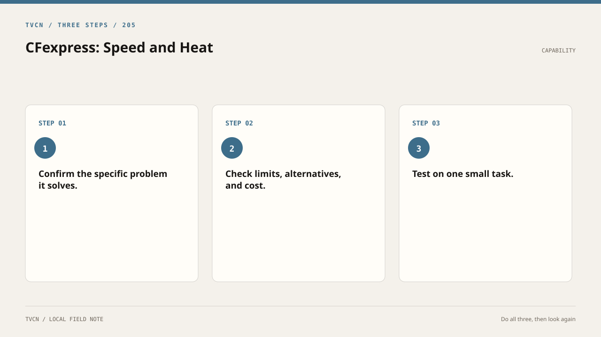

Check sustained write and heat, not peak speed; on long takes, thermal throttling hurts before capacity.

<!-- DIAGRAM_START -->
<h2>Diagram</h2>
<figure>
  
  <figcaption>Do the three steps in order, then look again at the image or file.</figcaption>
</figure>
<!-- DIAGRAM_END -->
<h2>On set</h2>

Record ten minutes at the highest bitrate and feel the card temperature. Copy to an SSD and measure sustained write speed.

<h2>Do this</h2>

CFexpress cards are judged by sustained write and heat, not peak speed; on long takes, thermal throttling hurts more than capacity.
<ol><li>Record ten minutes at maximum bitrate and feel the card temperature.</li><li>Copy to SSD and measure sustained write for a drop.</li><li>If it drops, change card or lower bitrate.</li></ol>
<h2>Avoid</h2>

Do not trust peak write; thermal throttling after ten minutes breaks long takes.

<h2>Check</h2>
<ul><li>A ten-minute maximum-bitrate take completes and card temperature is logged.</li><li>Sustained copy to SSD shows no sharp drop.</li><li>A card change or bitrate reduction is prepared if it drops.</li></ul>
