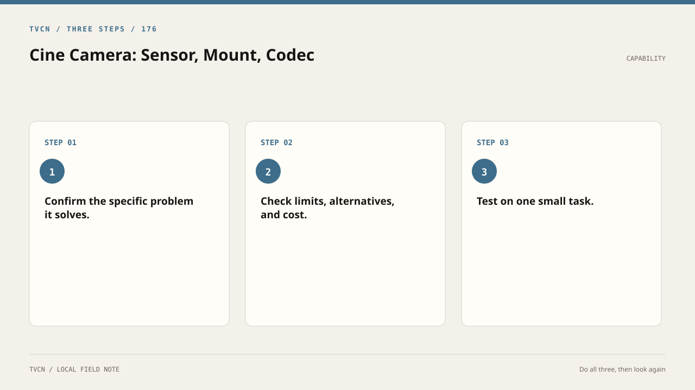

Cine cameras are sensor, mount, and codec first; the badge and body do not decide the job.

<!-- DIAGRAM_START -->
<h2>Diagram</h2>
<figure>
  
  <figcaption>Do the three steps in order, then look again at the image or file.</figcaption>
</figure>
<!-- DIAGRAM_END -->
<h2>On set</h2>

Bring your own PL or EF lens and card, record five minutes of 4K 60p, feel the mount temperature, and check rolling shutter and shadow noise.

<h2>Do this</h2>

A cinema camera is judged by sensor, mount, and recording format; the name and shape do not decide whether it shoots your project.
<ol><li>Bring your own PL or EF lens and card, record five minutes of 4K 60p.</li><li>Feel the mount temperature and play back for rolling shutter and shadow noise.</li><li>Only discuss rental price after all three pass.</li></ol>
<h2>Avoid</h2>

Do not judge by the spec sheet alone; mount heat, rolling shutter, and shadow noise must show in your own footage.

<h2>Check</h2>
<ul><li>Five minutes of 4K 60p is recorded on your own lens and card and plays back.</li><li>Mount temperature is logged and not too hot to change lenses.</li><li>Playback shows rolling shutter and shadow noise levels, not just a demo reel.</li></ul>
