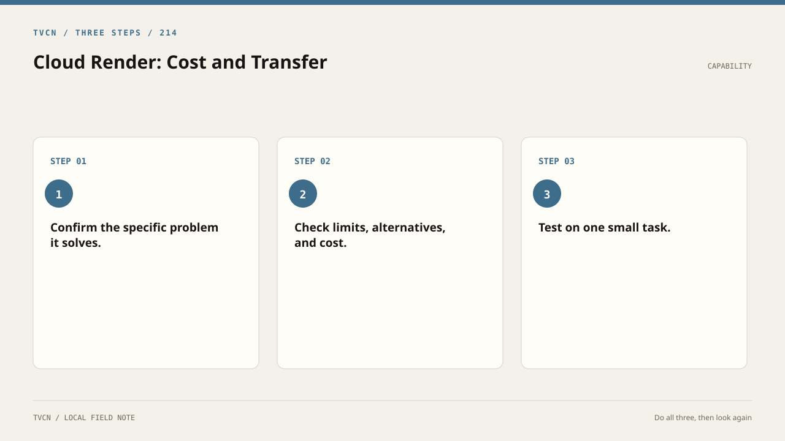

Calculate upload time and output cost; with big media, upload is slower than render.

<!-- DIAGRAM_START -->
<h2>Diagram</h2>
<figure>
  
  <figcaption>Do the three steps in order, then look again at the image or file.</figcaption>
</figure>
<!-- DIAGRAM_END -->
<h2>On set</h2>

Upload 10 GB as a test and calculate the transfer time. Render 100 frames and compare local and cloud cost.

<h2>Do this</h2>

Cloud rendering starts with upload time and cost per frame; large media uploads slower than it renders.
<ol><li>Upload 10 GB as a test and calculate upload time.</li><li>Render 100 frames and compare local versus cloud cost.</li><li>If upload exceeds render time, do not go cloud.</li></ol>
<h2>Avoid</h2>

Do not look at price per frame alone; uploading 10 GB can take longer than rendering.

<h2>Check</h2>
<ul><li>A 10 GB upload is timed.</li><li>Local and cloud costs are compared over 100 frames.</li><li>Upload time is compared with render time and a conclusion is stated.</li></ul>
