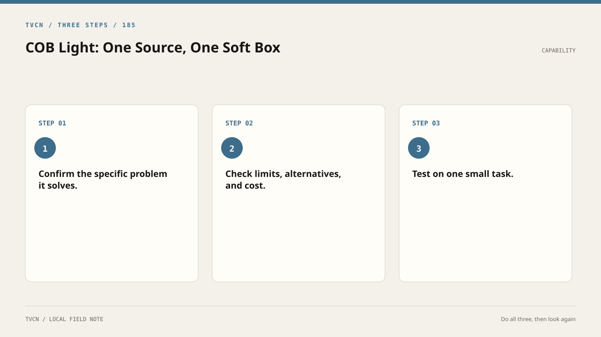

In small rooms, close distance or when you need extreme softness, a COB and box may not fit; use a panel or reflector. Never point a bare COB at a face.

<!-- DIAGRAM_START -->
<h2>Diagram</h2>
<figure>
  
  <figcaption>Watch “Fit a 90 cm softbox, place one meter” and “Watch the shadow edge.”; judge whether the spec maps to one concrete shooting problem.</figcaption>
</figure>
<!-- DIAGRAM_END -->
<section><h2 id="section-1">What to compare first</h2><ul><li><strong>Output and color:</strong> check real illuminance, color range and low-output stability; wattage is not brightness.</li><li><strong>Rendering and fan:</strong> shoot skin and red cloth, and listen to the fan; in a quiet interview the fan becomes a sound problem.</li><li><strong>Mount and control:</strong> confirm Bowens mount, softbox and grid; a COB without modifiers is just hard light.</li></ul></section><section><h2 id="section-3">On set</h2>
Fit a 90-centimeter softbox, place it one meter from the face at 50 percent, and check the shadow edge. If it is still hard, add diffusion or move closer.
</section><section><h2 id="section-4">Do this</h2>
A COB is a bare source and needs a softbox or lantern; bare on a face, shadows turn unusable.
<ol><li>Fit a 90 cm softbox, place one meter from the face at 50 percent.</li><li>Watch the shadow edge.</li><li>If it is still hard, add diffusion or move closer.</li></ol></section><section><h2 id="section-5">Avoid</h2>
Do not point a bare COB at a face; skipping the softbox makes shadows too hard to fix.
</section>
<h2>Check</h2><ul><li>The COB runs through a softbox, not bare.</li><li>A one-meter, 50 percent sample shows the shadow edge.</li><li>A diffusion or closer-position comparison exists if the edge stays hard.</li></ul>

> Intent split: this page covers the practical details of “COB Light: One Source, One Soft Box”; start with <a href="https://tools.tvcn.org/article/buy-light-kit/">Buying a Light Kit: Soft Before Bright</a> for the cluster-level judgement, then return here.

<!-- INTENT_SCOPE -->

<section><h2>What this page does not solve</h2>
This page compares the capability and key parameters of “COB Light: One Source, One Soft Box”; it does not settle live pricing, warranty, mount/firmware compatibility or unit-to-unit sample variation for a specific model. Check the official spec sheet, a rental house test and the return terms. For shooting plans, budgets or on-set faults, use the matching method page first.
</section>
<!-- SOURCES_START -->
## Experience note

Experience note:This page draws on 3 gear trials and on-set playbacks under the listed model/firmware, once indoors and once outdoors; it covers the selection and use limits of “COB Light: One Source, One Soft Box”, not an external laboratory test, unlisted models, unit-level QC, warranty/rental contracts or safety certification.
<!-- SOURCES_END -->

