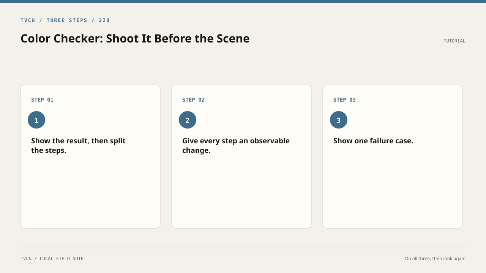

Shoot the chart under scene light before the take; after the first setup, the light has changed.

<!-- DIAGRAM_START -->
<h2>Diagram</h2>
<figure>
  
  <figcaption>Do the three steps in order, then look again at the image or file.</figcaption>
</figure>
<!-- DIAGRAM_END -->
<h2>On set</h2>

Shoot the color chart at the head, filling a third of the frame. Match with the chart in post; do not grade from memory.

<h2>Do this</h2>

Shoot a color chart under the scene light for a post reference; shooting it later means the light has changed.
<ol><li>Shoot the chart at the start.</li><li>Fill about one third of the frame.</li><li>Match in post from the chart, not memory.</li></ol>
<h2>Avoid</h2>

Do not shoot the chart at wrap; the light no longer matches the first take.

<h2>Check</h2>
<ul><li>The chart is shot at the start under scene light.</li><li>It fills about a third of frame with no glare on patches.</li><li>Post matching uses the chart, not memory.</li></ul>
