<!-- DIAGRAM_START -->
<h2>Diagram</h2>
<figure>
  
  <figcaption>Diagram: each sheet has one owner. The call sheet is the day’s only version, not a notification.</figcaption>
</figure>
<!-- DIAGRAM_END -->
<h2>Call sheet: one page decides the day</h2>
A call sheet includes call time, address, contact, parking, meals, nearest hospital, weather backup, and each department’s call time. Do not write “everyone at 8”; camera, lighting, and makeup need different calls, and one time makes everyone wait.

Send it 24 hours ahead. Changes go out as a new version at least an hour ahead with “this version governs” in the message. Verbal changes do not count; the set runs on the latest sheet.
<h2>Roles and ownership: every risk gets a person</h2>
List risks: power, fire, height, traffic, weather, minors, animals, gear damage. Each gets an owner and a backup. The owner is not “everyone”; it is the person who can call a stop.

Key roles need backups: camera, sound, lighting, producing. A role without a backup is a single point of failure; one illness stops the project.
<h2>Sign-in, communication, and changes</h2>
Sign-in is not paperwork; it confirms who is on site, who is insured, and who can travel. The sheet lists name, role, phone, arrival, and insurance. A last-minute joiner signs in before entering set.

Changes go through a small form: who asked, what changes, which shots are affected, who approved. Do not “just grab one more” on set; grabbed shots usually lack light, sound, and clearance.
<h2>Wrap: backup, clear, report</h2>
Before wrap: confirm media backup, restore the location, and count gear. Backup is not “tomorrow”; two copies must exist that day. Restoration includes props, trash, and keys; gear count follows the rental list.

The wrap report states what was shot, what was missed, what is needed tomorrow, and any injury/damage/overtime. Send it to producer and director, not the whole crew; the crew only needs tomorrow’s call.
<h2>Failure case: “everyone at 8”</h2>
A six-person cafe shoot called everyone at 8. Camera arrived at 8 with no lights; makeup arrived at 8 with no actor; the actor came at 8:30; the cafe opened at 9. Everyone waited and the first shot rolled at 10:40. Twelve shots were planned, seven were captured.

The fix is not overtime; it is a staggered call: camera 7:30, lighting 7:30, makeup 8:30, cast 9:00, first shot 9:30. A call sheet is not a notification; it minimizes waiting.
<h2>Cost and acceptance</h2>
Crew management usually sits in the producer fee: small ¥1,000–3,000/day, mid ¥3,000–8,000/day, large ¥8,000–20,000/day. Skipping production usually doubles the shoot day.
<h2>Check</h2><ul><li>Call sheet 24 hours ahead with address, contact, hospital, weather backup.</li><li>Every risk has a name and backup.</li><li>Key roles have backups.</li><li>Sign-in records insurance status.</li><li>Change form names affected shots and approver.</li><li>Two backups and a gear count on wrap day.</li></ul>
<!-- SOURCES_START -->
<h2>Sources</h2>

Experience: field notes and buying checklists; tested: short tests against public specs, not lab scores; references: manufacturer and standards links below.

<ul><li>[S23] SMPTE Standards</li><li>[S25] ITU-R BT.709</li><li>[S26] ITU-R BT.2020</li><li>[S29] YouTube Upload Specs</li><li>[S38] State Taxation Administration</li></ul>

<a href="../../SOURCES.md">Full links and notes in SOURCES.md</a>

<!-- SOURCES_END -->
