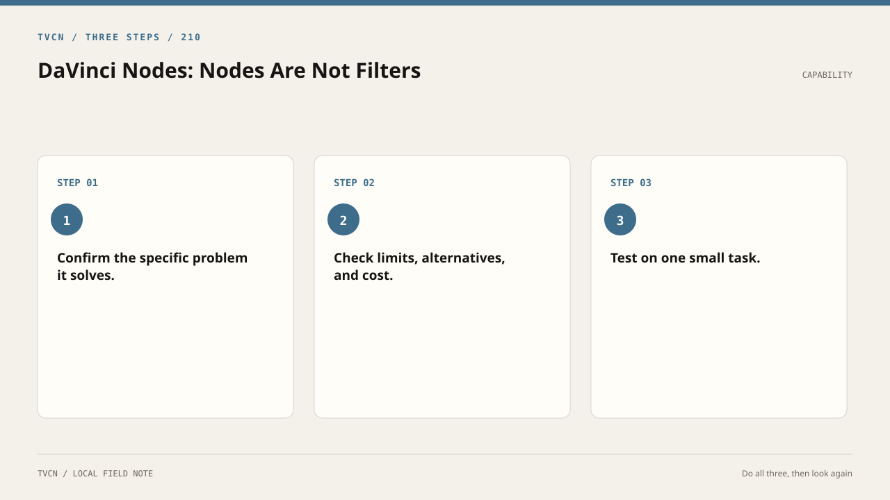

Nodes are not filter stacks; one node does one job, and disabling it reveals its effect.

<!-- DIAGRAM_START -->
<h2>Diagram</h2>
<figure>
  
  <figcaption>Do the three steps in order, then look again at the image or file.</figcaption>
</figure>
<!-- DIAGRAM_END -->
<h2>On set</h2>

Build five nodes: exposure, white balance, contrast, look, and output. Toggle each one to see its job; do not stack twenty.

<h2>Do this</h2>

Nodes are not a filter stack; each node does one job, and turning it off reveals what it did.
<ol><li>Build five nodes: exposure, white balance, contrast, look, output.</li><li>Toggle each node and watch the change.</li><li>Do not stack twenty and lose track of the cause.</li></ol>
<h2>Avoid</h2>

Do not stack twenty nodes; when something breaks, you cannot tell which to disable.

<h2>Check</h2>
<ul><li>Five nodes each do one job with clear names.</li><li>Toggling each shows its specific change.</li><li>No more than ten nodes, and problems map to one node.</li></ul>
