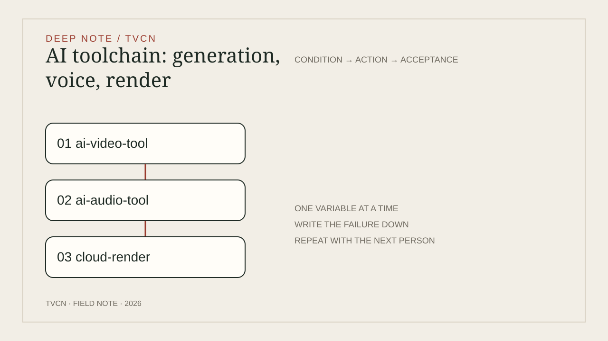

AI tools are not one-click films; generation, voice, render and human review need a traceable chain. One page of &amp;quot;AI Video Tool: Controllability First&amp;quot; solves one local problem; joining &amp;quot;AI Video Tool: Controllability First&amp;quot;, &amp;quot;AI Audio Tool: Rights and Quality&amp;quot; and &amp;quot;Cloud Render: Cost and Transfer&amp;quot; exposes the real failure: conditions are missing, too many variables move, and the result cannot be reproduced.

<!-- DEEP_DIVE_START -->
<!-- DIAGRAM_START -->
<h2>图解</h2>
<figure>
  
  <figcaption>Read &quot;AI Video Tool: Controllability First&quot; and &quot;AI Audio Tool: Rights and Quality&quot;: write the condition first, then check whether the failure can be recorded.</figcaption>
</figure>
<!-- DIAGRAM_END -->

<section><h2 id="section-1">Problem</h2>
The problem is not a lack of methods; each step works alone, but together they fail because the condition was not written, too many variables moved and the result cannot be reproduced.

The order is condition, judgement, one variable and evidence. A step is complete only when the next person can repeat it.
</section>
<section><h2 id="section-2">Judgement</h2><ul><li>First gate in &quot;AI Video Tool: Controllability First&quot;: The same prompt keeps the character consistent across three shots.</li><li>Second gate in &quot;AI Audio Tool: Rights and Quality&quot;: Camera motion and duration respond to specific controls.</li><li>Third gate in &quot;Cloud Render: Cost and Transfer&quot;: Failure cases are saved and the boundary is known.</li></ul>
If one gate fails, return to its single page; do not hide an unsolved point inside a longer chain.
</section>
<section><h2 id="section-3">Method</h2><ol><li>Write the condition first: turn &quot;Use one prompt to test character consistency, camera control, and duration.&quot; from &quot;AI Video Tool: Controllability First&quot; into three rows: material, environment, acceptance.</li><li>Run one minimal action: follow &quot;AI Video Tool: Controllability First&quot; for 30 seconds and do not add the second page yet.</li><li>Attach the second page: Pay only after all three pass..</li><li>Use the third page as a control: Save the failure cases too..</li><li>Change one variable at a time; write the other conditions down instead of remembering them.</li><li>Film the failure too: put failure and success side by side to see which step cannot be skipped.</li><li>Ask the next person to reproduce from the record; if they cannot, the record is not finished.</li></ol></section>
<section><h2 id="section-4">Field test</h2>
A reproducible test, not a client case: take 30 seconds of material, make version A using &quot;The same prompt keeps the character consistent across three shots…&quot; from &quot;AI Video Tool: Controllability First&quot;, then version B using &quot;Camera motion and duration respond to specific controls.&quot; from &quot;AI Audio Tool: Rights and Quality&quot;; only one variable may differ. Put them side by side and record what breaks first in &quot;Cloud Render: Cost and Transfer&quot;: condition, action or acceptance. If it works on the first try, add one real constraint and run it again.
</section>
<section><h2 id="section-5">Failure table</h2>
<table class="data-table"><thead><tr><th>Symptom</th><th>Cause</th><th>Replacement action</th></tr></thead><tbody><tr><td>Do not be fooled by demo reels; they show success, not character …</td><td>Condition was not written</td><td>Return to page one and rewrite the three rows</td></tr><tr><td>Do not judge timbre alone; a personal-use license still blocks co…</td><td>Condition was not written</td><td>Return to page one and rewrite the three rows</td></tr><tr><td>Do not look at price per frame alone; uploading 10 GB can take lo…</td><td>Condition was not written</td><td>Return to page one and rewrite the three rows</td></tr></tbody></table>
</section>
<section><h2 id="section-6">Acceptance</h2><ul><li>The same prompt keeps the character consistent across three shots.</li><li>Camera motion and duration respond to specific controls.</li><li>Failure cases are saved and the boundary is known.</li><li>Sibilance, pauses, and tails are assessed on a thirty-second line.</li><li>Commercial license and clone scope have written terms.</li><li>Output clears the current project without extra licensing.</li><li>A 10 GB upload is timed.</li><li>Local and cloud costs are compared over 100 frames.</li><li>Upload time is compared with render time and a conclusion is stated.</li><li>The condition from AI Video Tool: Controllability First fits on one line and can be repeated by someone else.</li></ul></section>
<section><h2 id="section-7">Alternatives</h2><ul><li>For a single-point problem in "AI Video Tool: Controllability First", go back to <a href="https://tools.tvcn.org/en/article/ai-video-tool/">AI Video Tool: Controllability First</a>; do not use the whole chain.</li><li>To compare two actions, read <a href="https://tools.tvcn.org/en/article/ai-audio-tool/">AI Audio Tool: Rights and Quality</a> and leave the third page alone.</li><li>For acceptance only, use <a href="https://tools.tvcn.org/en/article/cloud-render/">Cloud Render: Cost and Transfer</a> as a self-test sheet.</li></ul></section>

<!-- SOURCES_START -->
## References and further reading

- [S14] [YouTube Community Guidelines](https://support.google.com/youtube/answer/2801973) — Accessed 2026-11-26. Used to check the terminology and public context in the opening paragraph (“AI tools are not one-click films; generation, voice, render ”) against Current platform rules on misleading content, dangerous acts, copyright and disclosure; not a substitute for an on-set test.
- [S15] [TikTok Community Guidelines](https://www.tiktok.com/community-guidelines/en/) — Accessed 2026-11-26. Used to check the terminology and public context in the opening paragraph (“AI tools are not one-click films; generation, voice, render ”) against Short-video platform rules on content, AI-generated media and commercial disclosure; not a substitute for an on-set test.
- [S29] [YouTube Upload Specs](https://support.google.com/youtube/answer/1722171) — Accessed 2026-11-26. Used to check the terminology and public context in the opening paragraph (“AI tools are not one-click films; generation, voice, render ”) against Recommended resolution, bitrate, frame rate and audio codec; not a substitute for an on-set test.
- [S23] [SMPTE Standards](https://www.smpte.org/standards) — Accessed 2026-11-26. Used to check the terminology and public context in the opening paragraph (“AI tools are not one-click films; generation, voice, render ”) against Entry point for timecode, color, cinema and signal-chain standards; not a substitute for an on-set test.
- [S30] [DaVinci Resolve](https://www.blackmagicdesign.com/products/davinciresolve) — Accessed 2026-11-26. Used to check the terminology and public context in the opening paragraph (“AI tools are not one-click films; generation, voice, render ”) against Official entry for editing, grading, Fusion and delivery; not a substitute for an on-set test.
<!-- SOURCES_END -->

