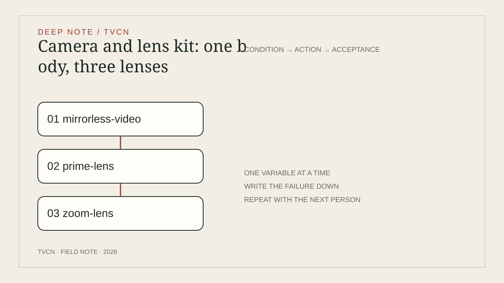

The body sets the floor; lenses decide what you can capture. One body and three lenses finish more often. One page of &amp;quot;Mirrorless for Video: Heat, Rolling Shutter, Crop&amp;quot; solves one local problem; joining &amp;quot;Mirrorless for Video: Heat, Rolling Shutter, Crop&amp;quot;, &amp;quot;Prime Lens: Move Your Feet&amp;quot; and &amp;quot;Zoom Lens: Convenience Has a Cost&amp;quot; exposes the real failure: conditions are missing, too many variables move, and the result cannot be reproduced.

<!-- DEEP_DIVE_START -->
<!-- DIAGRAM_START -->
<h2>图解</h2>
<figure>
  
  <figcaption>Read &quot;Mirrorless for Video: Heat, Rolling Shutter, Crop&quot; and &quot;Prime Lens: Move Your Feet&quot;: write the condition first, then check whether the failure can be recorded.</figcaption>
</figure>
<!-- DIAGRAM_END -->

<section><h2 id="section-1">Problem</h2>
The problem is not a lack of methods; each step works alone, but together they fail because the condition was not written, too many variables moved and the result cannot be reproduced.

The order is condition, judgement, one variable and evidence. A step is complete only when the next person can repeat it.
</section>
<section><h2 id="section-2">Judgement</h2><ul><li>First gate in &quot;Mirrorless for Video: Heat, Rolling Shutter, Crop&quot;: A thirty-minute 4K 25p run logs temperature or warnings.</li><li>Second gate in &quot;Prime Lens: Move Your Feet&quot;: Rolling shutter on the railing is visible and described.</li><li>Third gate in &quot;Zoom Lens: Convenience Has a Cost&quot;: The 4K 60p crop has a before-and-after angle comparison.</li></ul>
If one gate fails, return to its single page; do not hide an unsolved point inside a longer chain.
</section>
<section><h2 id="section-3">Method</h2><ol><li>Write the condition first: turn &quot;Record thirty minutes of 4K 25p and watch for a heat warning.&quot; from &quot;Mirrorless for Video: Heat, Rolling Shutter, Crop&quot; into three rows: material, environment, acceptance.</li><li>Run one minimal action: follow &quot;Mirrorless for Video: Heat, Rolling Shutter, Crop&quot; for 30 seconds and do not add the second page yet.</li><li>Attach the second page: Pan across a railing to see rolling shutter..</li><li>Use the third page as a control: Switch to 4K 60p and check whether the angle narrows..</li><li>Change one variable at a time; write the other conditions down instead of remembering them.</li><li>Film the failure too: put failure and success side by side to see which step cannot be skipped.</li><li>Ask the next person to reproduce from the record; if they cannot, the record is not finished.</li></ol></section>
<section><h2 id="section-4">Field test</h2>
A reproducible test, not a client case: take 30 seconds of material, make version A using &quot;A thirty-minute 4K 25p run logs temperature or warnings.&quot; from &quot;Mirrorless for Video: Heat, Rolling Shutter, Crop&quot;, then version B using &quot;Rolling shutter on the railing is visible and described.&quot; from &quot;Prime Lens: Move Your Feet&quot;; only one variable may differ. Put them side by side and record what breaks first in &quot;Zoom Lens: Convenience Has a Cost&quot;: condition, action or acceptance. If it works on the first try, add one real constraint and run it again.
</section>
<section><h2 id="section-5">Failure table</h2>
<table class="data-table"><thead><tr><th>Symptom</th><th>Cause</th><th>Replacement action</th></tr></thead><tbody><tr><td>Do not test for three minutes; overheating often appears around m…</td><td>Condition was not written</td><td>Return to page one and rewrite the three rows</td></tr><tr><td>Do not stay glued to the tripod; the prime&#x27;s value is making you …</td><td>Condition was not written</td><td>Return to page one and rewrite the three rows</td></tr><tr><td>Do not check center sharpness only; edges and backlight expose a …</td><td>Condition was not written</td><td>Return to page one and rewrite the three rows</td></tr></tbody></table>
</section>
<section><h2 id="section-6">Acceptance</h2><ul><li>A thirty-minute 4K 25p run logs temperature or warnings.</li><li>Rolling shutter on the railing is visible and described.</li><li>The 4K 60p crop has a before-and-after angle comparison.</li><li>At least three positions cover the same person at one focal length.</li><li>The background and perspective change from two meters of walking is described.</li><li>The 24 vs 50 decision comes from walking, not review videos.</li><li>Wide-open backlit window and railing shots record edge performance.</li><li>Distortion and breathing are named, not just “good quality.”</li><li>Weight is measured and the saved step is stated.</li><li>The condition from Mirrorless for Video: Heat, Rolling Shutter, Crop fits on one line and can be repeated by someone else.</li></ul></section>
<section><h2 id="section-7">Alternatives</h2><ul><li>For a single-point problem in "Mirrorless for Video: Heat, Rolling Shutter, Crop", go back to <a href="https://tools.tvcn.org/en/article/mirrorless-video/">Mirrorless for Video: Heat, Rolling Shutter, Crop</a>; do not use the whole chain.</li><li>To compare two actions, read <a href="https://tools.tvcn.org/en/article/prime-lens/">Prime Lens: Move Your Feet</a> and leave the third page alone.</li><li>For acceptance only, use <a href="https://tools.tvcn.org/en/article/zoom-lens/">Zoom Lens: Convenience Has a Cost</a> as a self-test sheet.</li></ul></section>

<!-- SOURCES_START -->
## References and further reading

- [S31] [ARRI: Cine Systems](https://www.arri.com/en/cine-systems) — Accessed 2026-11-26. Used to check the terminology/method/rule in the “Problem” section against ARRI camera, lens and lighting documentation, not a general shooting tutorial; it does not verify numbers, model choices or on-set conclusions derived from this page, and is not a substitute for a test.
- [S52] [ARRI: ALEXA 35](https://www.arri.com/en/camera-systems/cameras/legacy-camera-systems/alexa-35) — Accessed 2026-11-26. Used to check the terminology/method/rule in the “Judgement” section against ALEXA 35 official specs, not independent testing; it does not verify numbers, model choices or on-set conclusions derived from this page, and is not a substitute for a test.
- [S53] [Sony: FX6](https://pro.sony/ue_US/products/handheld-camcorders/ilme-fx6v) — Accessed 2026-11-26. Used to check the terminology/method/rule in the “Method” section against FX6 official specs, not independent testing; it does not verify numbers, model choices or on-set conclusions derived from this page, and is not a substitute for a test.
<!-- SOURCES_END -->

