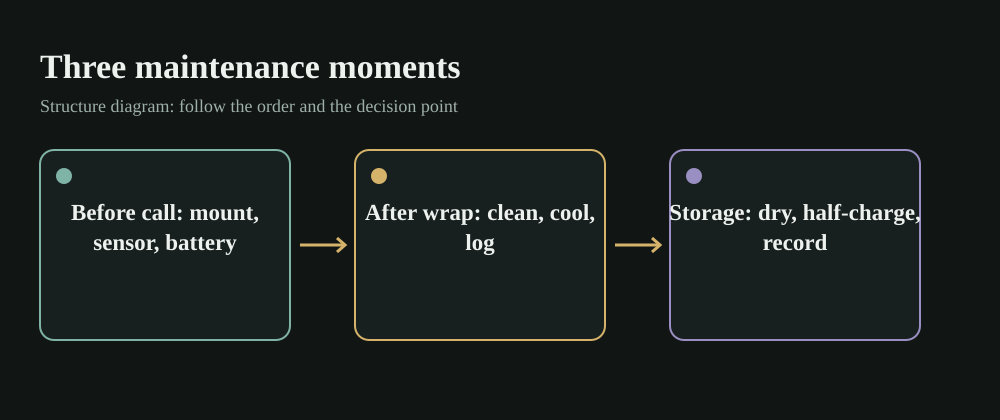

A camera that fails at call time usually did not break at that moment. The mount has been loose for months, the sensor has dust, the battery sits full, salt mist was never wiped after a beach shoot. The fault was there; the call only revealed it. Maintenance is not repair; it is making faults show up early.

<!-- DIAGRAM_START -->
<h2 id="diagram">Diagram</h2>
<figure class="diagram">
  
  <figcaption>Check before call, after wrap and in storage. If you only act when it breaks, maintenance has become repair.</figcaption>
</figure>
<!-- DIAGRAM_END -->

<section><h2 id="section-1">On location</h2>
A three-year-old body: before the shoot the mount has a slight wobble, there is a fixed dust spot in the upper right of the sensor, and the battery reads 100% but drops to 40% at start. The team wipes the lens with a shirttail, swaps a battery and keeps shooting. Three months later the mount fails completely; the repair quote is close to half the used price.
</section>
<section><h2 id="section-2">What to look for</h2><ul><li><strong>Mount and lens seat:</strong> does the lens wobble up and down after mounting? If yes, stop shooting; do not tape it.</li><li><strong>Sensor:</strong> shoot a white wall at f/16 and look for fixed spots; a spot that does not move with the lens is on the sensor.</li><li><strong>Battery:</strong> a full battery that drops over 20% at start, or two batteries with a big voltage difference, are ageing.</li><li><strong>Firmware and storage:</strong> firmware version, card health and dropped frames; do not discover a card error on set.</li></ul></section>
<section><h2 id="section-3">What to do</h2><ol><li>Ten checks before call: mount, sensor dust, front and rear lens groups, battery voltage, card space, firmware, record test, timecode, vents, strap lugs.</li><li>Three things after wrap: blow the sensor and lens, wipe salt or rain off the body, let the body cool ten minutes before packing.</li><li>Store batteries at 40–60%, not full; run a full charge-discharge every three months and log health.</li><li>Use a dry cabinet at 40–50% humidity; keep lens and body separate, cap the mount, do not seal in a plastic bag.</li><li>Keep a maintenance log: date, project, problem found, action, next check. The log travels with the body, not with the person.</li></ol></section>
<section><h2 id="section-4">Failure modes</h2><ul><li><strong>Wiping a lens with a shirttail:</strong> fibres and sand leave fine scratches; the more you wipe, the worse it gets.</li><li><strong>Storing batteries full:</strong> full storage accelerates ageing, and they drop faster than expected on set.</li><li><strong>No cleaning after the coast:</strong> salt stays on the mount and screws and starts corroding within weeks.</li></ul></section>
<section><h2 id="section-5">Limits</h2>
This covers digital bodies, lenses, batteries and cards. It does not replace manufacturer service and is not for film or vintage mechanical cameras. If you are not confident with sensor cleaning, do not try it; a sensor costs far more than a cleaning. A body that has been wet or dropped goes straight to repair; do not power it on to test.
</section>
<section><h2 id="section-6">Check</h2><ul><li>The ten pre-call checks fit on one sheet and take under five minutes.</li><li>The sensor dust test is logged, with the last cleaning date.</li><li>Batteries are stored at 40–60%, with health recorded.</li><li>Body, lens and cards have unique IDs that match the maintenance log.</li></ul></section>
<!-- DEEP_DIVE_START -->
## Deep dive

<strong>About 8 minutes.</strong> This section places the same judgement in two different conditions, then gives a counterexample and a reusable model. It does not repeat the page; it decides when to change the method.

### Condition A: rented body

For a rental, maintenance is handover evidence. On pickup, shoot a thirty-second video: body exterior, mount, sensor against a white wall, every button, a record test and the accessory list. Do not rely on stills. Before returning, shoot the same sequence and compare for new scratches, spots or errors. A time-stamped video beats a verbal description.

Do not deep-clean a rental on set, especially not the sensor; contact the rental house first and keep a record. For a short rental, spend ten extra minutes on handover rather than lose the deposit on return.

### Condition B: owned body

For an owned body, maintenance is a lifetime account. Track shutter count, recording hours, battery cycles and cleaning count; every six months compare repair cost to depreciation. If a year's repair exceeds 20% of the used value, consider replacing instead of reinvesting.

An owned kit can carry a spares pack: one battery of the same model, one backup card, a mount cap and a cleaning swab. Spares are not hoarding; they keep one failure from stopping a shoot. Log the spares too, or the backup battery will be old when you need it.

### Counterexample: cleaning the lens, missing the mount

One corner is always soft. The team cleans the lens, swaps the lens, and the problem stays. Finally the mount screws are loose and the lens is not parallel to the sensor. Three days of lens cleaning, no mount check.

Reverse the order: mount and sensor first, lens second. A wobbling mount is visible to the eye; sensor dust shows on a white wall at f/16; lens problems are the rarest. Check the cheapest, most ignored link first.

### Reusable model

<strong>Inspect → clean → store → log.</strong> Inspection makes faults appear early; cleaning stops accumulation; storage keeps gear from failing while idle; the log gives the next inspection a baseline. None of the four needs deep expertise; all four need repetition.

Put maintenance on a five-minute card inside the case; follow it before every call instead of trusting memory. The card is more reliable than experience, especially when you are in a hurry.

<!-- DEEP_DIVE_END -->
<!-- SOURCES_START -->
## Further reading

- [S32] [Sony Pro Support: Sony Pro Support](https://pro.sony/ue_US/support) — accessed 2026-11-26. Used to check the terms, method or rule in the “What to look for” section; not the page's field numbers, gear models or conclusions, and not a substitute for a test or contract.
- [S33] [Canon Support: Canon Support](https://www.usa.canon.com/support) — accessed 2026-11-26. Used to check the terms, method or rule in the “Limits” section; not the page's field numbers, gear models or conclusions, and not a substitute for a test or contract.
<!-- SOURCES_END -->
