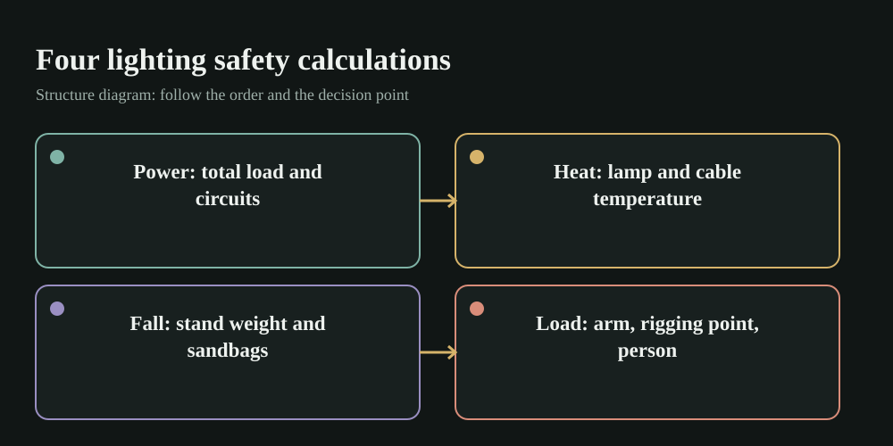

Low-budget sets cut safety first: three lamps on one strip, a stand with no sandbag, cables across a walkway. Nothing happens and the shoot wraps, but that does not make it right; it only means nothing fell this time. Safety is not luck; it is lowering probability.

<!-- DIAGRAM_START -->
<h2 id="diagram">Diagram</h2>
<figure class="diagram">
  
  <figcaption>Check power, heat, fall and load. Calculating wattage without counterweight still lets a stand fall.</figcaption>
</figure>
<!-- DIAGRAM_END -->

<section><h2 id="section-1">On location</h2>
A small room, three 300W LEDs on one power strip, stands by the door, a carpet on the floor. No sandbags, an arm extended 1.2 metres, cables running from the door to the window. Mid-shoot someone trips on a cable; the stand wobbles and does not fall. The team laughs and keeps shooting.
</section>
<section><h2 id="section-2">What to look for</h2><ul><li><strong>Power and circuits:</strong> three 300W lamps plus other gear exceed the safe margin of one 10A/220V circuit; a warm power strip is a signal.</li><li><strong>Heat:</strong> the lamp head, softbox and cable connectors feel hot; LEDs heat too, do not assume otherwise.</li><li><strong>Fall:</strong> the longer the arm, the more counterweight; no sandbag, uneven floor and foot traffic are all fall conditions.</li><li><strong>Load:</strong> arm rating, rigging point and stand legs locked; nobody stands under the arm.</li></ul></section>
<section><h2 id="section-3">What to do</h2><ol><li>Calculate total power: add every lamp's rating, keep 20% headroom; if it exceeds one circuit, split across circuits, do not chain strips.</li><li>Check heat: after ten minutes touch the lamp head, softbox and cable connectors; if hot, lower power, increase distance or move.</li><li>Counterweight: at least two sandbags per stand, more for a longer arm; hang them at the centre of the legs, not the end of the arm.</li><li>Cable management: run cables along walls or in cable ramps; no cable across a walkway; connectors face down, not up.</li><li>Power down at wrap: lamps off, then strip, then cables; do not pack a hot lamp.</li></ol></section>
<section><h2 id="section-4">Failure modes</h2><ul><li><strong>Everything on one strip:</strong> the strip overheats and connectors melt; it only feels “a bit warm” at first.</li><li><strong>No counterweight:</strong> the arm extends and the base is light; a passer-by touches it and the lamp falls.</li><li><strong>Cables trip people:</strong> a line across a walkway is invisible to someone carrying a camera; the person falls and the gear falls.</li></ul></section>
<section><h2 id="section-5">Limits</h2>
This checklist is for small interior and exterior shoots. It does not replace a licensed electrician, a studio safety officer or a large rigging plan. Above 5kW, overhead work, generators or wet conditions require a professional. A fallen stand, damaged cable or burnt plug is retired, not repaired and reused.
</section>
<section><h2 id="section-6">Check</h2><ul><li>Total power is calculated and split across circuits, not chained on one strip.</li><li>Each stand has at least two sandbags and nobody stands under the arm.</li><li>No cable crosses a walkway and connectors face down.</li><li>Power-down order is followed and lamps cool before packing.</li></ul></section>
<!-- DEEP_DIVE_START -->
## Deep dive

<strong>About 8 minutes.</strong> This section places the same judgement in two different conditions, then gives a counterexample and a reusable model. It does not repeat the page; it decides when to change the method.

### Condition A: small indoor power

The main danger in small indoor power is not shock but heat and tripping. LEDs draw little, but power adapters and cable connectors get hot; keep adapters ventilated, not under a carpet. Put stands against walls, open the legs fully and hang sandbags at the centre; do not narrow the legs to save space.

In a small interview room there are many lamps, many cables and few people. Keep all cables on one side and leave the actor a clean walking path; tape stand positions on the floor so a camera move does not kick them. At wrap, lamps off before cables, never unplug live.

### Condition B: outdoor or high power

The first problem outdoors is where the power comes from. A generator needs grounding, distance from people and rain protection; cables need waterproof connectors, not household strips. A stand in wind becomes a sail, and a longer arm is more dangerous; counterweight by wind, not by indoor experience.

Outdoors also calculate the fall direction: which way the stand goes, and whether there are people, cars or glass there. Put stands on the low-traffic side and point the arm at open space, not at the actor. Check the forecast at wrap; do not hang a large softbox above force 5 wind.

### Counterexample: the stand falls and nobody steadies it

A stand by the door, arm over the walkway, no sandbag. Three people pass, the stand wobbles three times, nobody steadies it because everyone is busy. The fourth time it falls, hits the monitor, injures nobody, and stops the shoot for two hours.

The problem is not the fourth time; it is the first three. Make a rule that anyone can stop: if you see a wobbling stand, a cable across the path or a hot strip, call stop without the director's approval. Safety is not one person's job; it is a system that can be stopped.

### Reusable model

<strong>Power → heat → fall → load.</strong> Power decides whether it can go on; heat decides how long; fall decides who it hits; load decides whether it holds. Do them in order: power first, then hang. Do not hang first and look for power after.

Walk the set for sixty seconds before call: strips, cables, stands, sandbags, people under arms. If any item is uncertain, stop; do not “finish the shot first”. Safety is not the opposite of efficiency; it is the precondition.

<!-- DEEP_DIVE_END -->
<!-- SOURCES_START -->
## Further reading

- [S31] [ARRI Cine Systems: ARRI Cine Systems](https://www.arri.com/en/cine-systems) — accessed 2026-11-26. Used to check the terms, method or rule in the “What to look for” section; not the page's field numbers, gear models or conclusions, and not a substitute for a test or contract.
- [S52] [ARRI: ALEXA 35](https://www.arri.com/en/camera-systems/cameras/legacy-camera-systems/alexa-35) — accessed 2026-11-26. Used to check the terms, method or rule in the “Limits” section; not the page's field numbers, gear models or conclusions, and not a substitute for a test or contract.
<!-- SOURCES_END -->
