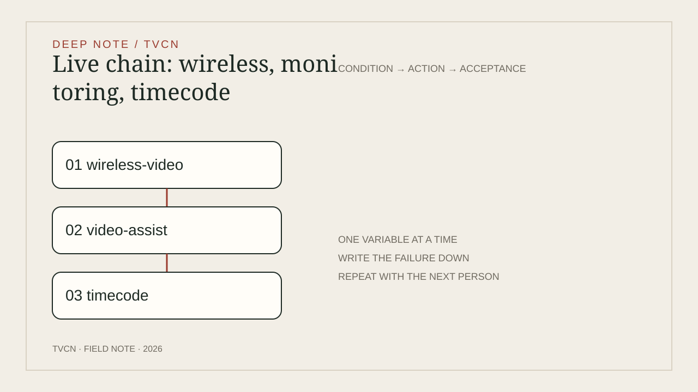

Live is not camera-to-laptop; wireless, monitoring, timecode and backup are one chain. One page of &amp;quot;Wireless Video: Latency and Interference&amp;quot; solves one local problem; joining &amp;quot;Wireless Video: Latency and Interference&amp;quot;, &amp;quot;Video Assist: Playback on Set&amp;quot; and &amp;quot;Timecode: Sync Without Guessing&amp;quot; exposes the real failure: conditions are missing, too many variables move, and the result cannot be reproduced.

<!-- DEEP_DIVE_START -->
<!-- DIAGRAM_START -->
<h2>图解</h2>
<figure>
  
  <figcaption>Read &quot;Wireless Video: Latency and Interference&quot; and &quot;Video Assist: Playback on Set&quot;: write the condition first, then check whether the failure can be recorded.</figcaption>
</figure>
<!-- DIAGRAM_END -->

<section><h2 id="section-1">Problem</h2>
The problem is not a lack of methods; each step works alone, but together they fail because the condition was not written, too many variables moved and the result cannot be reproduced.

The order is condition, judgement, one variable and evidence. A step is complete only when the next person can repeat it.
</section>
<section><h2 id="section-2">Judgement</h2><ul><li>First gate in &quot;Wireless Video: Latency and Interference&quot;: Latency and dropouts are logged across the set.</li><li>Second gate in &quot;Video Assist: Playback on Set&quot;: Director and focus monitoring use two separate links.</li><li>Third gate in &quot;Timecode: Sync Without Guessing&quot;: Dropout spots have a response, such as antennas or channel change.</li></ul>
If one gate fails, return to its single page; do not hide an unsolved point inside a longer chain.
</section>
<section><h2 id="section-3">Method</h2><ol><li>Write the condition first: turn &quot;Walk the set and measure latency and dropouts.&quot; from &quot;Wireless Video: Latency and Interference&quot; into three rows: material, environment, acceptance.</li><li>Run one minimal action: follow &quot;Wireless Video: Latency and Interference&quot; for 30 seconds and do not add the second page yet.</li><li>Attach the second page: Keep director and focus signals separate..</li><li>Use the third page as a control: Log dropout spots and add antennas or change channels..</li><li>Change one variable at a time; write the other conditions down instead of remembering them.</li><li>Film the failure too: put failure and success side by side to see which step cannot be skipped.</li><li>Ask the next person to reproduce from the record; if they cannot, the record is not finished.</li></ol></section>
<section><h2 id="section-4">Field test</h2>
A reproducible test, not a client case: take 30 seconds of material, make version A using &quot;Latency and dropouts are logged across the set.&quot; from &quot;Wireless Video: Latency and Interference&quot;, then version B using &quot;Director and focus monitoring use two separate links.&quot; from &quot;Video Assist: Playback on Set&quot;; only one variable may differ. Put them side by side and record what breaks first in &quot;Timecode: Sync Without Guessing&quot;: condition, action or acceptance. If it works on the first try, add one real constraint and run it again.
</section>
<section><h2 id="section-5">Failure table</h2>
<table class="data-table"><thead><tr><th>Symptom</th><th>Cause</th><th>Replacement action</th></tr></thead><tbody><tr><td>Do not share one wireless link between director and focus; one dr…</td><td>Condition was not written</td><td>Return to page one and rewrite the three rows</td></tr><tr><td>Do not back up without marking; when the director asks for playba…</td><td>Condition was not written</td><td>Return to page one and rewrite the three rows</td></tr><tr><td>Do not jam once and shoot all day; drift shows up in the afternoo…</td><td>Condition was not written</td><td>Return to page one and rewrite the three rows</td></tr></tbody></table>
</section>
<section><h2 id="section-6">Acceptance</h2><ul><li>Latency and dropouts are logged across the set.</li><li>Director and focus monitoring use two separate links.</li><li>Dropout spots have a response, such as antennas or channel change.</li><li>Every take carries good/bad, scene, and shot marks.</li><li>Cards are backed up between takes with verification.</li><li>A requested take plays within thirty seconds.</li><li>Recorder and camera display the same timecode.</li><li>The ten-second test syncs under one frame in post.</li><li>A second jam is logged mid-shoot, not only one at the start.</li><li>The condition from Wireless Video: Latency and Interference fits on one line and can be repeated by someone else.</li></ul></section>
<section><h2 id="section-7">Alternatives</h2><ul><li>For a single-point problem in "Wireless Video: Latency and Interference", go back to <a href="https://tools.tvcn.org/en/article/wireless-video/">Wireless Video: Latency and Interference</a>; do not use the whole chain.</li><li>To compare two actions, read <a href="https://tools.tvcn.org/en/article/video-assist/">Video Assist: Playback on Set</a> and leave the third page alone.</li><li>For acceptance only, use <a href="https://tools.tvcn.org/en/article/timecode/">Timecode: Sync Without Guessing</a> as a self-test sheet.</li></ul></section>

<!-- SOURCES_START -->
## References and further reading

- [S17] [Reuters Trust Principles](https://reutersagency.com/about/our-trust-principles/) — Accessed 2026-11-26. Used to check the terminology and public context in the opening paragraph (“Live is not camera-to-laptop; wireless, monitoring, timecode”) against The agency's public commitment to independence, accuracy and freedom from bias; not a substitute for an on-set test.
- [S29] [YouTube Upload Specs](https://support.google.com/youtube/answer/1722171) — Accessed 2026-11-26. Used to check the terminology and public context in the opening paragraph (“Live is not camera-to-laptop; wireless, monitoring, timecode”) against Recommended resolution, bitrate, frame rate and audio codec; not a substitute for an on-set test.
- [S23] [SMPTE Standards](https://www.smpte.org/standards) — Accessed 2026-11-26. Used to check the terminology and public context in the opening paragraph (“Live is not camera-to-laptop; wireless, monitoring, timecode”) against Entry point for timecode, color, cinema and signal-chain standards; not a substitute for an on-set test.
- [S30] [DaVinci Resolve](https://www.blackmagicdesign.com/products/davinciresolve) — Accessed 2026-11-26. Used to check the terminology and public context in the opening paragraph (“Live is not camera-to-laptop; wireless, monitoring, timecode”) against Official entry for editing, grading, Fusion and delivery; not a substitute for an on-set test.
- [S70] [FFmpeg: Documentation](https://ffmpeg.org/documentation.html) — Accessed 2026-11-26. Used to check the terminology and public context in the opening paragraph (“Live is not camera-to-laptop; wireless, monitoring, timecode”) against Codec, muxing and filter documentation; not a substitute for an on-set test.
<!-- SOURCES_END -->

