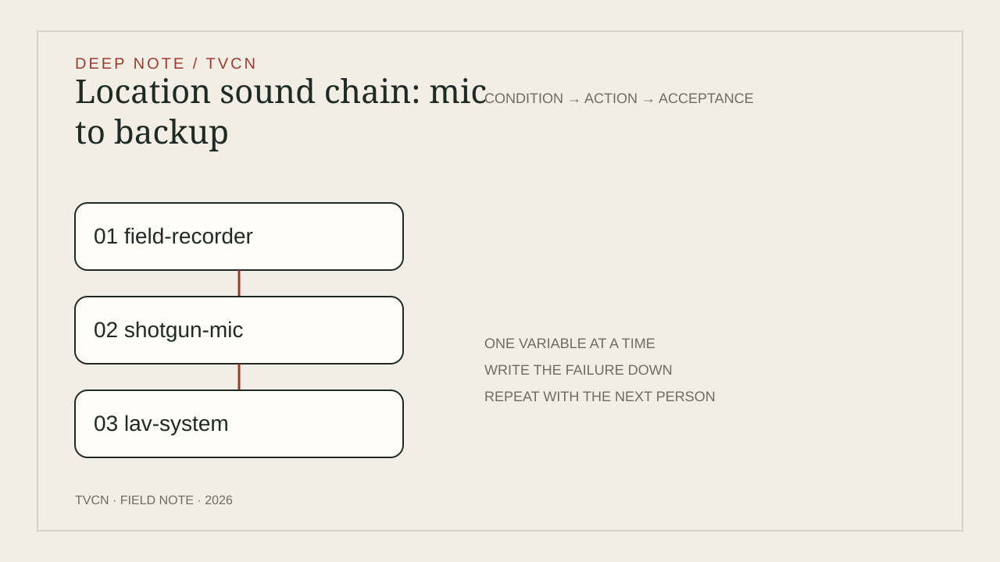

Location sound is not one microphone; it is mic, wireless, recorder, backup and log. One page of &amp;quot;Field Recorder: 32-Bit Is Not Magic&amp;quot; solves one local problem; joining &amp;quot;Field Recorder: 32-Bit Is Not Magic&amp;quot;, &amp;quot;Shotgun Mic: Point It, Get Close&amp;quot; and &amp;quot;Wireless Lav: Frequency and Backup&amp;quot; exposes the real failure: conditions are missing, too many variables move, and the result cannot be reproduced.

<!-- DEEP_DIVE_START -->
<!-- DIAGRAM_START -->
<h2>图解</h2>
<figure>
  
  <figcaption>Read &quot;Field Recorder: 32-Bit Is Not Magic&quot; and &quot;Shotgun Mic: Point It, Get Close&quot;: write the condition first, then check whether the failure can be recorded.</figcaption>
</figure>
<!-- DIAGRAM_END -->

<section><h2 id="section-1">Problem</h2>
The problem is not a lack of methods; each step works alone, but together they fail because the condition was not written, too many variables moved and the result cannot be reproduced.

The order is condition, judgement, one variable and evidence. A step is complete only when the next person can repeat it.
</section>
<section><h2 id="section-2">Judgement</h2><ul><li>First gate in &quot;Field Recorder: 32-Bit Is Not Magic&quot;: Quiet dialogue peaks near -12 dB with audible noise floor.</li><li>Second gate in &quot;Shotgun Mic: Point It, Get Close&quot;: Deliberate clipping is recovered to intelligibility in 32-bit.</li><li>Third gate in &quot;Wireless Lav: Frequency and Backup&quot;: A wind test proves float cannot rescue wind-eaten dialogue.</li></ul>
If one gate fails, return to its single page; do not hide an unsolved point inside a longer chain.
</section>
<section><h2 id="section-3">Method</h2><ol><li>Write the condition first: turn &quot;Record quiet dialogue with peaks at -12 dB.&quot; from &quot;Field Recorder: 32-Bit Is Not Magic&quot; into three rows: material, environment, acceptance.</li><li>Run one minimal action: follow &quot;Field Recorder: 32-Bit Is Not Magic&quot; for 30 seconds and do not add the second page yet.</li><li>Attach the second page: Deliberately clip once and see whether 32-bit recovers it..</li><li>Use the third page as a control: Test wind and confirm float cannot rescue it; do not treat it as insurance..</li><li>Change one variable at a time; write the other conditions down instead of remembering them.</li><li>Film the failure too: put failure and success side by side to see which step cannot be skipped.</li><li>Ask the next person to reproduce from the record; if they cannot, the record is not finished.</li></ol></section>
<section><h2 id="section-4">Field test</h2>
A reproducible test, not a client case: take 30 seconds of material, make version A using &quot;Quiet dialogue peaks near -12 dB with audible noise floor.&quot; from &quot;Field Recorder: 32-Bit Is Not Magic&quot;, then version B using &quot;Deliberate clipping is recovered to intelligibility in 32-bit.&quot; from &quot;Shotgun Mic: Point It, Get Close&quot;; only one variable may differ. Put them side by side and record what breaks first in &quot;Wireless Lav: Frequency and Backup&quot;: condition, action or acceptance. If it works on the first try, add one real constraint and run it again.
</section>
<section><h2 id="section-5">Failure table</h2>
<table class="data-table"><thead><tr><th>Symptom</th><th>Cause</th><th>Replacement action</th></tr></thead><tbody><tr><td>Do not treat 32-bit as universal insurance; it cannot save wind n…</td><td>Condition was not written</td><td>Return to page one and rewrite the three rows</td></tr><tr><td>Do not rescue a distant shotgun with noise reduction; dialogue is…</td><td>Condition was not written</td><td>Return to page one and rewrite the three rows</td></tr><tr><td>Do not record on the factory frequency; one interference hit ruin…</td><td>Condition was not written</td><td>Return to page one and rewrite the three rows</td></tr></tbody></table>
</section>
<section><h2 id="section-6">Acceptance</h2><ul><li>Quiet dialogue peaks near -12 dB with audible noise floor.</li><li>Deliberate clipping is recovered to intelligibility in 32-bit.</li><li>A wind test proves float cannot rescue wind-eaten dialogue.</li><li>One line is recorded at one, two, and three meters.</li><li>Playback reveals dialogue buried past two meters.</li><li>Shots beyond two meters have a lav or boom alternative.</li><li>A two-minute scan logs a clean frequency.</li><li>The transmitter sits at the lower back with no visible cable.</li><li>A 32-bit backup track exists and works independently.</li><li>The condition from Field Recorder: 32-Bit Is Not Magic fits on one line and can be repeated by someone else.</li></ul></section>
<section><h2 id="section-7">Alternatives</h2><ul><li>For a single-point problem in "Field Recorder: 32-Bit Is Not Magic", go back to <a href="https://tools.tvcn.org/en/article/field-recorder/">Field Recorder: 32-Bit Is Not Magic</a>; do not use the whole chain.</li><li>To compare two actions, read <a href="https://tools.tvcn.org/en/article/shotgun-mic/">Shotgun Mic: Point It, Get Close</a> and leave the third page alone.</li><li>For acceptance only, use <a href="https://tools.tvcn.org/en/article/lav-system/">Wireless Lav: Frequency and Backup</a> as a self-test sheet.</li></ul></section>

<!-- SOURCES_START -->
## References and further reading

- [S17] [Reuters Trust Principles](https://reutersagency.com/about/our-trust-principles/) — Accessed 2026-11-26. Used to check the terminology and public context in the opening paragraph (“Location sound is not one microphone; it is mic, wireless, r”) against The agency's public commitment to independence, accuracy and freedom from bias; not a substitute for an on-set test.
- [S29] [YouTube Upload Specs](https://support.google.com/youtube/answer/1722171) — Accessed 2026-11-26. Used to check the terminology and public context in the opening paragraph (“Location sound is not one microphone; it is mic, wireless, r”) against Recommended resolution, bitrate, frame rate and audio codec; not a substitute for an on-set test.
- [S23] [SMPTE Standards](https://www.smpte.org/standards) — Accessed 2026-11-26. Used to check the terminology and public context in the opening paragraph (“Location sound is not one microphone; it is mic, wireless, r”) against Entry point for timecode, color, cinema and signal-chain standards; not a substitute for an on-set test.
- [S30] [DaVinci Resolve](https://www.blackmagicdesign.com/products/davinciresolve) — Accessed 2026-11-26. Used to check the terminology and public context in the opening paragraph (“Location sound is not one microphone; it is mic, wireless, r”) against Official entry for editing, grading, Fusion and delivery; not a substitute for an on-set test.
- [S70] [FFmpeg: Documentation](https://ffmpeg.org/documentation.html) — Accessed 2026-11-26. Used to check the terminology and public context in the opening paragraph (“Location sound is not one microphone; it is mic, wireless, r”) against Codec, muxing and filter documentation; not a substitute for an on-set test.
<!-- SOURCES_END -->

