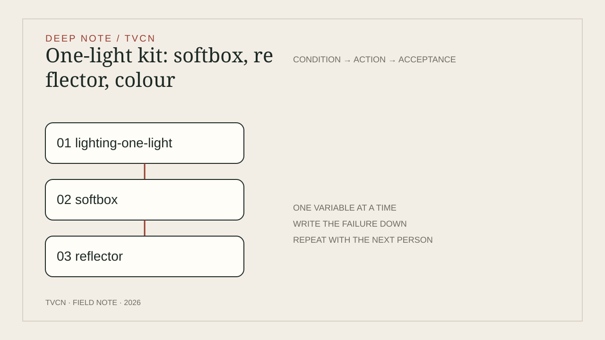

One light is enough only when soft area, bounce position and colour temperature agree. One page of &amp;quot;One-Light Portrait: Direction First&amp;quot; solves one local problem; joining &amp;quot;One-Light Portrait: Direction First&amp;quot;, &amp;quot;Softbox: Size Decides Softness&amp;quot; and &amp;quot;Reflector: Five Surfaces, One Job&amp;quot; exposes the real failure: conditions are missing, too many variables move, and the result cannot be reproduced.

<!-- DEEP_DIVE_START -->
<!-- DIAGRAM_START -->
<h2>图解</h2>
<figure>
  
  <figcaption>Read &quot;One-Light Portrait: Direction First&quot; and &quot;Softbox: Size Decides Softness&quot;: write the condition first, then check whether the failure can be recorded.</figcaption>
</figure>
<!-- DIAGRAM_END -->

<section><h2 id="section-1">Problem</h2>
The problem is not a lack of methods; each step works alone, but together they fail because the condition was not written, too many variables moved and the result cannot be reproduced.

The order is condition, judgement, one variable and evidence. A step is complete only when the next person can repeat it.
</section>
<section><h2 id="section-2">Judgement</h2><ul><li>First gate in &quot;One-Light Portrait: Direction First&quot;: The light sits at 45 degrees, one meter away, with position logged.</li><li>Second gate in &quot;Softbox: Size Decides Softness&quot;: The nose shadow clearly shows light direction.</li><li>Third gate in &quot;Reflector: Five Surfaces, One Job&quot;: Softbox size is chosen after direction is confirmed.</li></ul>
If one gate fails, return to its single page; do not hide an unsolved point inside a longer chain.
</section>
<section><h2 id="section-3">Method</h2><ol><li>Write the condition first: turn &quot;Place the light at 45 degrees, one meter from the face.&quot; from &quot;One-Light Portrait: Direction First&quot; into three rows: material, environment, acceptance.</li><li>Run one minimal action: follow &quot;One-Light Portrait: Direction First&quot; for 30 seconds and do not add the second page yet.</li><li>Attach the second page: Shoot one frame and watch the nose shadow..</li><li>Use the third page as a control: Then decide the softbox size..</li><li>Change one variable at a time; write the other conditions down instead of remembering them.</li><li>Film the failure too: put failure and success side by side to see which step cannot be skipped.</li><li>Ask the next person to reproduce from the record; if they cannot, the record is not finished.</li></ol></section>
<section><h2 id="section-4">Field test</h2>
A reproducible test, not a client case: take 30 seconds of material, make version A using &quot;The light sits at 45 degrees, one meter away, with position logge…&quot; from &quot;One-Light Portrait: Direction First&quot;, then version B using &quot;The nose shadow clearly shows light direction.&quot; from &quot;Softbox: Size Decides Softness&quot;; only one variable may differ. Put them side by side and record what breaks first in &quot;Reflector: Five Surfaces, One Job&quot;: condition, action or acceptance. If it works on the first try, add one real constraint and run it again.
</section>
<section><h2 id="section-5">Failure table</h2>
<table class="data-table"><thead><tr><th>Symptom</th><th>Cause</th><th>Replacement action</th></tr></thead><tbody><tr><td>Do not change softboxes first; without direction, every size is a…</td><td>Condition was not written</td><td>Return to page one and rewrite the three rows</td></tr><tr><td>Do not buy a pricier lamp for softness; moving the softbox closer…</td><td>Condition was not written</td><td>Return to page one and rewrite the three rows</td></tr><tr><td>Do not start with gold; warm skin is hard to pull back to neutral…</td><td>Condition was not written</td><td>Return to page one and rewrite the three rows</td></tr></tbody></table>
</section>
<section><h2 id="section-6">Acceptance</h2><ul><li>The light sits at 45 degrees, one meter away, with position logged.</li><li>The nose shadow clearly shows light direction.</li><li>Softbox size is chosen after direction is confirmed.</li><li>0.8 m and 1.5 m samples use the same light.</li><li>The closer frame has visibly softer shadow edges.</li><li>Eye-light size changes with distance and is compared.</li><li>A white-side 45-degree fill sample exists.</li><li>Silver is used only after white proves insufficient, with a comparison.</li><li>Gold is not default, or its warmth is justified.</li><li>The condition from One-Light Portrait: Direction First fits on one line and can be repeated by someone else.</li></ul></section>
<section><h2 id="section-7">Alternatives</h2><ul><li>For a single-point problem in "One-Light Portrait: Direction First", go back to <a href="https://tools.tvcn.org/en/article/lighting-one-light/">One-Light Portrait: Direction First</a>; do not use the whole chain.</li><li>To compare two actions, read <a href="https://tools.tvcn.org/en/article/softbox/">Softbox: Size Decides Softness</a> and leave the third page alone.</li><li>For acceptance only, use <a href="https://tools.tvcn.org/en/article/reflector/">Reflector: Five Surfaces, One Job</a> as a self-test sheet.</li></ul></section>

<!-- SOURCES_START -->
## References and further reading

- [S31] [ARRI: Cine Systems](https://www.arri.com/en/cine-systems) — Accessed 2026-11-26. Used to check the terminology/method/rule in the “Problem” section against ARRI camera, lens and lighting documentation, not a general shooting tutorial; it does not verify numbers, model choices or on-set conclusions derived from this page, and is not a substitute for a test.
- [S23] [SMPTE: Standards](https://www.smpte.org/standards) — Accessed 2026-11-26. Used to check the terminology/method/rule in the “Judgement” section against SMPTE standards portal, not specific camera specs; it does not verify numbers, model choices or on-set conclusions derived from this page, and is not a substitute for a test.
<!-- SOURCES_END -->

