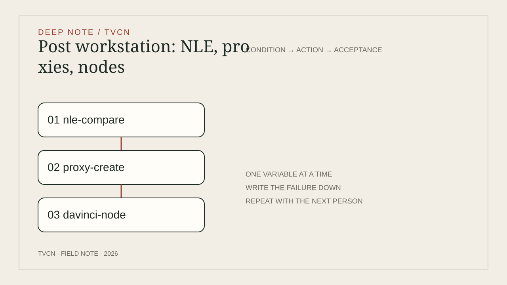

A workstation is not a spec sheet; NLE, proxies, cache and nodes must not fight in one project. One page of &amp;quot;Choosing an NLE: Start With the Project&amp;quot; solves one local problem; joining &amp;quot;Choosing an NLE: Start With the Project&amp;quot;, &amp;quot;Proxy Creation: Match the Timeline&amp;quot; and &amp;quot;DaVinci Nodes: Nodes Are Not Filters&amp;quot; exposes the real failure: conditions are missing, too many variables move, and the result cannot be reproduced.

<!-- DEEP_DIVE_START -->
<!-- DIAGRAM_START -->
<h2>图解</h2>
<figure>
  
  <figcaption>Read &quot;Choosing an NLE: Start With the Project&quot; and &quot;Proxy Creation: Match the Timeline&quot;: write the condition first, then check whether the failure can be recorded.</figcaption>
</figure>
<!-- DIAGRAM_END -->

<section><h2 id="section-1">Problem</h2>
The problem is not a lack of methods; each step works alone, but together they fail because the condition was not written, too many variables moved and the result cannot be reproduced.

The order is condition, judgement, one variable and evidence. A step is complete only when the next person can repeat it.
</section>
<section><h2 id="section-2">Judgement</h2><ul><li>First gate in &quot;Choosing an NLE: Start With the Project&quot;: One minute is cut in three apps from the same footage.</li><li>Second gate in &quot;Proxy Creation: Match the Timeline&quot;: Proxies, collaboration, subtitles, and export are compared.</li><li>Third gate in &quot;DaVinci Nodes: Nodes Are Not Filters&quot;: The choice follows the project&#x27;s weakest need, not popularity.</li></ul>
If one gate fails, return to its single page; do not hide an unsolved point inside a longer chain.
</section>
<section><h2 id="section-3">Method</h2><ol><li>Write the condition first: turn &quot;Cut one minute of the same footage in three apps.&quot; from &quot;Choosing an NLE: Start With the Project&quot; into three rows: material, environment, acceptance.</li><li>Run one minimal action: follow &quot;Choosing an NLE: Start With the Project&quot; for 30 seconds and do not add the second page yet.</li><li>Attach the second page: Compare proxies, collaboration, subtitles, and export..</li><li>Use the third page as a control: Decide by the project&#x27;s weakest requirement..</li><li>Change one variable at a time; write the other conditions down instead of remembering them.</li><li>Film the failure too: put failure and success side by side to see which step cannot be skipped.</li><li>Ask the next person to reproduce from the record; if they cannot, the record is not finished.</li></ol></section>
<section><h2 id="section-4">Field test</h2>
A reproducible test, not a client case: take 30 seconds of material, make version A using &quot;One minute is cut in three apps from the same footage.&quot; from &quot;Choosing an NLE: Start With the Project&quot;, then version B using &quot;Proxies, collaboration, subtitles, and export are compared.&quot; from &quot;Proxy Creation: Match the Timeline&quot;; only one variable may differ. Put them side by side and record what breaks first in &quot;DaVinci Nodes: Nodes Are Not Filters&quot;: condition, action or acceptance. If it works on the first try, add one real constraint and run it again.
</section>
<section><h2 id="section-5">Failure table</h2>
<table class="data-table"><thead><tr><th>Symptom</th><th>Cause</th><th>Replacement action</th></tr></thead><tbody><tr><td>Do not choose by tutorial volume; if the project lacks collaborat…</td><td>Condition was not written</td><td>Return to page one and rewrite the three rows</td></tr><tr><td>Do not export from proxies; relinking to originals shifts every s…</td><td>Condition was not written</td><td>Return to page one and rewrite the three rows</td></tr><tr><td>Do not stack twenty nodes; when something breaks, you cannot tell…</td><td>Condition was not written</td><td>Return to page one and rewrite the three rows</td></tr></tbody></table>
</section>
<section><h2 id="section-6">Acceptance</h2><ul><li>One minute is cut in three apps from the same footage.</li><li>Proxies, collaboration, subtitles, and export are compared.</li><li>The choice follows the project&#x27;s weakest need, not popularity.</li><li>Proxies are quarter-resolution ProRes Proxy on a separate SSD.</li><li>Timeline and proxy names map back to originals.</li><li>After relink, timecode and framing match the proxy cut.</li><li>Five nodes each do one job with clear names.</li><li>Toggling each shows its specific change.</li><li>No more than ten nodes, and problems map to one node.</li><li>The condition from Choosing an NLE: Start With the Project fits on one line and can be repeated by someone else.</li></ul></section>
<section><h2 id="section-7">Alternatives</h2><ul><li>For a single-point problem in "Choosing an NLE: Start With the Project", go back to <a href="https://tools.tvcn.org/en/article/nle-compare/">Choosing an NLE: Start With the Project</a>; do not use the whole chain.</li><li>To compare two actions, read <a href="https://tools.tvcn.org/en/article/proxy-create/">Proxy Creation: Match the Timeline</a> and leave the third page alone.</li><li>For acceptance only, use <a href="https://tools.tvcn.org/en/article/davinci-node/">DaVinci Nodes: Nodes Are Not Filters</a> as a self-test sheet.</li></ul></section>

<!-- SOURCES_START -->
## References and further reading

- [S19] [Generative Adversarial Nets (2014)](https://arxiv.org/abs/1406.2661) — Accessed 2026-11-26. Used to check the terminology and public context in the opening paragraph (“A workstation is not a spec sheet; NLE, proxies, cache and n”) against The original GAN paper: a generator and discriminator trained against each other; not a substitute for an on-set test.
- [S29] [YouTube Upload Specs](https://support.google.com/youtube/answer/1722171) — Accessed 2026-11-26. Used to check the terminology and public context in the opening paragraph (“A workstation is not a spec sheet; NLE, proxies, cache and n”) against Recommended resolution, bitrate, frame rate and audio codec; not a substitute for an on-set test.
- [S23] [SMPTE Standards](https://www.smpte.org/standards) — Accessed 2026-11-26. Used to check the terminology and public context in the opening paragraph (“A workstation is not a spec sheet; NLE, proxies, cache and n”) against Entry point for timecode, color, cinema and signal-chain standards; not a substitute for an on-set test.
- [S30] [DaVinci Resolve](https://www.blackmagicdesign.com/products/davinciresolve) — Accessed 2026-11-26. Used to check the terminology and public context in the opening paragraph (“A workstation is not a spec sheet; NLE, proxies, cache and n”) against Official entry for editing, grading, Fusion and delivery; not a substitute for an on-set test.
- [S70] [FFmpeg: Documentation](https://ffmpeg.org/documentation.html) — Accessed 2026-11-26. Used to check the terminology and public context in the opening paragraph (“A workstation is not a spec sheet; NLE, proxies, cache and n”) against Codec, muxing and filter documentation; not a substitute for an on-set test.
<!-- SOURCES_END -->

