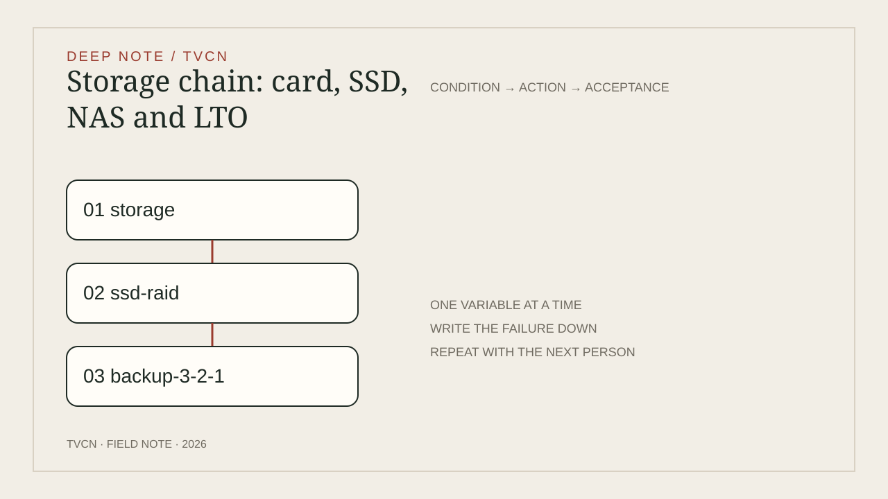

Storage is not one drive; it is a chain from card to work disk, backup and offline media. One page of &amp;quot;storage&amp;quot; solves one local problem; joining &amp;quot;storage&amp;quot;, &amp;quot;SSD RAID: Edit Array, Not Archive&amp;quot; and &amp;quot;3-2-1 Backup: Finish It Today&amp;quot; exposes the real failure: conditions are missing, too many variables move, and the result cannot be reproduced.

<!-- DEEP_DIVE_START -->
<!-- DIAGRAM_START -->
<h2>图解</h2>
<figure>
  
  <figcaption>Read &quot;storage&quot; and &quot;SSD RAID: Edit Array, Not Archive&quot;: write the condition first, then check whether the failure can be recorded.</figcaption>
</figure>
<!-- DIAGRAM_END -->

<section><h2 id="section-1">Problem</h2>
The problem is not a lack of methods; each step works alone, but together they fail because the condition was not written, too many variables moved and the result cannot be reproduced.

The order is condition, judgement, one variable and evidence. A step is complete only when the next person can repeat it.
</section>
<section><h2 id="section-2">Judgement</h2><ul><li>First gate in &quot;storage&quot;: RAID 0 holds working media only and originals are backed up elsewhere.</li><li>Second gate in &quot;SSD RAID: Edit Array, Not Archive&quot;: A RAID 1 or NAS backup job runs.</li><li>Third gate in &quot;3-2-1 Backup: Finish It Today&quot;: A full-drive test logs the write-speed drop.</li></ul>
If one gate fails, return to its single page; do not hide an unsolved point inside a longer chain.
</section>
<section><h2 id="section-3">Method</h2><ol><li>Write the condition first: turn &quot;Build RAID 0 for working media only.&quot; from &quot;storage&quot; into three rows: material, environment, acceptance.</li><li>Run one minimal action: follow &quot;storage&quot; for 30 seconds and do not add the second page yet.</li><li>Attach the second page: Set RAID 1 or NAS for backup..</li><li>Use the third page as a control: Fill the drive and measure the speed drop..</li><li>Change one variable at a time; write the other conditions down instead of remembering them.</li><li>Film the failure too: put failure and success side by side to see which step cannot be skipped.</li><li>Ask the next person to reproduce from the record; if they cannot, the record is not finished.</li></ol></section>
<section><h2 id="section-4">Field test</h2>
A reproducible test, not a client case: take 30 seconds of material, make version A using &quot;RAID 0 holds working media only and originals are backed up elsew…&quot; from &quot;storage&quot;, then version B using &quot;A RAID 1 or NAS backup job runs.&quot; from &quot;SSD RAID: Edit Array, Not Archive&quot;; only one variable may differ. Put them side by side and record what breaks first in &quot;3-2-1 Backup: Finish It Today&quot;: condition, action or acceptance. If it works on the first try, add one real constraint and run it again.
</section>
<section><h2 id="section-5">Failure table</h2>
<table class="data-table"><thead><tr><th>Symptom</th><th>Cause</th><th>Replacement action</th></tr></thead><tbody><tr><td>Do not make RAID 0 the only storage; one drive failure takes all …</td><td>Condition was not written</td><td>Return to page one and rewrite the three rows</td></tr><tr><td>Do not plan to back up tomorrow; if the card is lost, three copie…</td><td>Condition was not written</td><td>Return to page one and rewrite the three rows</td></tr><tr><td>Only the result is kept, not the condition</td><td>Condition was not written</td><td>Return to page one and rewrite the three rows</td></tr></tbody></table>
</section>
<section><h2 id="section-6">Acceptance</h2><ul><li>RAID 0 holds working media only and originals are backed up elsewhere.</li><li>A RAID 1 or NAS backup job runs.</li><li>A full-drive test logs the write-speed drop.</li><li>Three copies complete the same day with matching file counts.</li><li>Two media types are used, one offsite or cloud.</li><li>The card is formatted only after all three are confirmed.</li><li>Confirm the card plays back before copying</li><li>Copy to the first working drive</li><li>Verify file count and decode with a checksum tool</li><li>Rename date_project_camera_card</li></ul></section>
<section><h2 id="section-7">Alternatives</h2><ul><li>For a single-point problem in "storage", go back to <a href="https://tools.tvcn.org/en/article/storage/">storage</a>; do not use the whole chain.</li><li>To compare two actions, read <a href="https://tools.tvcn.org/en/article/ssd-raid/">SSD RAID: Edit Array, Not Archive</a> and leave the third page alone.</li><li>For acceptance only, use <a href="https://tools.tvcn.org/en/article/backup-3-2-1/">3-2-1 Backup: Finish It Today</a> as a self-test sheet.</li></ul></section>

<!-- SOURCES_START -->
## References and further reading

- [S17] [Reuters Trust Principles](https://reutersagency.com/about/our-trust-principles/) — Accessed 2026-11-26. Used to check the terminology and public context in the opening paragraph (“Storage is not one drive; it is a chain from card to work di”) against The agency's public commitment to independence, accuracy and freedom from bias; not a substitute for an on-set test.
- [S29] [YouTube Upload Specs](https://support.google.com/youtube/answer/1722171) — Accessed 2026-11-26. Used to check the terminology and public context in the opening paragraph (“Storage is not one drive; it is a chain from card to work di”) against Recommended resolution, bitrate, frame rate and audio codec; not a substitute for an on-set test.
- [S23] [SMPTE Standards](https://www.smpte.org/standards) — Accessed 2026-11-26. Used to check the terminology and public context in the opening paragraph (“Storage is not one drive; it is a chain from card to work di”) against Entry point for timecode, color, cinema and signal-chain standards; not a substitute for an on-set test.
- [S30] [DaVinci Resolve](https://www.blackmagicdesign.com/products/davinciresolve) — Accessed 2026-11-26. Used to check the terminology and public context in the opening paragraph (“Storage is not one drive; it is a chain from card to work di”) against Official entry for editing, grading, Fusion and delivery; not a substitute for an on-set test.
- [S70] [FFmpeg: Documentation](https://ffmpeg.org/documentation.html) — Accessed 2026-11-26. Used to check the terminology and public context in the opening paragraph (“Storage is not one drive; it is a chain from card to work di”) against Codec, muxing and filter documentation; not a substitute for an on-set test.
<!-- SOURCES_END -->

