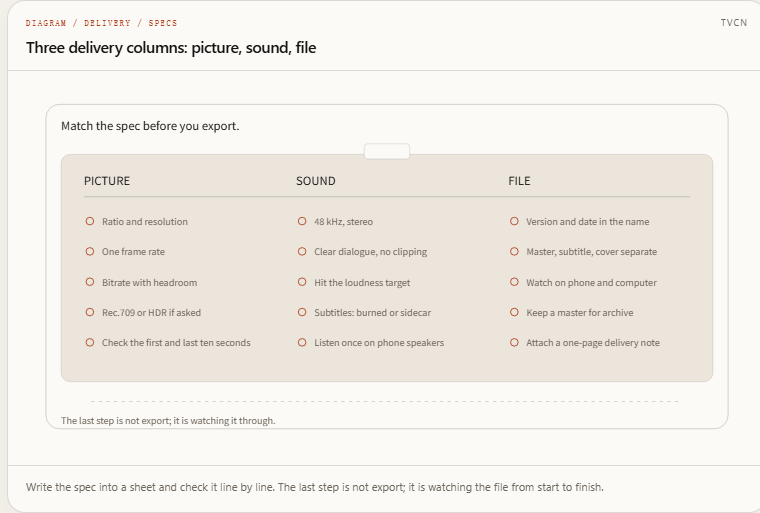

<!-- DIAGRAM_START -->
## Diagram

<figure>
  
  <figcaption>Write the spec into a sheet and check it line by line. The last step is not export; it is watching the file from start to finish.</figcaption>
</figure>
<!-- DIAGRAM_END -->

## Get the spec before you export

Ask about four destinations: the platform, the client, a cinema or event, and your own archive. Each wants different things: ratio, resolution, frame rate, codec, bitrate, color, audio channels, subtitles, filename.

Write them into one sheet. Do not keep it in your head. Platform notes change; old tutorials do not remind you. If the client says “whatever,” write down a default and have them confirm it. Do not guess.

## Picture: size, frame rate, bitrate

Deliver the resolution you shot, not a 1080p file forced into 4K. Keep one frame rate for the whole film; 23.976, 25, and 29.97 each have uses, but mixing them makes the opening stutter.

Favor compatibility: H.264 plays almost everywhere, H.265 is smaller but some older devices choke, ProRes is right for archive and regrading. Do not use the lowest bitrate. The platform will compress it again; give it too little and shadows and motion go first.

Color follows the destination. Most web platforms want Rec.709 SDR. Do not label an SDR grade as HDR. Check the scopes before export: are the blacks and whites crushed?

## Sound and subtitles: do not let the ear take the blame

Use 48 kHz audio and the channel layout the platform asks for: stereo is the safe default; 5.1 only when someone explicitly needs it. Dialogue must be clear and music must not eat the words. Hit the platform's loudness target; if there is none, avoid clipping and avoid level jumps.

Subtitles come in two forms: burned-in and sidecar. Deliver the one they asked for, not both. For sidecar, check encoding, timing, and punctuation. For burned-in, check the safe area so the platform UI does not cover the words.

## Play the file from start to finish

Do not trust the progress bar. Watch on a phone, on a computer, and on a TV if you can. Listen to the first ten seconds, the last ten, and every transition. Confirm sync, and confirm subtitles are neither early nor late.

Name the file with project, version, date, and resolution, like “project_v3_20261120_1080p.” Send a short note: which file is the master, which is the subtitle, which is the cover. Do not dump ten files into a zip and call it delivery.

## Checks

- Does the spec sheet list ratio, resolution, frame rate, codec, bitrate, color, audio, and subtitles?
- Is the frame rate consistent, with no 1080p file forced into 4K?
- Have you watched the whole file on a phone and a computer, with sync and subtitles correct?
- Can the client find the master from the filename and delivery note?

<!-- DEEP_DIVE_START -->
## Deep dive

<strong>About 7 minutes.</strong> Delivery is not exporting a file. It is making the film open on the right device, at the right spec, for the right person.

### Ask where it goes before asking what spec

One film has four destinations: platform, client, cinema or event, and your archive. Each needs something different: the platform needs ratio, bitrate, subtitles; the client needs a downloadable master and cover; cinema needs a DCP or high-bitrate ProRes; the archive needs something you can grade again.

Do not make one file serve all four. Make a destination-spec-owner table, one row per destination. If the client says “whatever,” write your default spec and get confirmation. Confirmed text is more reliable than memory and cheaper than an argument later.

### Seven specs, none guessed

Write all seven: ratio, resolution, frame rate, codec, bitrate, color, audio channels. Ratio includes the platform safe area, not just 16:9. Resolution matches what you shot and deliver; do not stretch 1080p into 4K. One frame rate for the whole film; mixed rates make the opening stutter.

Favor compatibility: H.264 is safest, H.265 is smaller but older devices may refuse it, ProRes is for archive and regrading. Do not use the lowest bitrate; the platform compresses again, and shadows and motion fail first. Color follows the target: most online platforms want Rec.709 SDR; do not label an SDR film as HDR.

### Filenames and versions that survive three months

A filename states four things: project, version, date, spec. Example: “riverside_v3_20261120_1080p_zh-sub.” Never “final,” “final2,” “really final.” Version numbers only increase and do not need explanation. Master, subtitles, and covers share a prefix so they pair at a glance.

Name the folders too: 01_master, 02_subs, 03_covers, 04_vertical. The client does not need to understand your edit project, but must know what to open first. The filename is not for you; it is for whoever inherits the project in three months, possibly the client, possibly you.

### Sound and subtitles: do not make the ears pay for the picture

Use 48 kHz audio. Channels follow the platform: stereo is the safe default; 5.1 only when explicitly requested. Dialogue must be clear and music must not cover words. Hit the platform loudness target; if none, at least avoid clipping and level jumps. Before export, listen to the first ten seconds, the last ten, and every transition.

Subtitles are either burned in or sidecar; deliver the one requested, not both. For sidecar, check encoding, timing, and punctuation. For burned-in, check the safe area so platform UI does not cover them. Subtitles are not decoration; they are a second audio track that must tell the story when dialogue is unclear.

### Before delivery, play it on three devices

Do not trust the progress bar. Play it on a phone, a computer, and a TV if possible. Check audio-video sync, subtitle lead or lag, crushed blacks, clipped highlights. Phone speakers expose unclear dialogue; a TV exposes compression blocks.

Write problems down: timecode, device, symptom. Fix what you can; document what you cannot. Delivery is not “the file is sent.” It is “what they see when they open it is what you saw.”

### The delivery package and receipt

The package contains only what the recipient needs now: master, subtitles, covers, vertical cuts, and a readme. The readme states what each file is, which is the master, how to load subtitles, and the cover ratio. Do not include project files, raw footage, and old versions; that is moving house, not delivery.

Ask for a receipt: can they open it, is there sound, do subtitles match? No receipt means no delivery. A receipt is not politeness; it is the last acceptance step that turns “I thought” into “confirmed.”

### Ten delivery checks
<ul><li>One row per destination</li><li>Ratio, resolution, frame rate stated</li><li>Codec and bitrate stated</li><li>Color labeled Rec.709 or HDR</li><li>Channels and loudness stated</li><li>Filename has project, version, date, spec</li><li>One subtitle type, not both</li><li>Played on phone, computer, TV</li><li>Package contains only what is needed now</li><li>Delivery is done only after a receipt</li></ul>
Delivery does not end when the file uploads. It ends when the other person opens it and sees the film you saw.

<!-- DEEP_DIVE_END -->
