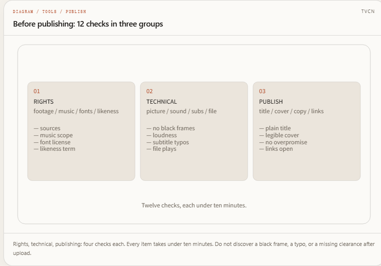

<!-- DIAGRAM_START -->
## Diagram

<figure>
  
  <figcaption>Rights, technical, publishing: four checks each. Every item takes under ten minutes. Do not discover a black frame, a typo, or a missing clearance after upload.</figcaption>
</figure>
<!-- DIAGRAM_END -->

## Check rights first

Music, fonts, likeness, location, and AI disclosure: five separate checks. A platform music library is not a commercial license; a verbal yes is not a likeness release.

Keep the paperwork in one folder named for the project and date. If a complaint arrives after publishing, you can find it in ten minutes instead of pulling the whole film.

## Then check the file

Ratio, bitrate, loudness, subtitles, black frames, and file name. Watch the film from start to finish, not on the timeline; the timeline will not tell you the dialogue is muddy on a phone speaker.

Proofread subtitles by reading them aloud, not just scanning the screen. Check names, numbers, and place names separately; those are the three most common mistakes.

## Finally, check the publishing

Title, cover, platform rules, backup, and schedule. Can you see the face at thumbnail size? Does the title promise something the film does not deliver?

Do not close the laptop right after uploading. Open it on your phone once, confirm ratio, subtitles, and sound, then shut down.

## Three checks

- All five permissions can be found within ten minutes.
- The film has been watched once on a phone speaker.
- The subject reads at thumbnail size.

<!-- DEEP_DIVE_START -->
## Deep dive

<strong>About 6 minutes.</strong> Publishing is not pressing upload. It is closing rights, subtitles, cover, backup, and version on the same day.

### Clear rights first

Check music, fonts, footage, likeness, and location one by one. If there is no written permission, do not use it. Free download does not mean commercial use.

Label AI-generated material and read both platform rules and local law; do not trust a single tutorial.

Keep the permission files in the project archive, named by asset and expiry. Someone will ask again in six months.

### Technical delivery

Play the export yourself: opening, ending, subtitles, sound, black frames. Do not trust the progress bar. Name the file with date, project, version, platform.

One wrong subtitle character is remembered; one wrong cover ratio is cropped by the platform.

Use the platform’s current bitrate, resolution, and loudness spec, not a blog post from three years ago; platforms change requirements.

### The first 24 hours

Check for platform compression, cropping, and lip-sync drift first, then read comments for misunderstanding. Log the issues for the next version.

Back up the original project and export. Do not overwrite the published version; keep a read-only archive.

Write the actual spec into the project README so the next release does not start from trial and error.

### One page before publishing

Put platform, resolution, bitrate, loudness, cover ratio, and subtitle language on one sheet and tick each item at release.

Archive the sheet after publishing; the next release on the same platform starts from it instead of trial and error.

When the platform changes a spec, change the sheet first, then the export preset. Do not fix one file and forget the next.

### Ten checks before publishing
<ul><li>Written permission for music, fonts, footage</li><li>Likeness and location releases complete</li><li>AI material labeled</li><li>Subtitles proofread character by character</li><li>Opening and ending complete</li><li>Loudness and bitrate match the platform</li><li>Cover survives all three ratios</li><li>Filename has date, project, version, platform</li><li>Project and export backed up</li><li>Published version kept read-only</li></ul>
Publishing is not the end; it turns this version into the foundation for the next.

<!-- DEEP_DIVE_END -->

<section><h2>Boundary</h2>
This page only covers “Twelve Checks Before Publishing: Do Not Lose the Last Hour”; it does not replace Reflector: Five Surfaces, One Job, Renting a Camera: Insurance, Deposit, Check, Composition: Tell the Eye Where to Look. When the problem belongs to one of those pages, use that page instead of adding more parameters here.
</section>
<!-- SOURCES_START -->
## References and further reading

- [S29] [YouTube: Upload Encoding Specs](https://support.google.com/youtube/answer/1722171) — Accessed 2026-11-26. Used to check the terminology/method/rule in the “Check rights first” section against YouTube upload encoding recommendations, not creative standards; it does not verify numbers, model choices or on-set conclusions derived from this page, and is not a substitute for a test.
- [S28] [Netflix: Partner Help](https://partnerhelp.netflixstudios.com/) — Accessed 2026-11-26. Used to check the terminology/method/rule in the “Then check the file” section against Netflix delivery help, not general platform rules; it does not verify numbers, model choices or on-set conclusions derived from this page, and is not a substitute for a test.
<!-- SOURCES_END -->

