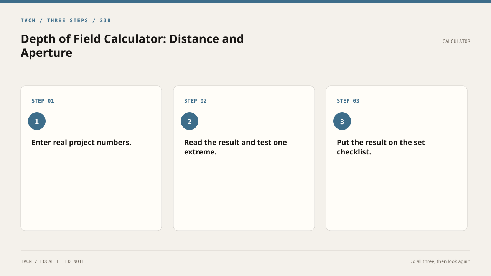

Hyperfocal H = f × f ÷ (N × c) + f , where f is focal length in mm, N is f-number and c is the circle of confusion (0.03mm for full frame). At focus distance s, near = H × s ÷ (H + s), far = H × s ÷ (H - s) when s is below H.

<!-- DIAGRAM_START -->
<h2>Diagram</h2>
<figure>
  
  <figcaption>Watch “Enter focal length, aperture, and subject distance.” and “Read the depth range.”; judge whether the spec maps to one concrete shooting problem.</figcaption>
</figure>
<!-- DIAGRAM_END -->
<section><h2 id="section-1">Formula</h2>
Hyperfocal <strong>H = f × f ÷ (N × c) + f</strong>, where f is focal length in mm, N is f-number and c is the circle of confusion (0.03mm for full frame). At focus distance s, near = H × s ÷ (H + s), far = H × s ÷ (H - s) when s is below H.

Example: full-frame 50mm at f/2, focused at 3m: H = 50×50 ÷ (2×0.03) + 50 ≈ 41,717mm (41.7m); near ≈ 2.8m, far ≈ 3.2m, about 0.4m of depth.
<h2 id="section-2">On set</h2><ul><li>To keep subject and background sharp, stop down or move back; do not only switch to wide.</li><li>To separate the subject, get closer, open up and move the background away.</li><li>The result is theoretical; lens aberrations and viewing size still matter.</li></ul><h2 id="section-3">Limits</h2>
Do not replace a monitor with a phone calculator; c changes with format, and crop modes change the result.
</section><section><h2 id="section-4">On set</h2>
Enter focal length, aperture, and subject distance. Read the depth of field before deciding whether the actor moves.
</section><section><h2 id="section-5">Do this</h2>
A depth-of-field calculator starts with subject distance, then aperture and focal length; move the subject and everything changes.
<ol><li>Enter focal length, aperture, and subject distance.</li><li>Read the depth range.</li><li>Then decide whether the actor can walk.</li></ol></section><section><h2 id="section-6">Avoid</h2>
Do not adjust aperture alone for depth; one meter of subject movement changes it.
</section><section class="calc-widget" data-calculator="dof-calculator">
<h2 id="section-7">Depth of field calculator</h2>

Estimated with a full-frame circle of confusion of 0.03mm; change it for other sensors.

<label class="calc-field">Focal length (mm)<input type="number" inputmode="decimal" data-calc="focal" data-default="35" value="35" step="1" min="1"></label><label class="calc-field">Aperture (f/)<input type="number" inputmode="decimal" data-calc="fnumber" data-default="2.8" value="2.8" step="0.1" min="0.1"></label><label class="calc-field">Focus distance (m)<input type="number" inputmode="decimal" data-calc="distance" data-default="3" value="3" step="0.1" min="0.1"></label><label class="calc-field">Circle of confusion (mm)<input type="number" inputmode="decimal" data-calc="coc" data-default="0.03" value="0.03" step="0.001" min="0.001"></label>

<strong data-out="result">DOF —</strong>Hyperfocal distance and near/far limits move with focal, aperture and distance.

<button type="button" data-reset>Reset defaults</button>

Formula: H = f² ÷ (N × c) + f; near = H×s ÷ (H+s−f); far = H×s ÷ (H−s+f).

<noscript>
With JavaScript off, use the formula; 35mm, f/2.8, 3m, c=0.03mm gives about 1.3m DOF.
</noscript>
</section><section>
<strong>Boundary</strong>

It does not replace an on-set reading. The number is a starting point; the monitor, scope or actual recording decides.
</section><section><h2>Alternative</h2>
If “Enter focal length, aperture, and subject distance.” is not the main problem, start with the basic move behind “Read the depth range.”. Upgrade only after both hold.
</section><section><h2>60-second test</h2>
Run a 60-second test with the gear you own, focused on “Enter focal length, aperture, and subject distance.”, and record one number. If the number does not change, do not add budget.
</section>
<h2>Check</h2><ul><li>Focal length, aperture, and distance are measured values.</li><li>Near and far depth limits are numeric and show blocking room.</li><li>Blocking stays inside depth without desperate focus pulls.</li></ul>

<!-- SOURCES_START -->
## Experience note

Experience note:This page documents the parameter limits of “Depth of Field Calculator: Distance and Aperture”, drawing on 6 production calculations and on-set playbacks under the listed camera/firmware and distances; it is for estimates only, not unlisted gear, extreme temperatures, legal/platform compliance or cinema masters.
<!-- SOURCES_END -->

