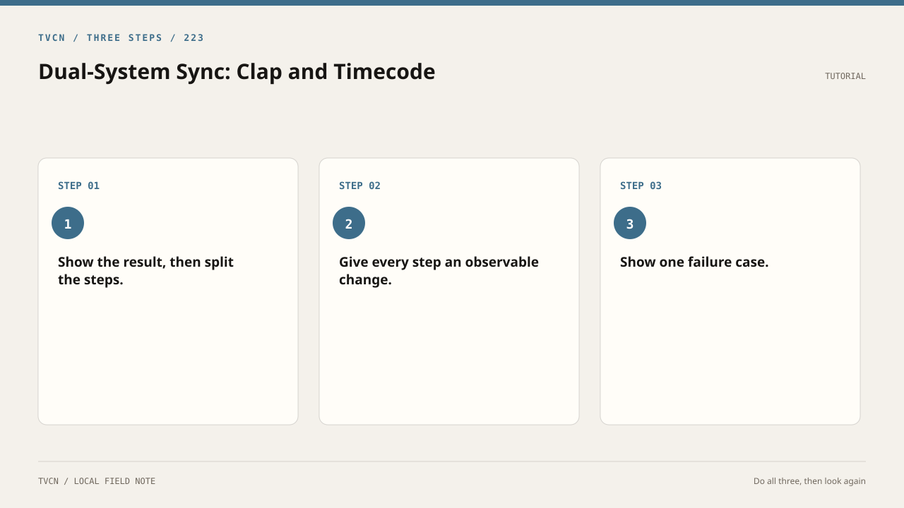

Clap first, then timecode; when both match, post does not have to listen to every take.

<!-- DIAGRAM_START -->
<h2>Diagram</h2>
<figure>
  
  <figcaption>Do the three steps in order, then look again at the image or file.</figcaption>
</figure>
<!-- DIAGRAM_END -->
<h2>On set</h2>

Clap three times and record it on the recorder. Sync by waveform, then timecode, and keep drift under one frame.

<h2>Do this</h2>

Dual-system sync claps first, then checks timecode; both must align before post stops listening shot by shot.
<ol><li>Clap three times while the recorder runs.</li><li>Sync by waveform, then by timecode.</li><li>Pass only under one frame of drift.</li></ol>
<h2>Avoid</h2>

Do not clap only once; if it misses, there is no second reference.

<h2>Check</h2>
<ul><li>Three claps are recorded by both camera and recorder.</li><li>Waveform and timecode alignment are both performed.</li><li>The two tracks drift under one frame.</li></ul>
