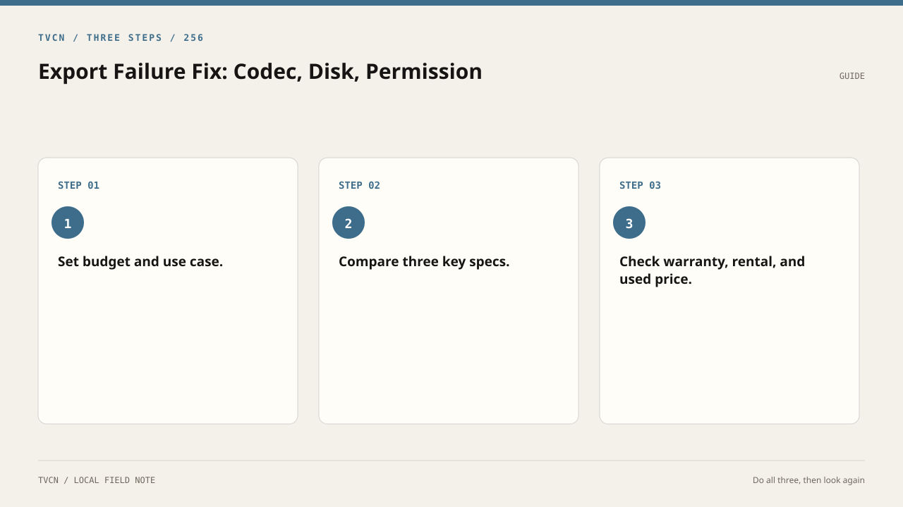

Check in order: bad frames or offline media, disk space, codec support, special characters in the filename, hardware acceleration. Change one variable and log the result.

<!-- DIAGRAM_START -->
<h2>Diagram</h2>
<figure>
  
  <figcaption>Watch “Read the exact error and note the time” and “Failure at the start points to codec, path,”; judge whether the spec maps to one concrete shooting problem.</figcaption>
</figure>
<!-- DIAGRAM_END -->
<section><h2 id="section-1">Find the failing step before reinstalling</h2>
Copy the project, export to a local disk with a short filename. If it passes, the issue is path or permission, not the project.
<h2 id="section-2">Limits</h2>
A successful export is not a correct file. Open the result and play three points for black frames, freezes, audio dropouts and captions; a finished progress bar is not enough.
</section><section><h2 id="section-3">On set</h2>
Check the codec, disk space, permissions, and fonts. Change the output path, rebuild the project, and eliminate one item at a time.
</section><section><h2 id="section-4">Do this</h2>
Export failure: classify it as codec, disk, permission, media, or resources. Change one variable at a time.
<ol><li>Read the exact error and note the time and percentage where it fails.</li><li>Failure at the start points to codec, path, or permissions; failure at a fixed point points to media or fonts.</li><li>Use a short English path, keep twice the space, and export in sections.</li></ol></section><section><h2 id="section-5">Avoid</h2>
Do not reinstall the software on the first failure; locate the variable first.
</section><aside class="regional-note">
<strong>Regional note for US / UK / EU readers</strong>

This English page keeps mainland-China examples where they are part of the method. Read platform names as examples, not as the only market: Douyin ↔ TikTok/Reels, Bilibili ↔ YouTube, Xiaohongshu ↔ Instagram/Pinterest; RMB figures are not converted here. Voltage, plug, warranty, import duty and radio certification differ by market; check the local spec sheet before ordering gear or batteries.
</aside><section><h2>Judge</h2>
Three signals are observable on set:
<ul><li>every spec maps to one concrete shooting problem</li><li>weight, power and connections hold on a real rig</li><li>a 60-second test leaves one comparable number</li></ul></section><section><h2>Failures</h2>
These three moves erase the detail you just built:
<ul><li>specs without connections, power or weight</li><li>batteries, storage or body do not match after purchase</li><li>no 60-second test, so the problem arrives on the shoot</li></ul></section><section><h2>Extend</h2>
<strong>10-minute exercise:</strong> Run a 60-second test with the gear you already own, measuring only “Read the exact error and note the time”. Record two numbers: what you need and what the gear actually gives.
</section>
<h2>Check</h2><ul><li>The exact error and failure point are recorded.</li><li>Codec, path, permissions, media, and fonts were checked as categories.</li><li>A short English path, twice the space, and sectioned export were tested.</li></ul>

<!-- DEEP_DIVE_START -->
## Deep dive

<strong>About 7 minutes.</strong> A failed export is not broken software. One variable does not match. Classify first, eliminate one by one; reinstalling is always the last step.

### Classify: codec, disk, permission, media, resources

Read the error, not just “export failed.” Unsupported codec, no disk space, no write permission, corrupted media, exhausted memory or GPU: five categories, five fixes. First decide whether it fails at the start or at a specific point.

Failure at the start usually means codec settings, output path, or permission. Failure at a fixed time usually means one frame of media, a transition, or a font. Failure at 99% usually means disk space, a file-size limit, or container issue. Note the failure time; it is more useful than pressing retry.

### Codec and media: transcode to something editable

Variable-frame-rate phone footage, screen recordings, alpha animation, and HDR clips can crash an export at one frame. Transcode to constant-frame-rate ProRes or DNxHR intermediates and replace the clips on the timeline; do not keep changing settings on the original.

If only one clip is bad, export or preview it alone. Once confirmed, transcode it, relink it, or use a nearby alternate. Do not rerun a twenty-minute film for one three-second clip.

### Disk, path, filename

Check free space on the output disk; leave at least twice the estimated file size. Do not write a long 4K film to FAT32; the 4 GB per-file limit fails at the end. Avoid symbols, emoji, and very long Chinese names in the path. Test with a short English path on the desktop first, then move to the target drive.

Cloud sync folders lock files: OneDrive, iCloud, and Dropbox can hold a file mid-export. Pause sync on the output folder or write to a local, non-synced disk. Same for permissions: do not write to the system root or a company share without write access.

### Fonts, plugins, cache, GPU

A missing font does not always fail at the start; it often fails when the render reaches subtitles. Convert text to outlines or install the exact font; do not gamble on font substitution. A plugin that does not match the app version can fail at one effect. Disable that effect, export, then re-enable in sections.

Cache and GPU are another category: clear media cache, disable GPU acceleration, switch to the software encoder. Do not change five things at once; change one, confirm, then add back. You are looking for the variable, not a magic settings combination.

### Split exports and alternate paths

If the whole timeline fails, split it into three sections, export each, and join losslessly. This is not cheating; it is locating the problem. The failing section contains the cause. Splitting also preserves finished work instead of restarting from zero.

Take another route: export a ProRes master and transcode to H.264 with Media Encoder or ffmpeg; or export XML/AAF and render on another machine or app. A detour is not failure; it identifies whether the problem is the project, the software, or the hardware. A deliverable film matters more than loyalty to one export path.

### Log and prevent: make the next export pass

Log four lines per failure: exact error, failure time, what changed, result. Next time, read the log before experimenting from zero. Save the settings that finally worked as a preset and put them in the project README; reuse them on another machine.

Prevention is cheaper than repair: export a ten-second test at the start to confirm codec, path, fonts, and audio; split long films; leave half a day for export before delivery. The expensive part is not rerunning; it is discovering the failure two hours before deadline.

### Ten export-failure checks
<ul><li>Read the full error text</li><li>Record the failure time</li><li>Start failure: check codec and path</li><li>Fixed-time failure: check media and fonts</li><li>99% failure: check disk and file limit</li><li>Transcode variable frame rate to constant</li><li>Leave twice the estimated space</li><li>Short English path, pause cloud sync</li><li>Change one setting at a time</li><li>Split export to locate the bad section</li></ul>
Export troubleshooting does not end at “it passed this time.” It ends at “I know why it will pass next time.”

<!-- DEEP_DIVE_END -->

<!-- SOURCES_START -->
## References and further reading

- [S29] [YouTube Upload Specs](https://support.google.com/youtube/answer/1722171) — Accessed 2026-11-26. Used to check the terminology and public context in the opening paragraph (“Check codec, disk space, and permissions; only then rebuild ”) against Recommended resolution, bitrate, frame rate and audio codec; not a substitute for an on-set test.
- [S70] [FFmpeg: Documentation](https://ffmpeg.org/documentation.html) — Accessed 2026-11-26. Used to check the terminology and public context in the opening paragraph (“Check codec, disk space, and permissions; only then rebuild ”) against Codec, muxing and filter documentation; not a substitute for an on-set test.
<!-- SOURCES_END -->

