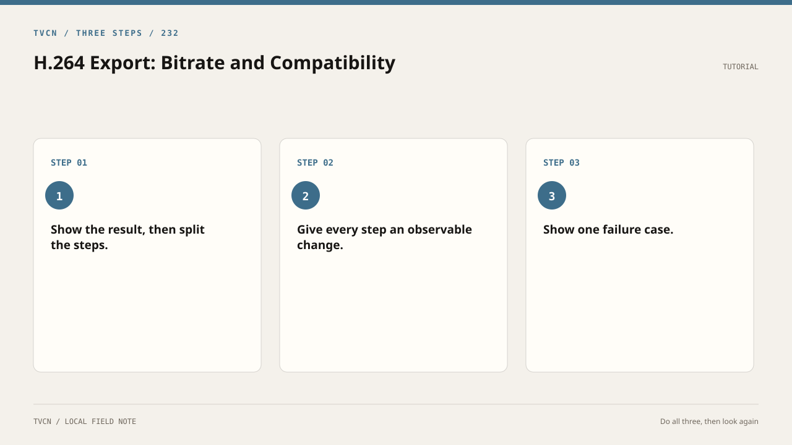

Set platform and bitrate before two-pass encoding; low bitrate destroys motion first.

<!-- DIAGRAM_START -->
<h2>Diagram</h2>
<figure>
  
  <figcaption>Do the three steps in order, then look again at the image or file.</figcaption>
</figure>
<!-- DIAGRAM_END -->
<h2>On set</h2>

Use 10 to 16 Mbps for 1080p and 35 to 45 Mbps for 4K. Two-pass encode, AAC audio at 192 kbps.

<h2>Do this</h2>

H.264 export fixes platform and bitrate first, then two-pass encoding; low bitrate destroys motion first.
<ol><li>1080p at 10 to 16 Mbps, 4K at 35 to 45 Mbps.</li><li>Use two-pass encoding.</li><li>Audio AAC at 192 kbps.</li></ol>
<h2>Avoid</h2>

Do not upload 4K at 5 Mbps; any motion turns into blocks.

<h2>Check</h2>
<ul><li>Resolution and bitrate sit in the recommended range.</li><li>Encoding is two-pass, not single-pass rushed.</li><li>Audio is AAC 192 kbps and stays in sync.</li></ul>
