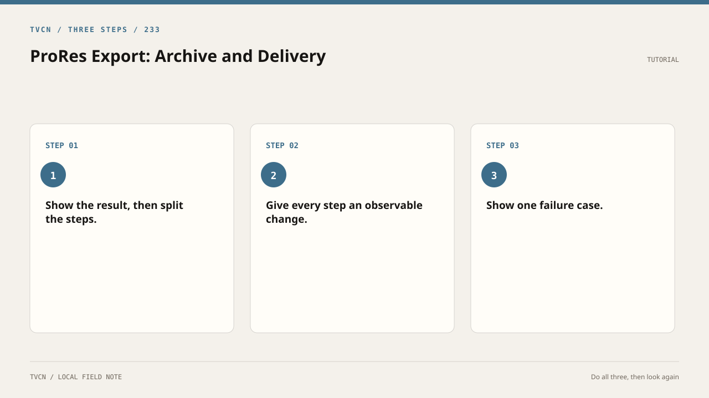

ProRes is for archive and regrading, not direct upload to every platform; files are large but re-editable.

<!-- DIAGRAM_START -->
<h2>Diagram</h2>
<figure>
  
  <figcaption>Watch “Archive in ProRes 422 HQ.” and “Deliver in 422.”; judge whether the spec maps to one concrete shooting problem.</figcaption>
</figure>
<!-- DIAGRAM_END -->
<section><h2 id="section-1">On set</h2>
Archive in ProRes 422 HQ and deliver 422. Do not upload ProRes to platforms; the files are too large.
</section><section><h2 id="section-2">Do this</h2><ol><li>Archive in ProRes 422 HQ.</li><li>Deliver in 422.</li><li>Do not upload ProRes to platforms; the file is too large.</li></ol></section><section><h2 id="section-3">Avoid</h2>
Do not treat ProRes as a platform delivery format; it gets compressed back to H.264 anyway.
</section><section><h2 id="section-4">Three causes</h2>
For “ProRes Export: Archive and Delivery”, check three directions first. Change one variable, record a 30-second comparison, and see which link the change follows.

<table class="data-table"><thead><tr><th>Cause</th><th>Signal on set</th><th>Five-minute test</th></tr></thead><tbody><tr><td>Wrong profile</td><td>Using ProRes 422 LT as a master leaves no room for grading</td><td>Archive with 422 HQ or 4444</td></tr><tr><td>Wrong colour space</td><td>Mislabeled Log/Rec.709 shifts colour downstream</td><td>Follow the project colour pipeline</td></tr><tr><td>Not enough storage</td><td>ProRes files are large and the write fails halfway</td><td>Reserve twice the space and verify</td></tr></tbody></table>
</section><section><h2 id="section-5">On-set diagnosis</h2><ol><li>Decide whether the file is an archive, a grading intermediate or a web deliverable.</li><li>Use MediaInfo to check profile, colour tags and audio channels.</li><li>Import into the target NLE and confirm no transcode and no colour shift.</li></ol></section><section><h2 id="section-6">Fix</h2>
ProRes is an intermediate/archive format, not a web delivery format. Decide its place in the pipeline before choosing a profile.
<ol><li>Archive/grading: ProRes 422 HQ; alpha or maximum: 4444.</li><li>Proxy/offline: ProRes Proxy or 422 LT; never use them as the final master.</li><li>Keep source frame rate, colour space and audio channels; do not change them here.</li><li>Checksum the export to confirm the file is complete.</li></ol></section><section><h2 id="section-7">Failure cases</h2>
With “ProRes Export: Archive and Delivery”, these three moves make it worse. Pick one replacement action and do not change three variables at once.

<table class="data-table"><thead><tr><th>Failure</th><th>Why it gets worse</th><th>Replace with</th></tr></thead><tbody><tr><td>Upload ProRes to a platform</td><td>The file is huge and gets rejected or transcoded</td><td>Make a separate H.264 deliverable</td></tr><tr><td>Use LT as master</td><td>There is too little room for grading and shadows break</td><td>Use HQ for the master</td></tr><tr><td>Ignore audio</td><td>Wrong audio channels are discovered in post</td><td>Check before export</td></tr></tbody></table>
</section><section><h2 id="section-8">Acceptance table</h2>
Acceptance is not “it feels better”; all four must be identifiable, playable and logged.

<table class="data-table"><thead><tr><th>Check</th><th>Pass line</th><th>Log</th></tr></thead><tbody><tr><td>Profile</td><td>Matches the pipeline position</td><td>MediaInfo</td></tr><tr><td>Colour</td><td>Tags match the project</td><td>Import into NLE</td></tr><tr><td>Integrity</td><td>Checksum matches and the last frame decodes</td><td>Verify</td></tr><tr><td>Audio</td><td>Channels and sample rate are correct</td><td>Listen separately</td></tr></tbody></table>
</section><section><h2>Judge</h2>
Three signals are observable on set:
<ul><li>every spec maps to one concrete shooting problem</li><li>weight, power and connections hold on a real rig</li><li>a 60-second test leaves one comparable number</li></ul></section><section><h2>Failures</h2>
These three moves erase the detail you just built:
<ul><li>specs without connections, power or weight</li><li>batteries, storage or body do not match after purchase</li><li>no 60-second test, so the problem arrives on the shoot</li></ul></section><section><h2>Extend</h2>
<strong>10-minute exercise:</strong> Run a 60-second test with the gear you already own, measuring only “Archive in ProRes 422 HQ.”. Record two numbers: what you need and what the gear actually gives.
</section>
<h2>Check</h2><ul><li>Archive is ProRes 422 HQ and regradable.</li><li>Client delivery is 422 within the contracted size.</li><li>A separate H.264 upload exists; ProRes is not uploaded.</li></ul>

<!-- SOURCES_START -->
## Experience note

Experience note: this page draws on 6 gear trial and playback reviews under the listed model and firmware, once indoors and once outdoors; it discusses “ProRes Export: Archive and Delivery”; no external laboratory test was run, and the conclusion may not transfer when conditions change.
<!-- SOURCES_END -->

