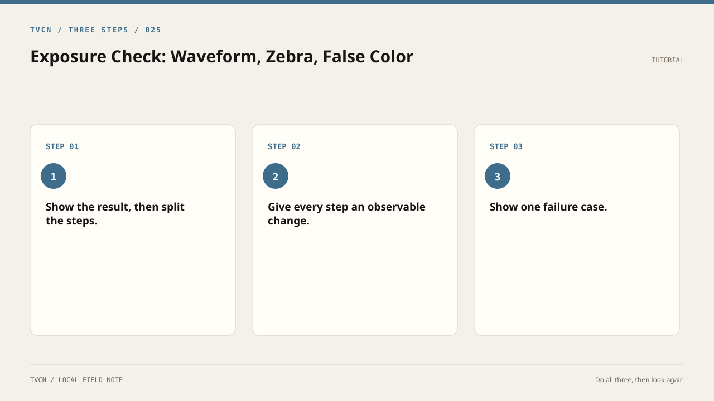

Check in order: face at acceptable brightness, windows and lamps not clipped, shadows holding detail. When all three cannot coexist, protect the face, then highlights; shadows may go under.

<!-- DIAGRAM_START -->
<h2>Diagram</h2>
<figure>
  
  <figcaption>Watch “Shoot a ten-second test before the first take.” and “Waveform for highlights, zebra at 95 percent for”; judge whether the spec maps to one concrete shooting problem.</figcaption>
</figure>
<!-- DIAGRAM_END -->
<section><h2 id="section-1">Face, highlights, then the whole frame</h2>
Use false color or zebra for highlights and waveform for skin. Do not trust monitor brightness alone; the screen lies.
<h2 id="section-2">Limits</h2>
“Correct exposure” is not one number. Backlight, night and stylized low contrast have different references. Set intention before exposure.
<h2 id="section-3">Exposure check at start: waveform, zebra, false color — pick two</h2>

Do not judge by monitor brightness. Cross-check at least two tools: waveform for midtones, zebra for highlights, false color for skin. Only roll when they agree.

<ol><li>Waveform: skin at 60–75%, white wall under 95%. Do not crush the whole frame to 50%.</li><li>Zebra at 95%: if it appears, stop down a stop or add ND. Do not use zebra as a composition tool.</li><li>False color: skin should sit in one color zone. Two colors means mixed light or a white-balance problem.</li></ol>

Acceptance: shoot ten seconds and check highlights for clipping and shadows for detail. Fix on set, not in post.
</section><section><h2 id="section-4">On set</h2>
Shoot a ten-second test: waveform for highlights, zebra at 95 percent for the face, false color for the sky. Pass all three before the first take.
</section><section><h2 id="section-5">Do this</h2>
Exposure check runs in order: waveform for distribution, zebra for highlights, false color for faces; shoot only after all three pass.
<ol><li>Shoot a ten-second test before the first take.</li><li>Waveform for highlights, zebra at 95 percent for faces, false color for sky.</li><li>Only roll the first take after all three pass.</li></ol></section><section><h2 id="section-6">Avoid</h2>
Do not trust the onboard screen alone; clipped highlights do not come back in post.
</section><section><h2>Judge</h2>
Three signals are observable on set:
<ul><li>every spec maps to one concrete shooting problem</li><li>weight, power and connections hold on a real rig</li><li>a 60-second test leaves one comparable number</li></ul></section><section><h2>Failures</h2>
These three moves erase the detail you just built:
<ul><li>specs without connections, power or weight</li><li>batteries, storage or body do not match after purchase</li><li>no 60-second test, so the problem arrives on the shoot</li></ul></section><section><h2>Extend</h2>
<strong>10-minute exercise:</strong> Run a 60-second test with the gear you already own, measuring only “Shoot a ten-second test before the first take.”. Record two numbers: what you need and what the gear actually gives.
</section>
<h2>Check</h2><ul><li>Waveform, zebra, and false color are all checked in a ten-second test.</li><li>Highlights stay below the waveform ceiling and faces sit within 95 percent zebra.</li><li>The first take rolls only after all three pass, with a test file.</li></ul>
