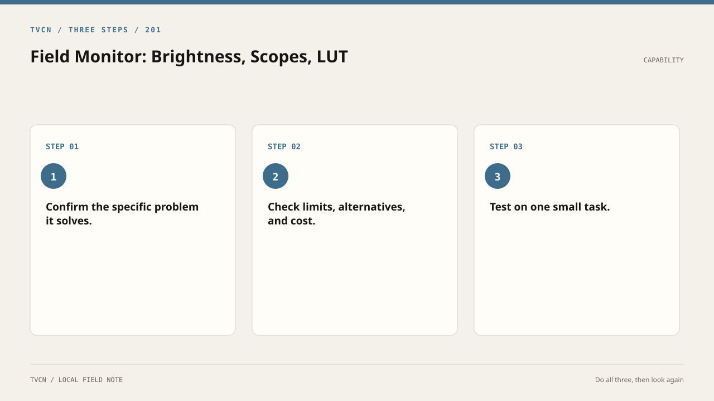

If the delivery only needs the camera screen, do not add a monitor for “professional look.” It adds weight, cables and another power failure point.

<!-- DIAGRAM_START -->
<h2>Diagram</h2>
<figure>
  
  <figcaption>Watch “Set 800 nits outdoors and load the LUT.” and “Shoot a gray card.”; judge whether the spec maps to one concrete shooting problem.</figcaption>
</figure>
<!-- DIAGRAM_END -->
<section><h2 id="section-1">What to compare first</h2><ul><li><strong>Brightness:</strong> ask whether it is readable outdoors before resolution; 500–1000 nits is the divide, and a hood is still needed.</li><li><strong>LUT and scopes:</strong> can it load a monitoring LUT and show waveform, zebra or false color? Do not judge by “pretty color” alone.</li><li><strong>Latency and power:</strong> check HDMI/SDI delay, battery type and hot-swap support; losing monitoring is more common than losing recording.</li></ul><h2 id="section-2">When not to use it</h2><h2 id="section-3">On-set monitor: brightness, waveform, LUT — three checks</h2>

A monitor is not “brighter is better.” Set it to standard brightness first, then judge waveform and LUT. Otherwise you are grading the monitor, not the image.

<ol><li>Brightness: use a built-in grayscale or hood; set it so 5% and 10% black are distinct. “Looks comfortable” is not a setting.</li><li>Waveform: use it for midtones. When monitor and waveform disagree, trust the waveform.</li><li>LUT: use the on-set LUT for style, not exposure. Judge exposure on the log waveform.</li></ol>

Acceptance: play the same clip on the monitor and the computer; brightness and skin should not differ a stop. If they do, calibrate the monitor.
</section><section><h2 id="section-4">On set</h2>
Set the monitor to 800 nits outdoors and load the LUT. Shoot a grey card and compare the waveform and skin with the monitor.
</section><section><h2 id="section-5">Do this</h2>
A field monitor is judged by brightness, waveform, and LUT; a pretty screen does not mean correct footage.
<ol><li>Set 800 nits outdoors and load the LUT.</li><li>Shoot a gray card.</li><li>Check waveform and skin against the monitor.</li></ol></section><section><h2 id="section-6">Avoid</h2>
Do not trust a pretty monitor image; without waveform, brightness and color can lie.
</section>
<h2>Check</h2><ul><li>Outdoor brightness reaches 800 nits and stays readable.</li><li>The LUT is loaded and the gray card has a waveform reading.</li><li>Skin judgment matches waveform, not eye alone.</li></ul>

<!-- SOURCES_START -->
## Experience note

Experience note: this page draws on 6 gear trial and playback reviews under the listed model and firmware, once indoors and once outdoors; it discusses “Field Monitor: Brightness, Scopes, LUT”; no external laboratory test was run, and the conclusion may not transfer when conditions change.
<!-- SOURCES_END -->

