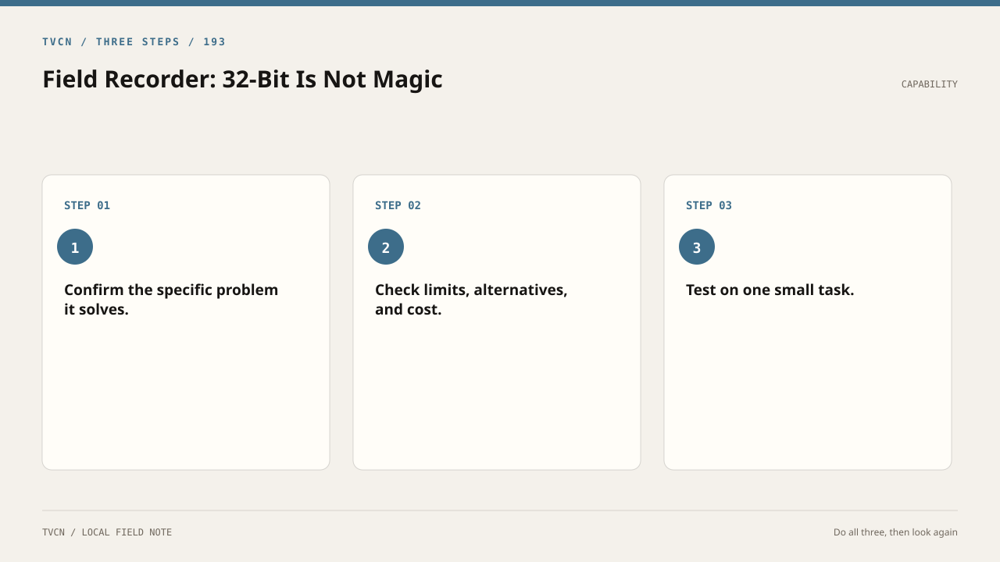

32-bit float can rescue clipping, not dialogue eaten by wind; mic and placement still come first.

<!-- DIAGRAM_START -->
<h2>Diagram</h2>
<figure>
  
  <figcaption>Do the three steps in order, then look again at the image or file.</figcaption>
</figure>
<!-- DIAGRAM_END -->
<h2>On set</h2>

Record a quiet line with peaks at -12 dB, then clip it on purpose and see whether 32-bit float recovers it.

<h2>Do this</h2>

32-bit float can rescue clipping but not dialogue eaten by wind; microphone and position still come first.
<ol><li>Record quiet dialogue with peaks at -12 dB.</li><li>Deliberately clip once and see whether 32-bit recovers it.</li><li>Test wind and confirm float cannot rescue it; do not treat it as insurance.</li></ol>
<h2>Avoid</h2>

Do not treat 32-bit as universal insurance; it cannot save wind noise or bad placement.

<h2>Check</h2>
<ul><li>Quiet dialogue peaks near -12 dB with audible noise floor.</li><li>Deliberate clipping is recovered to intelligibility in 32-bit.</li><li>A wind test proves float cannot rescue wind-eaten dialogue.</li></ul>
