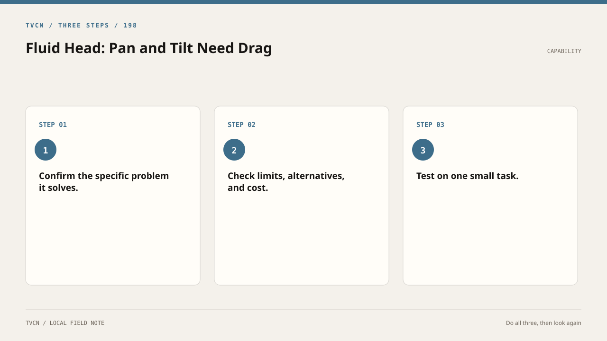

For fast following, tight spaces or long handheld work, a fluid head is worse than a gimbal or body support. It is not a universal answer for “more stable.”

<!-- DIAGRAM_START -->
<h2>Diagram</h2>
<figure>
  
  <figcaption>Watch “Mount the full rig and set damping.” and “Do a three-second start, five-second pan, three-second stop.”; judge whether the spec maps to one concrete shooting problem.</figcaption>
</figure>
<!-- DIAGRAM_END -->
<section><h2 id="section-1">What to compare first</h2><ul><li><strong>Payload and center of gravity:</strong> choose by the full rig, not the bare body; a long lens moves the center forward and needs more tilt range.</li><li><strong>Counterbalance:</strong> let go at your working tilt angle; the head should hold or return slowly, not slam down.</li><li><strong>Drag and locks:</strong> pan and tilt drag adjust separately, locks do not drift, and the plate returns to a repeatable position.</li></ul><h2 id="section-2">When not to use it</h2></section><section><h2 id="section-3">On set</h2>
Mount the full rig and set the drag. Do a three-second start, five-second pan, and three-second stop; check for a jerk.
</section><section><h2 id="section-4">Do this</h2>
A fluid head's value is damping: starts and stops must be smooth, not flying at a touch.
<ol><li>Mount the full rig and set damping.</li><li>Do a three-second start, five-second pan, three-second stop.</li><li>Play back and check for jerks at start and stop.</li></ol></section><section><h2 id="section-5">Avoid</h2>
Do not back damping all the way out; a touch sends it flying and ruins starts and stops.
</section>
<h2>Check</h2><ul><li>A 3-5-3 second start-pan-stop runs with the full rig.</li><li>Playback shows no sudden jerk at start or stop.</li><li>Damping settings are logged and reproducible at a new position.</li></ul>
