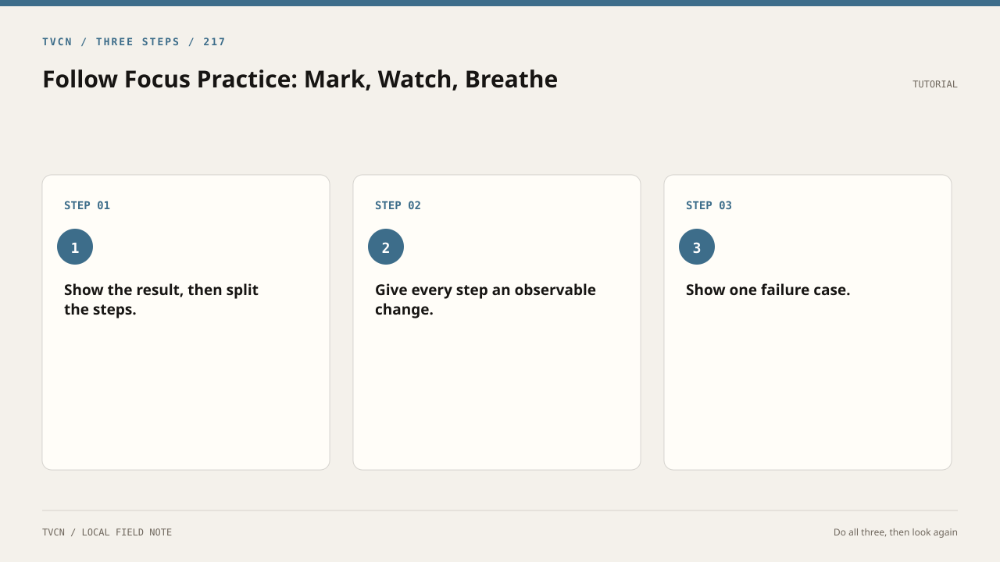

Three steps: mark the barrel, watch the chest, and keep breathing steady.

<!-- DIAGRAM_START -->
<h2>Diagram</h2>
<figure>
  
  <figcaption>Do the three steps in order, then look again at the image or file.</figcaption>
</figure>
<!-- DIAGRAM_END -->
<h2>On set</h2>

Mark one, two, and three meters and have an assistant walk 1-2-3-2-1. Practice ten passes with less than five centimeters of focus error.

<h2>Do this</h2>

Follow-focus practice has three steps: make marks, watch the chest, and keep breathing from shaking the hand.
<ol><li>Mark one, two, and three meters.</li><li>Have the assistant walk 1-2-3-2-1.</li><li>Do ten reps with focus error under five centimeters.</li></ol>
<h2>Avoid</h2>

Do not chase the mouth; it turns, while the chest does not disappear.

<h2>Check</h2>
<ul><li>One, two, and three meters are marked and walked 1-2-3-2-1.</li><li>At least eight of ten reps stay within five centimeters.</li><li>Focus follows the chest, not the mouth.</li></ul>
