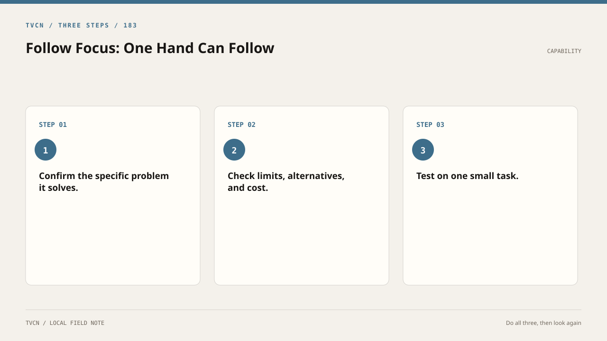

A follow focus gives marks and feel; autofocus is not reliable in darkness or fast motion.

<!-- DIAGRAM_START -->
<h2>Diagram</h2>
<figure>
  
  <figcaption>Do the three steps in order, then look again at the image or file.</figcaption>
</figure>
<!-- DIAGRAM_END -->
<h2>On set</h2>

Mark one, 1.5, and two meters on the floor. Have an assistant walk the marks and practice ten follows with less than five centimeters of error.

<h2>Do this</h2>

A follow focus gives focus changes marks and feel; autofocus is not reliable in darkness or fast motion.
<ol><li>Mark one, 1.5, and two meters on the floor.</li><li>Have an assistant walk while you pull focus ten times.</li><li>Keep the error within five centimeters.</li></ol>
<h2>Avoid</h2>

Do not rely on autofocus alone; in darkness and fast blocking it hands focus to the background.

<h2>Check</h2>
<ul><li>Three distances are clearly marked on the floor.</li><li>At least eight of ten pulls stay within five centimeters.</li><li>The autofocus failure case is tied to a specific condition.</li></ul>
