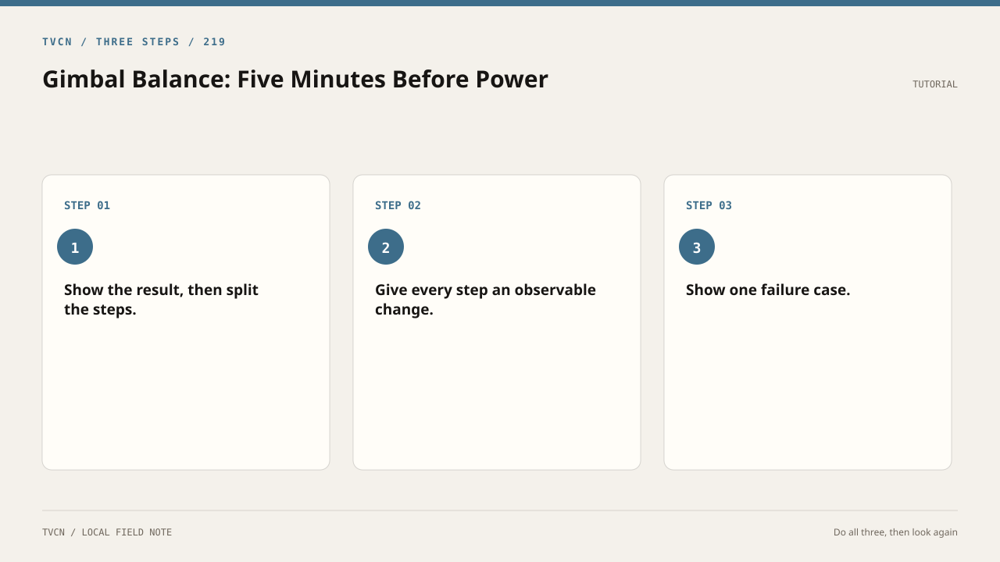

Balance each axis with the others locked; five minutes before power saves half an hour on set.

<!-- DIAGRAM_START -->
<h2>Diagram</h2>
<figure>
  
  <figcaption>Do the three steps in order, then look again at the image or file.</figcaption>
</figure>
<!-- DIAGRAM_END -->
<h2>On set</h2>

Lock tilt to set roll, lock roll to set pan, and set pan last. Push the gimbal after each adjustment to check for centering.

<h2>Do this</h2>

Gimbal balance goes axis by axis, locking one before adjusting the next; five minutes before power-on saves half an hour on set.
<ol><li>Lock pan and adjust tilt.</li><li>Lock tilt and adjust roll.</li><li>Finally adjust pan, nudging after each to check centering.</li></ol>
<h2>Avoid</h2>

Do not loosen all three axes at once; everything moves and never balances.

<h2>Check</h2>
<ul><li>Axes are locked and adjusted in pan, tilt, roll order.</li><li>Each axis returns to center after a nudge without drifting.</li><li>Balance completes before power-on and motors do not constantly correct.</li></ul>
