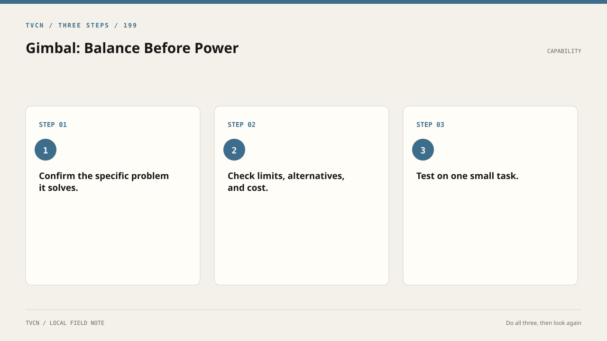

For locked-off shots, long lenses or repeatable motion, a tripod and slider beat a gimbal. Do not trade “can walk” for “can hold.”

<!-- DIAGRAM_START -->
<h2>Diagram</h2>
<figure>
  
  <figcaption>Watch “Balance all three axes and listen for motor” and “Walk a ten-meter straight line.”; judge whether the spec maps to one concrete shooting problem.</figcaption>
</figure>
<!-- DIAGRAM_END -->
<section><h2 id="section-1">What to compare first</h2><ul><li><strong>Payload and balance:</strong> calculate the full rig; lens length changes tilt balance, and a payload rating is not a promise of balance.</li><li><strong>Axis locks and plate:</strong> three axes lock and the plate returns repeatably; otherwise every lens change means rebalancing.</li><li><strong>Follow and latency:</strong> check follow speed, deadband and motor noise; too responsive chases footsteps, too slow loses the subject.</li></ul></section><section><h2 id="section-3">On set</h2>
Balance all three axes and listen for motor noise. Walk ten meters straight and check for vertical bounce.
</section><section><h2 id="section-4">Do this</h2>
A gimbal must be balanced before power-on; motors constantly correcting imbalance cause shake and drain battery.
<ol><li>Balance all three axes and listen for motor noise at power-on.</li><li>Walk a ten-meter straight line.</li><li>Play back and check vertical bounce.</li></ol></section><section><h2 id="section-5">Avoid</h2>
Do not let motors correct imbalance; constant effort makes the image shakier.
</section>
<h2>Check</h2><ul><li>Three axes balance and motors do not hum constantly at power-on.</li><li>A ten-meter walk shows no vertical bounce.</li><li>Footage exists before and after balancing for comparison.</li></ul>

> Intent split: this page covers the practical details of “Gimbal: Balance Before Power”; start with <a href="https://tools.tvcn.org/article/gimbal-balance/">Gimbal Balance: Five Minutes Before Power</a> for the cluster-level judgement, then return here.

<!-- INTENT_SCOPE -->

<section><h2>What this page does not solve</h2>
This page compares the capability and key parameters of “Gimbal: Balance Before Power”; it does not settle live pricing, warranty, mount/firmware compatibility or unit-to-unit sample variation for a specific model. Check the official spec sheet, a rental house test and the return terms. For shooting plans, budgets or on-set faults, use the matching method page first.
</section>
<!-- SOURCES_START -->
## Experience note

Experience note:This page draws on 4 gear trials and on-set playbacks under the listed model/firmware, once indoors and once outdoors; it covers the selection and use limits of “Gimbal: Balance Before Power”, not an external laboratory test, unlisted models, unit-level QC, warranty/rental contracts or safety certification.
<!-- SOURCES_END -->

