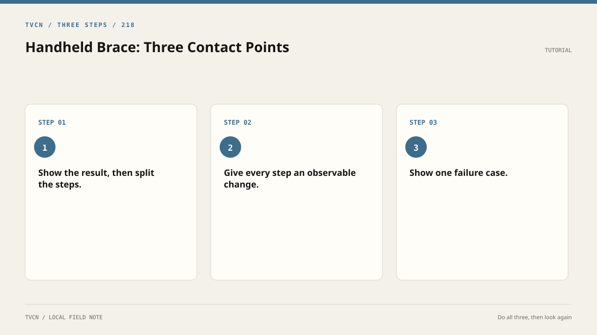

Find three contact points: chest, shoulder, elbow; three points stabilize the frame.

<!-- DIAGRAM_START -->
<h2>Diagram</h2>
<figure>
  
  <figcaption>Do the three steps in order, then look again at the image or file.</figcaption>
</figure>
<!-- DIAGRAM_END -->
<h2>On set</h2>

Use three contact points: the chest against the body, elbows into the ribs, the left hand under the lens. Hold ten seconds and check the breathing.

<h2>Do this</h2>

Handheld support finds three contact points: chest, shoulder, elbow; three points steady the frame.
<ol><li>Press the chest against the camera back and tuck the elbow to the ribs.</li><li>Support the lens with the left hand as the third point.</li><li>Shoot ten static seconds and play back for breathing motion.</li></ol>
<h2>Avoid</h2>

Do not hold the camera at arm's length; two contact points fail within ten seconds.

<h2>Check</h2>
<ul><li>Chest, elbow, and left hand all make contact.</li><li>Ten static seconds show only slight breathing, no big sway.</li><li>Arms are not extended and the center of gravity stays close.</li></ul>
