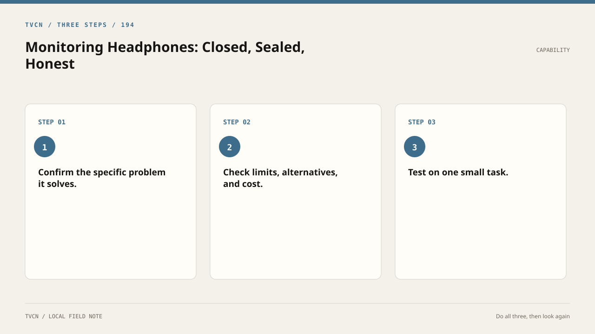

Monitoring headphones must be closed, sealed, and honest; consumer cans are color grading with eyes shut.

<!-- DIAGRAM_START -->
<h2>Diagram</h2>
<figure>
  
  <figcaption>Do the three steps in order, then look again at the image or file.</figcaption>
</figure>
<!-- DIAGRAM_END -->
<h2>On set</h2>

Wear closed headphones and listen to thirty seconds of room tone. If you hear your own breathing, the cups leak or the mic is too close.

<h2>Do this</h2>

Monitoring headphones must be closed, fit well, and not flatter; consumer headphones are like grading blindfolded.
<ol><li>Wear closed headphones and listen to thirty seconds of ambience.</li><li>If you hear your own breathing, the cups leak or the mic is too close.</li><li>Refit the ear pads and listen again.</li></ol>
<h2>Avoid</h2>

Do not monitor on noise-canceling Bluetooth headphones; they flatter noise floor and sibilance.

<h2>Check</h2>
<ul><li>Monitoring uses closed-back headphones, not consumer Bluetooth.</li><li>Thirty seconds of ambience contains no own breathing or cup leak.</li><li>The seal holds and noise judgment stays stable when you move.</li></ul>
