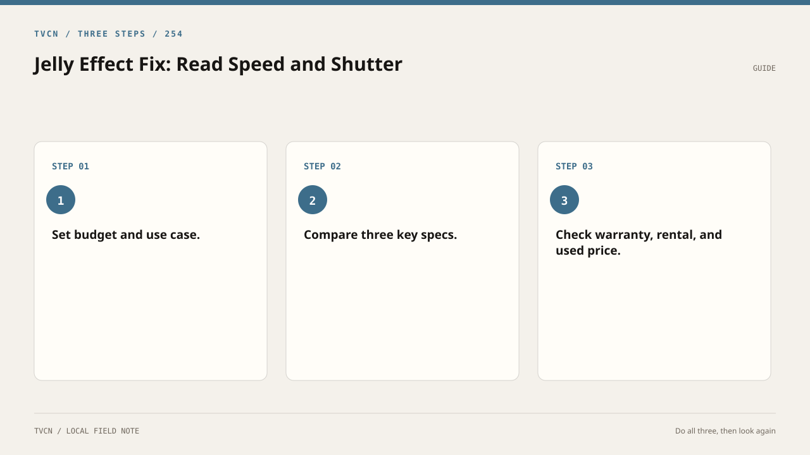

Rolling shutter comes from slow readout and fast motion; change body or shutter before blaming the lens.

<!-- DIAGRAM_START -->
<h2>Diagram</h2>
<figure>
  
  <figcaption>Do the three steps in order, then look again at the image or file.</figcaption>
</figure>
<!-- DIAGRAM_END -->
<h2>On set</h2>

Pan fast across a railing and check for bent lines. Change the camera or use a global shutter; post cannot fix it.

<h2>Do this</h2>

Rolling shutter comes from slow readout plus fast motion. Change the camera or use a global shutter before touching shutter speed.
<ol><li>Pan across a railing or window and review whether straight lines bend.</li><li>Use a faster-readout camera or a global shutter.</li><li>Reduce fast whips; use locked-off shots and slow pans.</li></ol>
<h2>Avoid</h2>

Do not blame the lens; CMOS readout speed is the cause.

<h2>Check</h2>
<ul><li>A pan across a railing or window was shot and straight lines reviewed.</li><li>A faster-readout camera or global shutter is used.</li><li>Fast whips are reduced; locked-off shots and slow pans replace them.</li></ul>
