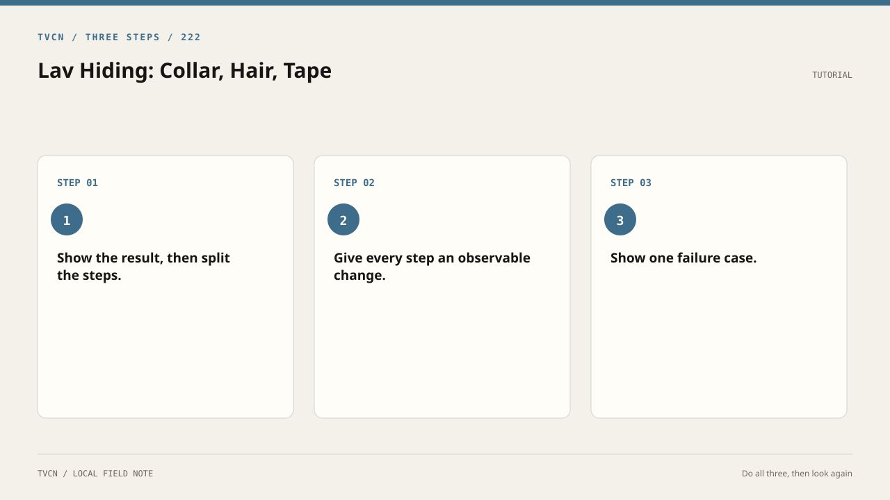

The enemy is cloth friction and muffling. Anchor the capsule inside a collar, tape the cable away from skin, keep jacket and buttons off the capsule. Do not bury it in hair or a scarf.

<!-- DIAGRAM_START -->
<h2>Diagram</h2>
<figure>
  
  <figcaption>Watch “Try the collar, then the hair.” and “Use medical tape for shock isolation.”; judge whether the spec maps to one concrete shooting problem.</figcaption>
</figure>
<!-- DIAGRAM_END -->
<section><h2 id="section-1">Hide the lav without rubbing</h2>
Record the actor turning, raising an arm and sitting; play back for rustle. If present, reposition rather than denoise later.
<h2 id="section-2">Limits</h2>
Invisible is not audible. Too deep sounds hollow and distant; let the capsule show a little rather than lose the line.
<h2 id="section-3">Hide a lav: 15–20cm below the mouth, protect against cloth first</h2>

Lavs fail from cloth rustle and occlusion. Do not center it at the collar; place it 15–20cm below the collarbone, with a small tape arch so the cable does not touch fabric.

<ol><li>Mic head up, not under a button or zipper. Test sweaters and scarves for rustle first.</li><li>Run the cable inside the clothes and leave a loose bend at the waist. A taut cable transmits cloth noise.</li><li>Put a backup recorder in a pocket and sync the two devices.</li></ol>

Acceptance: have the actor turn, raise an arm and sit; listen for rustle and muffling. If present, move the mic before denoise.
</section><section><h2 id="section-4">On set</h2>
Try the collar first, then the hair. Use medical tape for strain relief; ordinary tape tears fabric.
</section><section><h2 id="section-5">Do this</h2>
Hide a lav at the collar first, then hair, then secure with medical tape; every wardrobe change needs a re-hide.
<ol><li>Try the collar, then the hair.</li><li>Use medical tape for shock isolation.</li><li>Do not use ordinary tape; it tears clothing and leaves residue.</li></ol></section><section><h2 id="section-6">Avoid</h2>
Do not stuff the lav into a collar and stop; fabric rustle covers dialogue.
</section><section><h2>Judge</h2>
This page passes on three observable checks, not slogans:
<ul><li><strong>1.</strong> The lav tries collar then hair with positions logged.</li><li><strong>2.</strong> Medical tape secures it, not ordinary tape.</li><li><strong>3.</strong> After wardrobe changes the lav is re-hidden and rustle-tested.</li></ul></section><section><h2>Failures</h2>
Any one of these means stop and fix it before post:
<ul><li><strong>1.</strong> Check 1 is only staged (“The lav tries collar then hair with positions…”); another camera position or location exposes it.</li><li><strong>2.</strong> Check 2 is left to post or a verbal explanation (“Medical tape secures it, not ordinary tape”); nothing on set can be rechecked.</li><li><strong>3.</strong> Do not stuff the lav into a collar and stop; fabric rustle covers dialogue.</li></ul></section><section><h2>Extend</h2>
<strong>10-minute exercise:</strong> Run a 60-second test with the gear you already own, measuring only “Try the collar, then the hair.”. Record two numbers: what you need and what the gear actually gives.
</section>
<h2>Check</h2><ul><li>The lav tries collar then hair with positions logged.</li><li>Medical tape secures it, not ordinary tape.</li><li>After wardrobe changes the lav is re-hidden and rustle-tested.</li></ul>

<!-- SOURCES_START -->
## References and further reading

- [S27] [ITU-R BS.1770: Loudness and True Peak](https://www.itu.int/rec/R-REC-BS.1770/en) — Accessed 2026-11-26. Used to check the terminology/method/rule in the “Hide a lav: 15–20cm below the mouth, protect against cloth first” section against BS.1770 loudness measurement, not microphone buying advice; it does not verify numbers, model choices or on-set conclusions derived from this page, and is not a substitute for a test.
- [S23] [SMPTE: Standards](https://www.smpte.org/standards) — Accessed 2026-11-26. Used to check the terminology/method/rule in the “Hide the lav without rubbing” section against SMPTE standards portal, not specific camera specs; it does not verify numbers, model choices or on-set conclusions derived from this page, and is not a substitute for a test.
<!-- SOURCES_END -->

