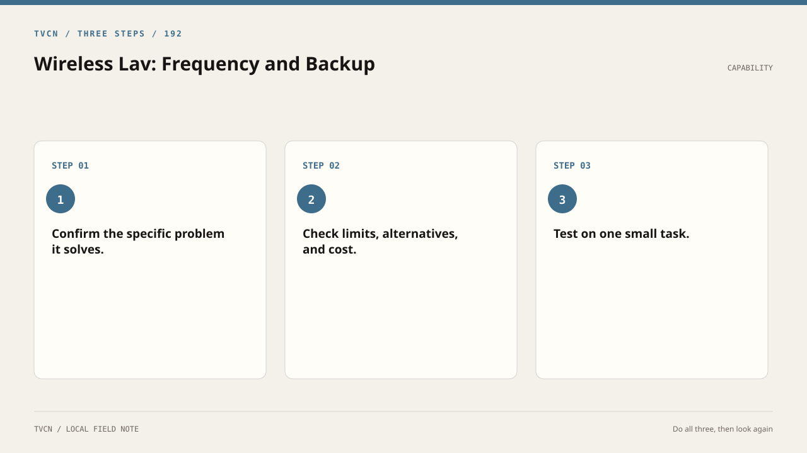

Check frequency and interference, and record a backup track; the set gives no second chance.

<!-- DIAGRAM_START -->
<h2>Diagram</h2>
<figure>
  
  <figcaption>Do the three steps in order, then look again at the image or file.</figcaption>
</figure>
<!-- DIAGRAM_END -->
<h2>On set</h2>

Scan frequencies for two minutes and pick a clean band. Hide the transmitter at the back waist and record a 32-bit backup.

<h2>Do this</h2>

Wireless lavs need a frequency scan and a backup track; the set gives no second chance.
<ol><li>Scan for two minutes and pick a clean frequency.</li><li>Hide the transmitter at the lower back with the cable inside clothing.</li><li>Record a 32-bit backup track.</li></ol>
<h2>Avoid</h2>

Do not record on the factory frequency; one interference hit ruins the whole take.

<h2>Check</h2>
<ul><li>A two-minute scan logs a clean frequency.</li><li>The transmitter sits at the lower back with no visible cable.</li><li>A 32-bit backup track exists and works independently.</li></ul>
