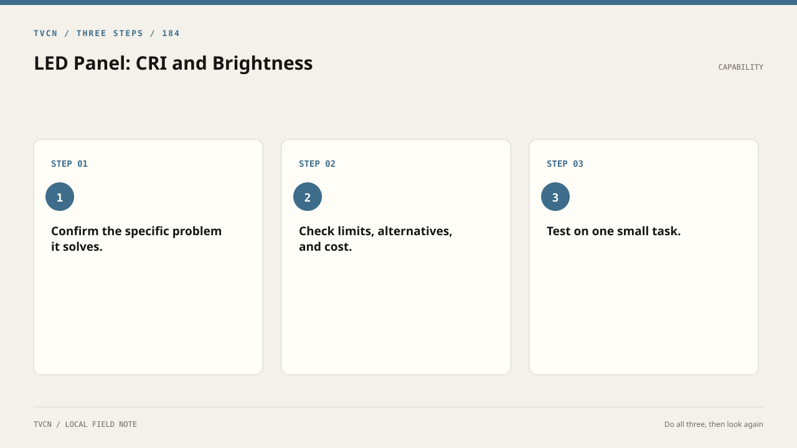

For strong direction, long throws or large areas, a panel loses to a COB with a softbox. It is best for close, low-power and fast setups.

<!-- DIAGRAM_START -->
<h2>Diagram</h2>
<figure>
  
  <figcaption>Watch “Set the light to 5600K at 100 percent” and “Check whether the hand turns green.”; judge whether the spec maps to one concrete shooting problem.</figcaption>
</figure>
<!-- DIAGRAM_END -->
<section><h2 id="section-1">What to compare first</h2><ul><li><strong>Color rendering:</strong> shoot skin, red cloth and green plants; check real performance beyond CRI/TLCI claims. Cheap panels often push green dirty.</li><li><strong>Dimming:</strong> sweep from high to low and look for flicker, cast and steps; it shows most at low output.</li><li><strong>Diffusion and control:</strong> is the built-in diffusion even, and can it take a grid? Edge spill shows when the panel is close to a face.</li></ul></section><section><h2 id="section-3">On set</h2>
Set the panel to 5600K at full power and shoot white paper and a hand. Check for green skin and measure the output at one meter.
</section><section><h2 id="section-4">Do this</h2>
An LED panel is judged by color rendering and actual output, not box wattage; green skin means bad color.
<ol><li>Set the light to 5600K at 100 percent and shoot white paper and a hand.</li><li>Check whether the hand turns green.</li><li>Measure illuminance at one meter to see whether it can key.</li></ol></section><section><h2 id="section-5">Avoid</h2>
Do not buy by wattage; bad color rendering makes a bright light usable only as fill.
</section>
<h2>Check</h2><ul><li>White paper and hand are sampled at 5600K full power.</li><li>Green or magenta skin cast is named.</li><li>One-meter illuminance is measured and judged against key-light needs.</li></ul>

> Intent split: this page covers the practical details of “LED Panel: CRI and Brightness”; start with <a href="https://tools.tvcn.org/article/buy-light-kit/">Buying a Light Kit: Soft Before Bright</a> for the cluster-level judgement, then return here.

<!-- INTENT_SCOPE -->

<section><h2>What this page does not solve</h2>
This page compares the capability and key parameters of “LED Panel: CRI and Brightness”; it does not settle live pricing, warranty, mount/firmware compatibility or unit-to-unit sample variation for a specific model. Check the official spec sheet, a rental house test and the return terms. For shooting plans, budgets or on-set faults, use the matching method page first.
</section>
<!-- SOURCES_START -->
## Experience note

Experience note:This page draws on 6 gear trials and on-set playbacks under the listed model/firmware, once indoors and once outdoors; it covers the selection and use limits of “LED Panel: CRI and Brightness”, not an external laboratory test, unlisted models, unit-level QC, warranty/rental contracts or safety certification.
<!-- SOURCES_END -->

