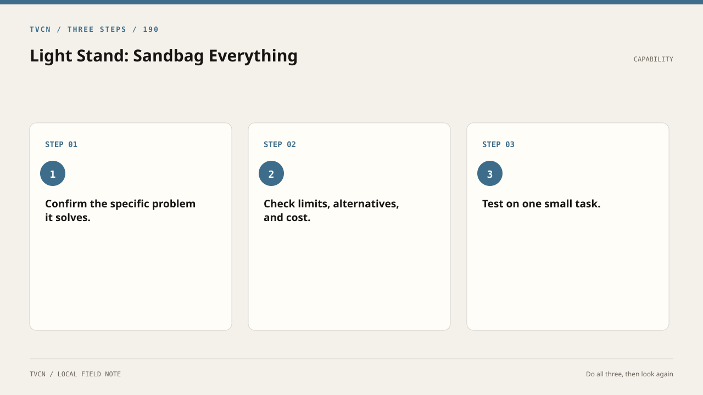

For a large softbox or height above a person&#x27;s head, a small stand tips; use a heavy stand or truss. Do not use a backpack as a sandbag.

<!-- DIAGRAM_START -->
<h2>Diagram</h2>
<figure>
  
  <figcaption>Watch “Hang two sandbags on each stand.” and “Raise to full height and push gently.”; judge whether the spec maps to one concrete shooting problem.</figcaption>
</figure>
<!-- DIAGRAM_END -->
<section><h2 id="section-1">What to compare first</h2><ul><li><strong>Payload and height:</strong> calculate light plus softbox plus sandbag, not the head alone; the center changes as it rises.</li><li><strong>Legs and locks:</strong> legs lock without slipping and offer leveling; it must stand on uneven ground.</li><li><strong>Sandbags and tie-downs:</strong> at least one sandbag per stand; outdoors it must take weight and rope, not rely on legs alone.</li></ul><h2 id="section-2">When not to use it</h2>
For a large softbox or height above a person's head, a small stand tips; use a heavy stand or truss. Do not use a backpack as a sandbag.
<h2 id="section-3">Light stand safety: sandbags at least twice the fixture weight</h2>

A falling stand is worse than a dim lamp. Put at least two sandbags on every stand, total weight at least twice the fixture. When a boom arm extends, counterweight the other side.

<ol><li>Hang bags at the base tripod, not at the end of the arm; end weight increases tipping torque.</li><li>Tie cables along the stand and leave a trip loop. Do not cross a walkway.</li><li>Lock casters before raising, lock the arm after. At wrap, lower the lamp before removing bags.</li></ol>

Acceptance: push the stand lightly; it should spring back, not keep falling. If it keeps falling, add weight or lower it.
</section><section><h2 id="section-4">On set</h2>
Hang two sandbags on every stand and push it gently at full height. If it moves, lower it before rolling.
</section><section><h2 id="section-5">Do this</h2>
Sandbag the stand before raising the light; an unweighted stand costs more when it falls than the lamp did.
<ol><li>Hang two sandbags on each stand.</li><li>Raise to full height and push gently.</li><li>Only power on if it does not wobble; otherwise lower it or add weight.</li></ol></section><section><h2 id="section-6">Avoid</h2>
Do not raise the light before finding sandbags; at full height it is already unmanageable.
</section>
<h2>Check</h2><ul><li>Each stand carries two sandbags with recorded weight.</li><li>A gentle push at full height does not wobble.</li><li>Any wobbling stand is lowered or weighted before power-on.</li></ul>

> Intent split: this page covers the practical details of “Light Stand: Sandbag Everything”; start with <a href="https://tools.tvcn.org/article/buy-light-kit/">Buying a Light Kit: Soft Before Bright</a> for the cluster-level judgement, then return here.

<!-- INTENT_SCOPE -->

<!-- SOURCES_START -->
## Experience note

Experience note: this page draws on 3 gear trial and playback reviews under the listed model and firmware, once indoors and once outdoors; it discusses “Light Stand: Sandbag Everything”; no external laboratory test was run, and the conclusion may not transfer when conditions change.
<!-- SOURCES_END -->

