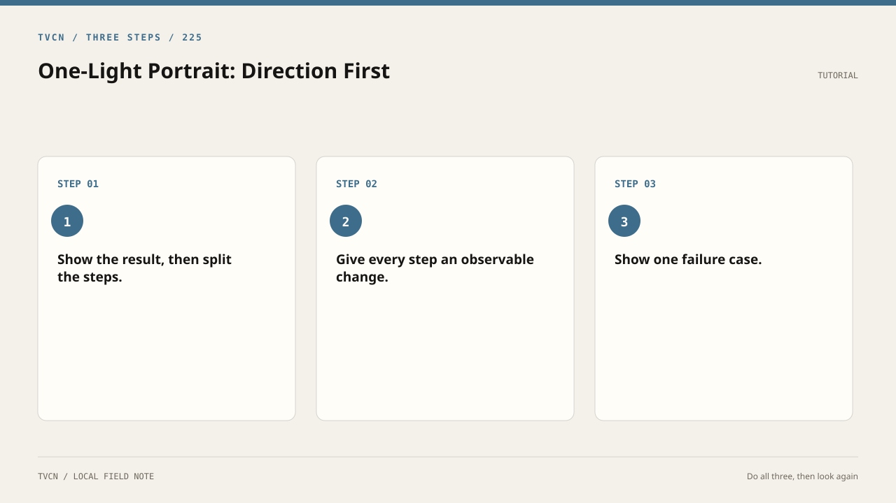

With one lamp, decide where it comes from: side-back for a rim, side-front for the face, top for pressure. Wrong direction cannot be saved by ten more lamps. Fill with a white wall, foam board or reflector, not a second lamp from the same side.

<!-- DIAGRAM_START -->
<h2>Diagram</h2>
<figure>
  
  <figcaption>Watch “Place the light at 45 degrees, one meter” and “Shoot one frame and watch the nose shadow.”; judge whether the spec maps to one concrete shooting problem.</figcaption>
</figure>
<!-- DIAGRAM_END -->
<section><h2 id="section-1">One lamp sets direction; bounce fills</h2>
Shoot a test and read the nose and jaw shadow; the shape tells the audience the mood.
<h2 id="section-2">Limits</h2>
One light is not flat. Flag the other side to deepen contrast; do not shove the lamp straight on to save time, or the face goes flat.
<h2 id="section-3">One-light portrait: direction first, brightness second</h2>

One lamp can have depth if direction and distance are right. Place it 45° to the subject's side, 1–1.5 meters away; fill the other side with a white wall or bounce, keeping about 2:1.

<ol><li>Turn off ambient light and use only the key. Check that nose and chin shadows fall the same way.</li><li>Higher light deepens the eye sockets; do not go above the hairline or you get a ghost shadow.</li><li>Soften with a box or white cloth; the closer the size to the face, the softer. Do not bare-bulb the face.</li></ol>

Acceptance: shadow should still hold skin texture. Dead black means not enough fill; flat means the key is too frontal. Shape lives between them.
</section><section><h2 id="section-4">On set</h2>
Place the light at 45 degrees, one meter from the face. Shoot one frame to see the nose shadow, then choose the softbox size.
</section><section><h2 id="section-5">Do this</h2>
One-light portraiture fixes direction first: 45 degrees, side, or back; then discuss softness and brightness.
<ol><li>Place the light at 45 degrees, one meter from the face.</li><li>Shoot one frame and watch the nose shadow.</li><li>Then decide the softbox size.</li></ol></section><section><h2 id="section-6">Avoid</h2>
Do not change softboxes first; without direction, every size is a different wrong.
</section><figure class="article-audio"><audio controls preload="none" src="../../../assets/audio/en/tool-lighting-one-light.en.mp3"></audio><figcaption>20-second audio demo: one check point and the most common failure. Transcript and steps are in the article.</figcaption></figure><section><h2>Judge</h2>
Three signals are observable on set:
<ul><li>every spec maps to one concrete shooting problem</li><li>weight, power and connections hold on a real rig</li><li>a 60-second test leaves one comparable number</li></ul></section><section><h2>Failures</h2>
These three moves erase the detail you just built:
<ul><li>specs without connections, power or weight</li><li>batteries, storage or body do not match after purchase</li><li>no 60-second test, so the problem arrives on the shoot</li></ul></section><section><h2>Extend</h2>
<strong>10-minute exercise:</strong> Run a 60-second test with the gear you already own, measuring only “Place the light at 45 degrees, one meter”. Record two numbers: what you need and what the gear actually gives.
</section>
<h2>Check</h2><ul><li>The light sits at 45 degrees, one meter away, with position logged.</li><li>The nose shadow clearly shows light direction.</li><li>Softbox size is chosen after direction is confirmed.</li></ul>

> Intent split: this page covers the practical details of “One-Light Portrait: Direction First”; start with <a href="https://tools.tvcn.org/article/buy-light-kit/">Buying a Light Kit: Soft Before Bright</a> for the cluster-level judgement, then return here.

<!-- INTENT_SCOPE -->

<!-- SOURCES_START -->
## Experience note

Experience note: this page draws on 7 gear trial and playback reviews under the listed model and firmware, once indoors and once outdoors; it discusses “One-Light Portrait: Direction First”; no external laboratory test was run, and the conclusion may not transfer when conditions change.
<!-- SOURCES_END -->

