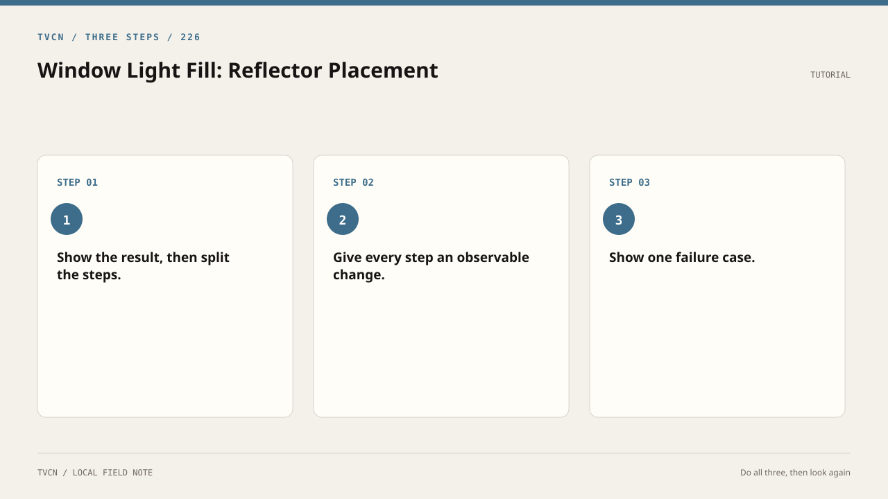

Place the reflector on the shadow side, not by the window; it fills shadow, not adds light.

<!-- DIAGRAM_START -->
<h2>Diagram</h2>
<figure>
  
  <figcaption>Do the three steps in order, then look again at the image or file.</figcaption>
</figure>
<!-- DIAGRAM_END -->
<h2>On set</h2>

Put the reflector on the shadow side, one meter away at 45 degrees. Check that shadows lift without clipping.

<h2>Do this</h2>

Window fill puts the reflector on the shadow side, not by the window; it fills darkness, not adds brightness.
<ol><li>Place the reflector on the shadow side, one meter from the face.</li><li>Angle it at 45 degrees.</li><li>Check that shadows lift without blowing out.</li></ol>
<h2>Avoid</h2>

Do not put the reflector by the window; it brightens the bright side and leaves shadows black.

<h2>Check</h2>
<ul><li>The reflector sits on the shadow side, one meter away at about 45 degrees.</li><li>Shadows lift without highlight clipping.</li><li>Before-and-after shows more shadow detail.</li></ul>
