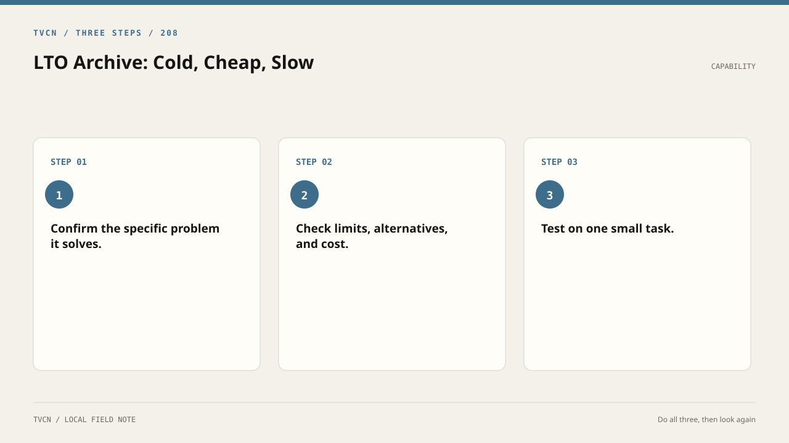

LTO is for cold archive, not same-day editing; calculate restore time before cost per TB.

<!-- DIAGRAM_START -->
<h2>Diagram</h2>
<figure>
  
  <figcaption>Do the three steps in order, then look again at the image or file.</figcaption>
</figure>
<!-- DIAGRAM_END -->
<h2>On set</h2>

Calculate restore time: how long to copy 1 TB from LTO to disk. If it exceeds the project window, do not use it as a working drive.

<h2>Do this</h2>

LTO suits long-term cold archive, not same-day editing; calculate restore time before cost per TB.
<ol><li>Time a 1 TB restore from LTO to disk.</li><li>If it exceeds the project cycle, it cannot be a work disk.</li><li>Then calculate cost per TB and storage conditions.</li></ol>
<h2>Avoid</h2>

Do not use LTO as an editing disk; a 1 TB restore takes hours and today's cut will not finish.

<h2>Check</h2>
<ul><li>A 1 TB restore is timed.</li><li>Restore time is compared with the project cycle and a conclusion is stated.</li><li>Cost per TB and storage conditions are recorded.</li></ul>
